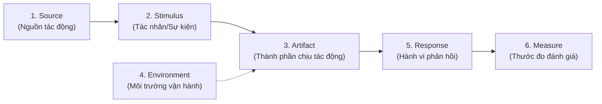

# Phần 1: Các Đặc Tính Chất Lượng (Quality Attributes) & Đánh Đổi Kiến Trúc

Thư mục này chứa cơ sở lý thuyết, ma trận đánh đổi (Trade-offs), khung kịch bản 6 yếu tố, cùng toàn bộ mã nguồn demo cho kiểm thử tải (**Scalability**) và rà soát an toàn thông tin (**Security**).

---

## 1. Cơ sở Lý thuyết & Sự Đánh Đổi Kiến Trúc (Trade-offs)

### 1.1. Khái niệm Cốt lõi
- **Quality Attributes (Đặc tính chất lượng)** là các yêu cầu phi chức năng (Non-Functional Requirements - NFRs) quyết định cấu trúc và phong cách kiến trúc hệ thống (Architectural Styles/Patterns) thay vì chỉ đáp ứng các chức năng nghiệp vụ đơn lẻ.
- Một hệ thống có thể hoàn thành đầy đủ tính năng thanh toán, nhưng nếu không đạt chuẩn về tính sẵn sàng (Availability 99.99%) hoặc độ trễ (Latency < 200ms) thì hệ thống đó vẫn thất bại trong môi trường thực tế.

### 1.2. Mở rộng 7 Đặc tính Chất lượng Quan trọng

| Đặc tính | Bản chất kỹ thuật | Chiến lược kiến trúc (Tactics) |
| :--- | :--- | :--- |
| **Scalability** (Khả năng mở rộng) | Khả năng xử lý lượng tải tăng lên bằng việc bổ sung tài nguyên mà không suy giảm hiệu năng đột ngột. | Horizontal scaling (Stateless services), Caching (Redis), Database Read Replicas, Sharding, Message Queuing. |
| **Security** (An ninh an toàn) | Khả năng chống lại các truy cập trái phép, bảo toàn tính bí mật (Confidentiality), toàn vẹn (Integrity), và sẵn sàng (Availability) - mô hình CIA. | Zero Trust, Mutual TLS (mTLS), Token-based Auth (JWT/OAuth2), RBAC/ABAC, Rate Limiting, Data Encryption at rest & in transit. |
| **Availability** (Độ sẵn sàng) | Tỷ lệ thời gian hệ thống hoạt động bình thường trên tổng thời gian dự kiến (thường đo bằng "số 9": 99.9%, 99.99%). | Redundancy (Dự phòng N+1), Health Check probes, Failover clusters, Geo-replication. |
| **Performance / Latency** (Hiệu năng) | Tốc độ đáp ứng yêu cầu tính bằng thời gian phản hồi (Response Time) và độ trễ phân vị (p50, p95, p99). | Asynchronous processing, In-memory cache, Connection pooling, CDN offloading, Query optimization. |
| **Maintainability** (Khả năng bảo trì) | Mức độ dễ dàng khi sửa đổi, nâng cấp, vá lỗi và mở rộng mã nguồn mà không gây lỗi dây chuyền. | Modular monolith, Microservices, Separation of Concerns (SoC), Clean Architecture, Tự động hóa kiểm thử (CI/CD). |
| **Observability** (Khả năng quan sát) | Mức độ hiểu rõ trạng thái nội tại của hệ thống thông qua các đầu ra ngoại vi. | 3 trụ cột: Metrics (Prometheus), Logs (Structured JSON logs), Traces (OpenTelemetry, Jaeger). |
| **Fault Tolerance** (Khả năng chịu lỗi) | Khả năng tiếp tục vận hành (có thể giảm cấp tính năng - Graceful Degradation) khi một hoặc nhiều thành phần bị sập. | Circuit Breaker, Bulkhead, Retry with Exponential Backoff, Dead Letter Queues (DLQ). |

---

### 1.3. Khung Phân tích Kịch bản Kiến trúc (6 Yếu tố của SEI / Bass et al.)

Để đánh giá một Quality Attribute khách quan và kiểm thử được, mỗi đặc tính được mô tả qua 6 thành phần:



#### Ví dụ Kịch bản Cụ thể cho 4 Đặc tính:

1. **Scalability Scenario:**
   - **Source:** Chiến dịch Flash Sale Black Friday.
   - **Stimulus:** Lưu lượng truy cập tăng vọt từ 1.000 RPS lên 25.000 RPS trong vòng 2 phút.
   - **Artifact:** API Gateway, Order Service, và Postgres Database Cluster.
   - **Environment:** Môi trường Production lúc cao điểm.
   - **Response:** Hệ thống tự động kích hoạt Horizontal Pod Autoscaler (HPA) nhân rộng Pod từ 3 lên 30, kích hoạt Read-Replica và Rate-limit các yêu cầu không thiết yếu.
   - **Measure:** Tỷ lệ lỗi HTTP 5xx < 0.1%, độ trễ p95 < 800ms, không có giao dịch thanh toán nào bị mất.

2. **Security Scenario:**
   - **Source:** Kẻ tấn công trên Internet sử dụng mạng botnet.
   - **Stimulus:** Gửi 50.000 yêu cầu đăng nhập chứa chuỗi SQL Injection (`' OR 1=1 --`) và Brute-force credential.
   - **Artifact:** WAF (Web Application Firewall) và Auth Service.
   - **Environment:** Môi trường Production mở công khai.
   - **Response:** WAF nhận diện mẫu chữ ký SQLi và chặn ngay tại rìa (Edge), Auth Service tự động khóa IP sau 5 lần thử sai và ghi log kiểm toán an ninh.
   - **Measure:** 100% payload tấn công bị chặn, thời gian phát hiện và cô lập IP < 500ms, không có dữ liệu người dùng bị rò rỉ.

3. **Fault Tolerance Scenario:**
   - **Source:** Sự cố hạ tầng mạng nội bộ máy chủ Database Master.
   - **Stimulus:** Mất kết nối đột ngột tới cơ sở dữ liệu chính trong 30 giây.
   - **Artifact:** Payment Service và Message Queue.
   - **Environment:** Hệ thống đang xử lý tải thông thường.
   - **Response:** Circuit Breaker ngắt kết nối trực tiếp, tạm lưu lệnh thanh toán vào Dead Letter Queue hoặc Local buffer, chuyển hướng đọc sang Read-Replica.
   - **Measure:** Người dùng nhận được thông báo "Đơn hàng đang xử lý" thay vì màn hình lỗi trắng (HTTP 500); hệ thống tự động retry thành công sau khi DB Master phục hồi mà không mất dữ liệu.

4. **Maintainability Scenario:**
   - **Source:** Thay đổi chính sách quy định tính thuế VAT từ 10% sang 8%.
   - **Stimulus:** Yêu cầu sửa đổi logic tính thuế và áp dụng cho toàn bộ phân hệ thanh toán.
   - **Artifact:** Tax Calculation Module trong Billing Service.
   - **Environment:** Môi trường Staging và Production.
   - **Response:** Nhà phát triển chỉ cần cập nhật quy tắc trong 1 module duy nhất mà không phải chỉnh sửa Order Service hay Catalog Service.
   - **Measure:** Thời gian thay đổi mã nguồn và kiểm thử hoàn tất < 4 giờ; tỷ lệ bao phủ kiểm thử (Coverage) > 85%, không có lỗi hồi quy (Regression bugs).

---

### 1.4. Phân tích Đánh đổi Kiến trúc (Trade-off Analysis)

Không có kiến trúc "hoàn hảo", chỉ có kiến trúc "phù hợp" với sự đánh đổi có chủ đích:

```mermaid
graph TD
    subgraph TradeOff1["Đánh đổi 1: Security vs Performance"]
        SEC[+"Tăng Security\n(Mã hóa nhiều lớp, TLS termination, WAF Deep Inspection, RBAC Token verify)"]
        PERF[-"Giảm Performance\n(Độ trễ Latency tăng, CPU overhead tăng từ 15-30% cho mã hóa)"]
        SEC -->|Trade-off| PERF
    end

    subgraph TradeOff2["Đánh đổi 2: Scalability vs Data Consistency"]
        SCALE[+"Tăng Scalability\n(Phân tán Microservices, Read Replicas, Caching phân tán)"]
        CONS[-"Giảm Consistency\n(Chấp nhận Eventual Consistency, nguy cơ đọc dữ liệu cũ/Stale Data)"]
        SCALE -->|Trade-off| CONS
    end
```

---

## 2. Thư mục `scalability-test/` (Kiểm thử tải với k6)

- **Ứng dụng thử nghiệm (`app/`)**: Node.js/Express kết hợp cơ sở dữ liệu có các API:
  - `GET /api/products` (Read-intensive: đọc danh mục, đo đạc I/O và Cache hit/miss).
  - `POST /api/orders` (Write-intensive: tạo đơn hàng, lock row trong DB, đo đạc Transaction lock và Connection Pool).
- **Kịch bản kiểm thử (`k6/`)**:
  - `01-baseline.js`: 10-20 Virtual Users (VUs) ổn định trong 2 phút để lấy chỉ số chuẩn (Baseline RPS, p50, p95).
  - `02-stress.js`: Tăng dần VUs từ 10 -> 50 -> 200 -> 500 để tìm **Điểm gãy (Breaking Point)** nơi tỷ lệ lỗi 5xx tăng vọt hoặc p99 vượt quá ngưỡng chấp nhận.
  - `03-spike.js`: Đột ngột nhảy từ 5 VUs lên 300 VUs trong 10 giây để kiểm tra khả năng phục hồi của hệ thống.
- **Báo cáo và phân tích (`results/`)**:
  - Đối chiếu RPS, độ trễ phân vị $p50, p95, p99$, và tỷ lệ lỗi $Error\ Rate$.
  - Chẩn đoán nút cổ chai: CPU bound, Database Connection Pool cạn kiệt, hay thiếu Index.

---

## 3. Thư mục `security-audit/` (SAST, DAST & AI Security Audit)

- **Ứng dụng mẫu có lỗ hổng (`vulnerable-app/`)**: Chứa mã nguồn thực tế vi phạm OWASP Top 10:
  - SQL Injection qua chuỗi ghép query trực tiếp.
  - Cross-Site Scripting (Stored/Reflected XSS).
  - Broken Access Control (IDOR - Insecure Direct Object References).
  - Hardcoded Secrets (API Keys, JWT Secrets nằm trong source code).
  - Outdated Dependencies (Thư viện phụ thuộc dính CVE).
- **Kịch bản quét (`sast-dast-scripts/`)**: Hướng dẫn chạy Semgrep / OWASP ZAP quét tự động.
- **AI Audit (`ai-audit-prompt-reports/`)**:
  - Đánh giá năng lực của AI: AI hiểu sâu logic nghiệp vụ (ví dụ: người dùng bypass logic thanh toán qua tham số âm), nhưng thường tạo ra **False Positives** do không nắm được cấu hình hạ tầng mạng thực tế (như port đã được firewall chặn ngoài rìa).
  - Giải pháp kiến trúc: Zero Trust, Centralized Authentication (OAuth2/OIDC), API Gateway Rate Limiting, Input Sanitization tại rìa.
