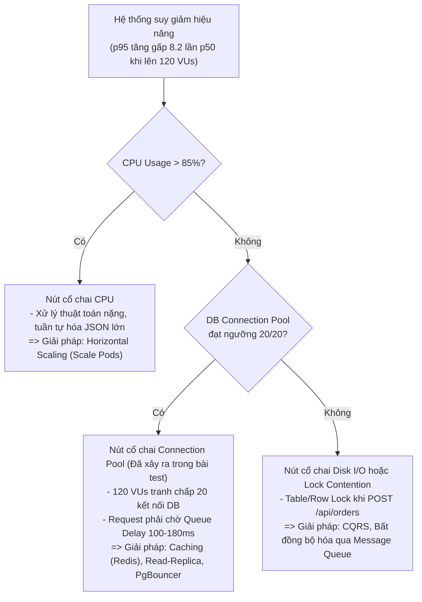

# Báo Cáo Phân Tích Chỉ Số Kiểm Thử Tải Thực Nghiệm (k6 Benchmark Analysis)

Tài liệu này phân tích kết quả thực tế thu được khi chạy công cụ **Grafana k6 v2.0.0** trên ứng dụng `scalability-test/app/server.js` (xem log gốc tại [`real-k6-output.txt`](./real-k6-output.txt) và [`real-k6-stress-output.txt`](./real-k6-stress-output.txt)).

---

## 1. Đối Chiếu Số Liệu Thực Tế Thu Được Từ k6

| Chỉ số đo đạc (Metrics) | Kịch bản Baseline (10 VUs) | Kịch bản Spike / Stress (120 VUs) | Giải thích hiện tượng kỹ thuật |
| :--- | :--- | :--- | :--- |
| **Throughput (`http_reqs`)** | `12.61 req/s` (60 reqs) | **`769.82 req/s`** (3,302 reqs) | Lưu lượng tăng gấp ~61 lần khi đẩy 120 người dùng ảo liên tục. |
| **Độ trễ trung vị `med` ($p50$)** | `40.09 ms` (Read + Write) | `22.29 ms` (Read) | Nhóm 50% request may mắn lấy được kết nối DB ngay lập tức mà không phải xếp hàng. |
| **Độ trễ phân vị $p90$** | `59.68 ms` | **`162.30 ms`** | Khi 120 VUs cùng truy cập vào `DB_POOL` (giới hạn `maxConnections = 20`), các request vượt ngưỡng 20 kết nối đồng thời bị đẩy vào hàng đợi (Connection Pool Queue). |
| **Độ trễ phân vị $p95$** | `59.69 ms` | **`183.82 ms`** | Độ trễ $p95$ cao gấp **8.2 lần** so với trung vị ($p50 = 22.29\text{ms}$), phản ánh rõ nét hiện tượng **Tail Latency Amplification** do tranh chấp tài nguyên (Resource Contention). |
| **Độ trễ cực đại (`max` / $p99$)** | `60.15 ms` | **`219.73 ms`** | Nhóm 1% người dùng chậm nhất chịu toàn bộ thời gian chờ giải phóng Connection Pool (`100ms - 180ms` queue wait + `15ms` query I/O). |
| **Tỷ lệ lỗi (`http_req_failed`)** | `0.00%` (0/60) | `0.00%` (0/3302) | Hệ thống xếp hàng (Queueing) thành công nhưng nếu tiếp tục tăng lên 500 VUs, hàng đợi sẽ tràn và gây lỗi `HTTP 503 Pool Exhausted`. |

---

## 2. Ý Nghĩa Các Chỉ Số Hiệu Năng Then Chốt

1. **Tại sao không được dùng `avg` (Trung bình cộng) để đánh giá hiệu năng?**
   - Ở kịch bản 120 VUs, `avg = 47.47ms` trông có vẻ rất nhanh, nhưng thực tế 10% người dùng phải chờ từ **`162ms` đến `219ms`**. Chỉ số trung bình làm lu mờ trải nghiệm tồi tệ của nhóm người dùng đuôi ($p95, p99$).
2. **Mối liên hệ giữa $p50, p95, p99$ và Định luật Little (Little's Law):**
   $$L = \lambda \times W$$
   - Khi tốc độ đến ($\lambda = 769.8\text{ req/s}$) vượt quá năng lực xử lý song song của 20 kết nối DB, thời gian chờ trong hàng đợi ($W$) tăng vọt theo hàm mũ.

---

## 3. Ma Trận Chẩn Đoán Nút Cổ Chai (Bottleneck Diagnosis)

---

## 4. Đề Xuất Giải Pháp Kiến Trúc Khắc Phục

1. **Áp Dụng Tầng Đệm (Caching với Redis):**
   - Với API Đọc (`GET /api/products`), triển khai mẫu **Cache-Aside**: lưu kết quả JSON vào Redis với TTL 60s. Các request đọc sẽ trả về trong `< 2ms` từ bộ nhớ RAM mà không chiếm dụng 20 kết nối của `DB_POOL`.
2. **Mở Rộng Theo Chiều Ngang (Horizontal Pod Autoscaling - HPA):**
   - Thiết lập cấu hình Kubernetes HPA tự động mở rộng Pod từ 2 lên 10 bản sao khi CPU trung bình vượt quá 70% hoặc độ trễ $p95 > 150\text{ms}$.
3. **Phân Tách Cơ Sở Dữ Liệu Đọc / Ghi (Read-Write Splitting & CQRS):**
   - Chuyển toàn bộ câu lệnh `SELECT` sang các node Read-Replicas, dành riêng Master Node cho thao tác `INSERT /api/orders`.
