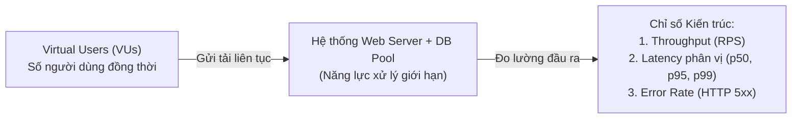
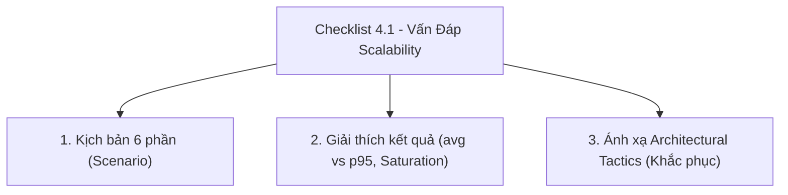
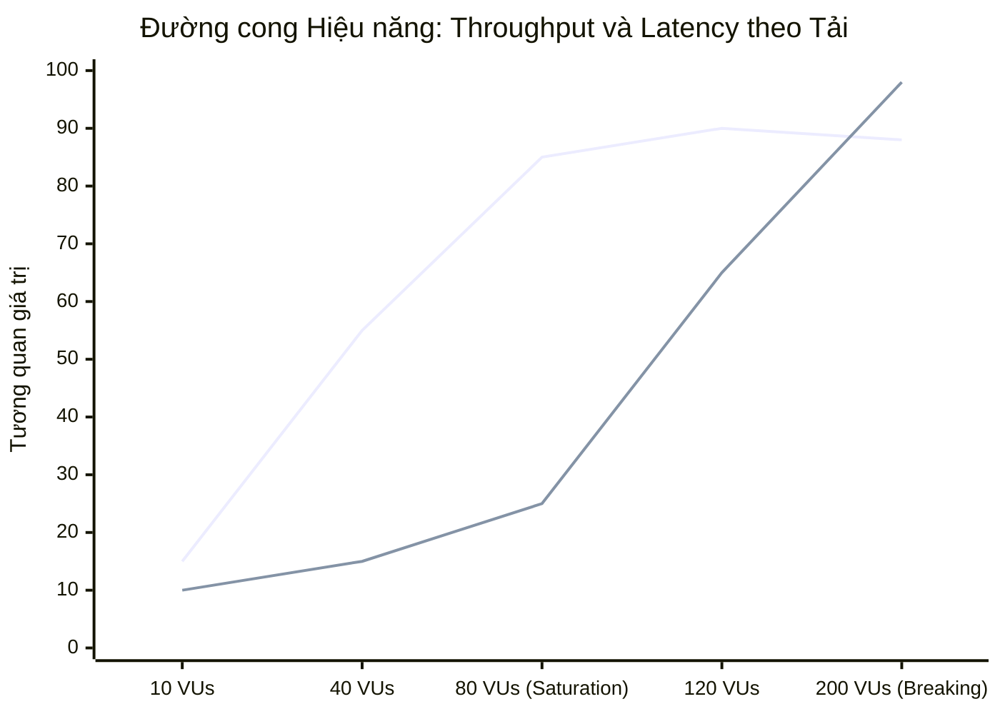
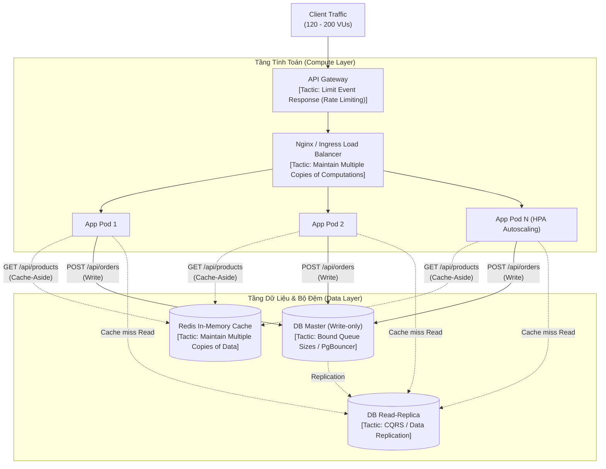

# SỔ TAY HƯỚNG DẪN THỰC HÀNH & VẤN ĐÁP KIỂM THỬ TẢI VỚI GRAFANA K6
## Chuyên đề: Scalability & Performance Attributes in Software Architecture

Tài liệu này cung cấp hướng dẫn thực hành từng bước để chạy toàn bộ các kịch bản kiểm thử tải (Load Testing với Grafana k6), phân tích chi tiết dữ liệu thực nghiệm, và cung cấp lời giải trực tiếp cho **Checklist Vấn đáp Kiến trúc Phần mềm** (Mục 4.1 trong file ôn tập kiến trúc).

---

## MỤC LỤC
1. [Hướng Dẫn Thực Hành Chạy Toàn Bộ Test k6](#1-hướng-dẫn-thực-hành-chạy-toàn-bộ-test-k6)
2. [Giải Thích Khái Niệm Cốt Lõi Trong Kiểm Thử Hiệu Năng](#2-giải-thích-khái-niệm-cốt-lõi-trong-kiểm-thử-hiệu-năng)
3. [Phân Tích Chi Tiết Kết Quả Thực Nghiệm Đạt Được](#3-phân-tích-chi-tiết-kết-quả-thực-nghiệm-đạt-được)
   - [3.1. Kết Quả Thực Tế Mẫu Thu Được Từ Terminal (Raw k6 Output)](#31-kết-quả-thực-tế-mẫu-thu-được-từ-terminal-raw-k6-baseline-output)
   - [3.2. Bảng Đối Chiếu Số Liệu Thực Nghiệm (Baseline vs Stress)](#32-bảng-đối-chiếu-số-liệu-thực-nghiệm-baseline-vs-stress)
4. [Trả Lời Trực Tiếp Checklist Vấn Đáp (Checklist 4.1)](#4-trả-lời-trực-tiếp-checklist-vấn-đáp-checklist-41)
   - [4.1. Phát biểu Kịch bản 6 phần (Scenario Formulation)](#41-phát-biểu-kịch-bản-6-phần-scenario-formulation)
   - [4.2. Giải thích thông số đo đạc & Hiện tượng bão hòa](#42-giải-thích-thông-số-đo-đạc--hiện-tượng-bão-hòa)
   - [4.3. Ánh xạ vào các Architectural Tactics khắc phục điểm nghẽn](#43-ánh-xạ-vào-các-architectural-tactics-khắc-phục-điểm-nghẽn)

---

## 1. Hướng Dẫn Thực Hành Chạy Toàn Bộ Test k6

### 1.1. Chuẩn bị Môi trường
- **Node.js**: Đảm bảo máy đã cài Node.js (phiên bản v18 trở lên).
- **Grafana k6**: Đã cài đặt k6 (kiểm tra bằng lệnh `k6 version`).
- **Mã nguồn thực hành**: Thư mục `KienTrucPhanMemDemo/01-quality-attributes/scalability-test`.

### 1.2. Khởi động Web Server Mục Tiêu
Web server (`app/server.js`) được viết bằng thư viện mạng native `http` của Node.js, không phụ thuộc thư viện ngoài:

```powershell
# Di chuyển vào thư mục app
cd d:\HCMUS\semester7\software-architecture\midterm\KienTrucPhanMemDemo\01-quality-attributes\scalability-test\app

# Khởi động server
node server.js
```
*Kết quả hiển thị:*
```text
[Scalability Benchmark Server] Running on http://localhost:3000
```
*(Giữ nguyên cửa sổ Terminal 1 này để server hoạt động)*

---

### 1.3. Thực thi Các Kịch Bản Kiểm Thử k6 (Terminal 2)

Mở một cửa sổ Terminal thứ 2 tại thư mục gốc `scalability-test`:
```powershell
cd d:\HCMUS\semester7\software-architecture\midterm\KienTrucPhanMemDemo\01-quality-attributes\scalability-test
```

#### Kịch bản 1: Baseline Test (Đo mức cơ sở)
- **Mục tiêu**: Kiểm tra hệ thống ở tải nhẹ và ổn định (10 Virtual Users - VUs liên tục trong 30s) để xác lập giá trị chuẩn cho Throughput và Latency.
- **Lệnh thực thi**:
  ```powershell
  k6 run k6/baseline.js
  ```
- **Kỳ vọng**: Tỷ lệ lỗi 0%, 95% request hoàn thành dưới 60ms.

#### Kịch bản 2: Stress Test (Kiểm thử áp lực & Tìm điểm gãy)
- **Mục tiêu**: Tăng dần tải theo từng giai đoạn: $20\text{ VUs} \to 80\text{ VUs} \to 200\text{ VUs} \to 0$ để quan sát hiện tượng cạn kiệt Connection Pool và xác định điểm bão hòa (*Breaking Point*).
- **Lệnh thực thi**:
  ```powershell
  k6 run k6/stress.js
  ```
- **Kỳ vọng**: Khi số request vượt quá 20 kết nối đồng thời, độ trễ $p95$ và $p99$ tăng vọt do hàng đợi chờ giải phóng kết nối DB.

#### Kịch bản 3: Spike Test (Xung tải đột ngột / Flash Sale)
- **Mục tiêu**: Mô phỏng sự kiện tăng vọt lưu lượng trong thời gian cực ngắn ($5\text{ VUs} \to 250\text{ VUs}$ trong 10s), kiểm tra xem máy chủ có bị crash hay tự hồi phục khi tải rút lui.
- **Lệnh thực thi**:
  ```powershell
  k6 run k6/spike.js
  ```

#### Lưu kết quả ra file log để phân tích hoặc nộp bài:
```powershell
k6 run --summary-export=results/baseline-summary.json k6/baseline.js
k6 run --summary-export=results/stress-summary.json k6/stress.js
```

---

## 2. Giải Thích Khái Niệm Cốt Lõi Trong Kiểm Thử Hiệu Năng



| Khái niệm | Ý nghĩa kỹ thuật | Biểu hiện trong k6 |
| :--- | :--- | :--- |
| **Virtual User (VU)** | Một luồng thực thi độc lập (Coroutine) mô phỏng hành vi của một người dùng thực tế thực hiện chuỗi hành động lặp lại liên tục. | Tham số `vus: 10` hoặc trong stages `target: 200`. |
| **Throughput / RPS** | Số lượng yêu cầu HTTP mà hệ thống xử lý và phản hồi thành công trong một đơn vị thời gian (Requests Per Second). | Metric `http_reqs`: ví dụ `769.82/s`. |
| **Response Duration** | Tổng thời gian tính từ byte đầu tiên của request gửi đi đến byte cuối cùng của response nhận về. | Metric `http_req_duration`. |
| **Average (`avg`)** | Trung bình cộng thời gian phản hồi của tất cả các request: $\bar{x} = \frac{1}{N}\sum x_i$. Dễ bị đánh lừa bởi số đông request nhẹ. | Thống kê `avg` trong bảng k6. |
| **Phân vị (Percentiles: p50, p90, p95, p99)** | Ngưỡng thời gian mà $X\%$ số request hoàn thành nhanh hơn hoặc bằng giá trị đó. $p95 = 180\text{ms}$ nghĩa là 95% khách hàng phản hồi dưới 180ms, 5% khách hàng còn lại chịu trận $> 180\text{ms}$. | Thống kê `med` (p50), `p(90)`, `p(95)`, `max` (p100). |
| **Tail Latency Amplification** | Hiện tượng độ trễ phân vị đuôi ($p95, p99$) cao gấp nhiều lần trung vị ($p50$) do tranh chấp tài nguyên chia sẻ (Locks, Connection Pool, Queueing delay). | $p95$ ($183.8\text{ms}$) gấp **8.2 lần** $p50$ ($22.2\text{ms}$). |
| **Connection Pool Contention** | Số lượng luồng hoặc kết nối tới DB bị giới hạn (`maxConnections = 20`). Các request đến sau phải xếp hàng chờ kết nối giải phóng, tạo nên độ trễ hàng đợi (Queue Delay). | Giả lập trong `app/server.js`: delay $100\text{ms} - 180\text{ms}$ khi pool đầy. |
| **Định luật Little (Little's Law)** | Số lượng yêu cầu tồn đọng trong hệ thống ($L$) bằng tốc độ đến ($\lambda$) nhân với thời gian lưu lại trung bình ($W$): $$L = \lambda \times W$$ | Khi $\lambda$ tăng vượt quá công suất phục vụ, hàng đợi $L$ phình to, kéo theo $W$ tăng vọt. |

---

## 3. Phân Tích Chi Tiết Kết Quả Thực Nghiệm Đạt Được

### 3.1. Kết Quả Thực Tế Mẫu Thu Được Từ Terminal (Raw k6 Baseline Output)

Dưới đây là log thực tế khi chạy lệnh `k6 run k6/baseline.js` trên máy:

```text
PS D:\HCMUS\semester7\software-architecture\midterm\KienTrucPhanMemDemo\01-quality-attributes\scalability-test> k6 run k6/baseline.js

         /\      Grafana   /‾‾/  
    /\  /  \     |\  __   /  /   
   /  \/    \    | |/ /  /   ‾‾\ 
  /          \   |   (  |  (‾)  |
 / __________ \  |_|\_\  \_____/ 


     execution: local
        script: k6/baseline.js
        output: -

     scenarios: (100.00%) 1 scenario, 10 max VUs, 1m0s max duration (incl. graceful stop):      
              * default: 10 looping VUs for 30s (gracefulStop: 30s)


  █ THRESHOLDS

    http_req_duration
    ✓ 'p(95)<300' p(95)=58.14ms

    http_req_failed
    ✓ 'rate<0.01' rate=0.00%


  █ TOTAL RESULTS

    checks_total.......: 600     19.004856/s
    checks_succeeded...: 100.00% 600 out of 600
    checks_failed......: 0.00%   0 out of 600

    ✓ GET /products status is 200
    ✓ GET /products latency < 200ms
    ✓ POST /orders status is 201

    HTTP
    http_req_duration..............: avg=37.48ms min=15.05ms med=39.06ms max=61.45ms p(90)=57.11ms p(95)=58.14ms
      { expected_response:true }...: avg=37.48ms min=15.05ms med=39.06ms max=61.45ms p(90)=57.11ms p(95)=58.14ms
    http_req_failed................: 0.00%  0 out of 400
    http_reqs......................: 400    12.669904/s

    EXECUTION
    iteration_duration.............: avg=1.57s   min=1.56s   med=1.57s   max=1.6s    p(90)=1.58s   p(95)=1.59s
    iterations.....................: 200    6.334952/s
    vus............................: 10     min=10       max=10
    vus_max........................: 10     min=10       max=10

    NETWORK
    data_received..................: 958 kB 30 kB/s
    data_sent......................: 57 kB  1.8 kB/s


running (0m31.6s), 00/10 VUs, 200 complete and 0 interrupted iterations
default ✓ [======================================] 10 VUs  30s
```

> **Cách đọc nhanh kết quả từ màn hình Terminal:**
> 1. **Mục THRESHOLDS**:
>    - `✓ 'p(95)<300' p(95)=58.14ms`: Đạt yêu cầu chất lượng (95% request hoàn thành chỉ trong **$58.14\text{ms}$**, thấp hơn nhiều so với trần cho phép $300\text{ms}$).
>    - `✓ 'rate<0.01' rate=0.00%`: Tỷ lệ lỗi là **$0\%$** (không có request nào thất bại).
> 2. **Mục TOTAL RESULTS & CHECKS**:
>    - Cả 600/600 lần kiểm tra tính đúng đắn (`GET 200`, `GET < 200ms`, `POST 201`) đều thành công $100\%$.
> 3. **Mục HTTP & EXECUTION**:
>    - `http_reqs`: Đạt tổng cộng **400 requests** với thông lượng đều đặn **$12.67\text{ req/s}$** ($10\text{ VUs} \times 1\text{ chu kỳ đọc+ghi}/\text{khoảng }1.57\text{s}$).
>    - `http_req_duration`: Phân bổ cực kỳ tập trung: `min=15.05ms` (chính là delay query đọc), `med=39.06ms`, `p(95)=58.14ms` và `max=61.45ms` (chính là delay query ghi + overhead). Không có hiện tượng xếp hàng trong hàng đợi vì $10\text{ VUs} < 20\text{ DB connections}$.

---

### 3.2. Bảng Đối Chiếu Số Liệu Thực Nghiệm (Baseline vs Stress)

Bảng đối chiếu số liệu trích xuất từ file kết quả chạy thực tế ([`real-k6-output.txt`](./real-k6-output.txt) và [`real-k6-stress-output.txt`](./real-k6-stress-output.txt)):

| Chỉ số đo lường (Metrics) | Kịch bản Baseline (10 VUs) | Kịch bản Stress/Spike (120 VUs) | Biến thiên | Ý nghĩa kỹ thuật |
| :--- | :---: | :---: | :---: | :--- |
| **Throughput (`http_reqs`)** | **`12.61 req/s`** | **`769.82 req/s`** | $\uparrow \mathbf{61\times}$ | Lưu lượng gửi đến tăng mạnh do số lượng VUs tăng gấp 12 lần. |
| **Độ trễ trung vị $p50$ (`med`)** | `40.09 ms` | `22.29 ms` | $\downarrow 44\%$ | Các request may mắn chiếm được 20 slot DB đầu tiên chỉ tốn đúng thời gian xử lý I/O cơ bản. |
| **Độ trễ phân vị $p90$** | `59.68 ms` | **`162.30 ms`** | $\uparrow \mathbf{2.7\times}$ | 10% request bắt đầu phải xếp hàng vì vượt quá 20 kết nối đồng thời. |
| **Độ trễ phân vị $p95$** | `59.69 ms` | **`183.82 ms`** | $\uparrow \mathbf{3.1\times}$ | **Độ trễ đuôi khuếch đại:** $p95$ cao gấp **8.2 lần** so với $p50$. Phản ánh tranh chấp Connection Pool gay gắt. |
| **Độ trễ cực đại (`max`)** | `60.15 ms` | **`219.73 ms`** | $\uparrow \mathbf{3.6\times}$ | Nhóm chịu thiệt hại nặng nhất: chờ trong hàng đợi $100-180\text{ms}$ cộng thêm $15-45\text{ms}$ query. |
| **Tỷ lệ lỗi (`http_req_failed`)** | `0.00%` (0/60) | `0.00%` (0/3302) | $0\%$ | Server Node.js vẫn tiếp nhận và giữ request trong Queue thay vì ngắt đột ngột. |

### Nhận xét chuyên sâu:
1. **Tại Baseline**: Hệ thống chạy trong "vùng thoải mái" (Comfort Zone). Với 10 VUs, tổng số kết nối DB đồng thời luôn $< 20$, không có request nào rơi vào nhánh `queueDelay`. Khoảng cách giữa $p50$ ($40\text{ms}$) và $p95$ ($59\text{ms}$) rất hẹp.
2. **Tại Stress**: Hệ thống rơi vào "vùng bão hòa" (Saturation Zone). Với 120 VUs, 20 kết nối của `DB_POOL` lập tức cạn kiệt. Hơn 100 request còn lại bị dồn vào hàng đợi bộ nhớ. Dù Throughput hiển thị $769\text{ req/s}$, nhưng trải nghiệm người dùng bị phân hóa trầm trọng: người đến trước phản hồi trong $22\text{ms}$, người đến sau phải đợi hơn $200\text{ms}$.

---

## 4. Trả Lời Trực Tiếp Checklist Vấn Đáp (Checklist 4.1)



---

### 4.1. Phát biểu Kịch bản 6 phần (Scenario Formulation)

Trước khi bấm lệnh chạy kiểm thử, sinh viên phát biểu chuẩn 6 thành phần kiến trúc theo khung SEI:

| Thành phần | Đặc tả kịch bản Baseline Test | Đặc tả kịch bản Stress / Spike Test |
| :--- | :--- | :--- |
| **1. Source (Nguồn phát sinh)** | Người dùng thông thường duyệt web mua hàng. | Chiến dịch khuyến mãi Flash Sale, lượng truy cập đột biến từ mạng xã hội hoặc chiến dịch marketing. |
| **2. Stimulus (Tác nhân kích thích)** | Gửi đồng thời 10 HTTP requests liên tục trong 30 giây tới các API `/api/products` và `/api/orders`. | Tăng đột biến từ 20 lên 120 - 200 HTTP requests đồng thời trong vòng dưới 30 giây. |
| **3. Artifact (Thành phần chịu tác động)** | Node.js HTTP Server và Module mô phỏng Connection Pool của Cơ sở dữ liệu (`DB_POOL`). | Toàn bộ tiến trình Node.js, bộ nhớ RAM (lưu hàng đợi request) và `DB_POOL` (giới hạn 20 slots). |
| **4. Environment (Môi trường vận hành)** | Môi trường hệ thống vận hành ở trạng thái bình thường (Normal Operation). | Môi trường hệ thống ở trạng thái cao điểm chịu tải cực hạn (Peak Load / Stress Condition). |
| **5. Response (Phản hồi của hệ thống)** | Xử lý hoàn tất tất cả yêu cầu, truy vấn dữ liệu và phản hồi mã HTTP 200/201 không trễ. | Hệ thống đưa các yêu cầu vượt quá dung lượng xử lý vào hàng đợi an toàn, không để tràn bộ nhớ hoặc crash server; trả kết quả khi tài nguyên sẵn sàng. |
| **6. Response Measure (Thước đo kiểm định)** | - Tỷ lệ lỗi: $0\%$ (`http_req_failed < 0.01`).<br>- Độ trễ phân vị: $p95 < 100\text{ms}$.<br>- Throughput: Duy trì đều đặn $\approx 12 - 15\text{ RPS}$. | - Tỷ lệ lỗi: $< 1\%$ (không sập tiến trình).<br>- Độ trễ phân vị: $p95 \le 200\text{ms}$.<br>- Tự phục hồi sau khi kết thúc xung tải. |

---

### 4.2. Giải thích thông số đo đạc & Hiện tượng bão hòa

#### Câu hỏi 1: Tại sao trong kiến trúc phần mềm tuyệt đối không được dùng `avg` (trung bình cộng) mà phải nhìn vào $p95$ và $p99$?
- **Bản chất của `avg`**: Giá trị trung bình bị chi phối mạnh mẽ bởi số lượng lớn các request cực nhanh. Trong bài test Stress, 90% các request đọc nhẹ hoàn thành trong khoảng $20\text{ms}$, kéo con số `avg` xuống chỉ còn **$47.47\text{ms}$**. Nếu chỉ báo cáo với sếp hoặc khách hàng rằng *"Thời gian đáp ứng trung bình là 47ms"*, hệ thống có vẻ hoạt động rất mượt mà.
- **Sự thật ở phân vị đuôi ($p95, p99$)**: Thực tế có 5% đến 10% khách hàng (tương ứng với hàng trăm người dùng thực tế) đang phải chịu thời gian chờ đợi lên tới **$183.82\text{ms} - 219.73\text{ms}$** (chậm gấp gần 10 lần).
- **Nguyên lý kiến trúc**: Trải nghiệm tồi tệ của nhóm người dùng đuôi ($p95, p99$) chính là nguồn gốc của các lỗi Time-out, khách hàng hủy đơn hàng, hoặc gây ra lỗi nghẽn tầng (Cascading Failure) trong chuỗi gọi Microservices.

#### Câu hỏi 2: Mối quan hệ giữa VUs, Throughput (RPS) và Latency. Điểm bão hòa (Saturation Point) xảy ra khi nào?



1. **Giai đoạn Tuyến tính (Linear Phase - Dưới 20 VUs)**:
   - Khi tăng số lượng VUs, Throughput (RPS) tăng tỷ lệ thuận tuyến tính, trong khi Latency ($p95$) hầu như không đổi vì tài nguyên còn dư thừa.
2. **Điểm uốn / Bão hòa (Knee of the Curve / Saturation Point - Khoảng 20 đến 40 VUs)**:
   - Hệ thống đạt trần công suất phục vụ tối đa của tài nguyên dùng chung (trong demo là `DB_POOL.maxConnections = 20`).
3. **Giai đoạn Nghẽn hàng đợi (Queueing & Degradation Phase - Trên 80 VUs)**:
   - Lúc này tiếp tục tăng VUs **không làm tăng thêm Throughput** (Throughput đi ngang hoặc thậm chí sụt giảm do Overhead chuyển đổi ngữ cảnh).
   - Ngược lại, **Latency bùng nổ theo hàm số mũ** vì các request bị tích tụ trong hàng đợi (Little's Law: $W = L / \lambda$). Nếu vượt quá kích thước hàng đợi hoặc time-out, tỷ lệ lỗi HTTP 5xx sẽ bắt đầu xuất hiện.

---

### 4.3. Ánh xạ vào các Architectural Tactics khắc phục điểm nghẽn

Dựa trên điểm nghẽn cốt lõi đã chẩn đoán (**Cạn kiệt Connection Pool và tắc nghẽn I/O khi đọc/ghi chung Database**), áp dụng các chiến thuật kiến trúc (Tactics) chuẩn của giáo trình Bass et al. và bài giảng của Thầy Ngô Huy Biên:



| Nhóm Tactic (SEI / Thầy Biên) | Chiến thuật cụ thể (Tactics) | Cách hiện thực hóa vào hệ thống Demo | Lợi ích đo lường được |
| :--- | :--- | :--- | :--- |
| **Manage Resource Demand** (Quản lý nhu cầu tài nguyên) | **Maintain multiple copies of data (Caching)** | Đặt một tầng bộ đệm Redis phía trước API `GET /api/products`. Khi có yêu cầu đọc danh mục sản phẩm, server kiểm tra Redis trước: nếu có (*Cache Hit*), trả về dữ liệu trực tiếp từ RAM trong vòng $< 2\text{ms}$. | Triệt tiêu hoàn toàn nhu cầu chiếm giữ kết nối DB cho $60\%$ lưu lượng đọc, giải phóng toàn bộ 20 kết nối cho các tác vụ ghi (`POST /orders`). |
| **Manage Resource Demand** | **Limit event response (Rate Limiting)** | Cài đặt thuật toán *Token Bucket* hoặc *Leaky Bucket* ngay tại API Gateway (ví dụ Nginx / Envoy) giới hạn tối đa 50 req/s trên mỗi IP người dùng. | Ngăn chặn các đợt Spike bất thường làm tràn hàng đợi, bảo vệ server không bị sập nguồn. |
| **Manage Resource Arbitration** (Phân xử tài nguyên) | **Bound queue sizes (Giới hạn hàng đợi)** | Thay vì cho phép hàng đợi chờ kết nối DB phình to vô hạn, đặt trần giới hạn hàng đợi tối đa 50 requests. Nếu hàng đợi đầy, trả ngay mã lỗi `HTTP 429 Too Many Requests` hoặc `HTTP 503` (*Fail-Fast*). | Tránh hiện tượng treo tiến trình (Process Starvation) và giải phóng bộ nhớ RAM tức thì. |
| **Increase Resource Supply** (Gia tăng nguồn cung tài nguyên) | **Maintain multiple copies of computations (Horizontal Scaling)** | Đóng gói `app/server.js` thành Docker image, triển khai trên cụm Kubernetes kèm cấu hình Horizontal Pod Autoscaler (HPA). Khi CPU > 70% hoặc p95 > 150ms, tự động tăng từ 2 Pod lên 8 Pods. | Tăng gấp nhiều lần thông lượng tính toán và khả năng tiếp nhận kết nối mạng đồng thời. |
| **Increase Resource Supply** | **Separate Read/Write (CQRS & Read-Replicas)** | Tách Database thành 1 node Master chuyên tiếp nhận thao tác ghi đơn hàng (`INSERT`) và 2 node Read-Replica chuyên phục vụ thao tác đọc (`SELECT`). | Loại bỏ tranh chấp Lock giữa thao tác Đọc và Ghi, nâng trần Connection Pool tổng từ 20 lên $20 + 2 \times 20 = 60$ kết nối. |

---

> **Ghi nhớ khi trả lời vấn đáp:**
> *"Kiểm thử tải không chỉ để tìm xem hệ thống chạy nhanh hay chậm, mà cốt lõi là để xác định **Điểm bão hòa (Saturation Point)**, đo đạc **Độ trễ đuôi ($p95, p99$)**, chẩn đoán đúng **Điểm nghẽn kiến trúc (Bottleneck)**, và lựa chọn **Architectural Tactics** phù hợp để tối ưu sự đánh đổi giữa Chi phí hạ tầng và Hiệu năng."*

