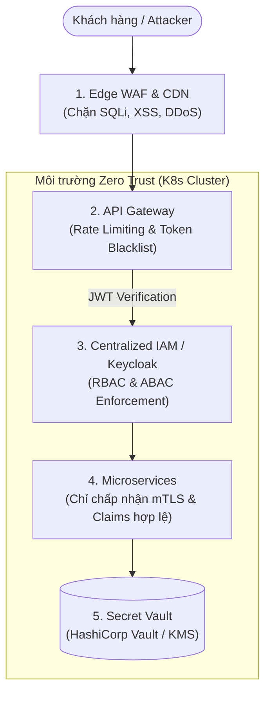

# Đánh Giá Năng Lực AI Khi Thực Hiện Rà Soát Bảo Mật (AI Security Audit)

Tài liệu này tổng hợp mẫu Prompt kiểm thử, phân tích so sánh giữa **Công cụ SAST truyền thống** và **Trí tuệ nhân tạo (AI Audit - Claude Code / Copilot / Gemini)**, cùng các phân tích về Cảnh báo giả (**False Positives**) và giải pháp kiến trúc tổng thể.

---

## 1. Mẫu Prompt Chuẩn Hóa Dùng Cho AI Security Audit

```markdown
Bạn là một Chuyên gia An toàn Thông tin & Kiến trúc sư Phần mềm (Lead Application Security Architect).
Hãy rà soát đoạn mã nguồn sau theo tiêu chuẩn OWASP Top 10 và tìm kiếm các lỗ hổng:
1. Xác định chính xác dòng code vi phạm và mã CWE tương ứng.
2. Đánh giá mức độ nghiêm trọng (Critical / High / Medium / Low).
3. ĐẶC BIỆT CHÚ Ý: Tìm kiếm các lỗ hổng logic nghiệp vụ (Business Logic Flaws) mà công cụ SAST dựa trên Regex thường bỏ sót (ví dụ: số âm, vòng lặp điều kiện, quyền hạn chéo).
4. Phân tích ngữ cảnh: Liệu lỗ hổng này có thể là False Positive nếu hệ thống đã có WAF hoặc API Gateway chặn bên ngoài hay không?
5. Đề xuất giải pháp khắc phục ở cả 2 tầng: Mã nguồn cục bộ (Code-level fix) và Tầng thiết kế kiến trúc (Architecture-level fix).
```

---

## 2. Bảng Đối Chiếu Năng Lực: SAST Truyền Thống vs AI Audit

| Lỗ hổng trong mã nguồn | Công cụ SAST (Regex / AST) | Trí tuệ Nhân tạo (AI Audit) | Đánh giá so sánh |
| :--- | :--- | :--- | :--- |
| **Lộ khóa API & JWT Secret** | ✅ Bắt rất chính xác qua pattern chuỗi | ✅ Bắt được và giải thích rủi ro | Cả hai đều tốt. SAST nhanh hơn. |
| **SQL Injection** | ✅ Bắt được qua chuỗi `SELECT...${}` | ✅ Bắt được và cung cấp code sửa bằng Parameterized | Cả hai đều tốt. |
| **Reflected XSS** | ✅ Bắt được qua lệnh `res.send()` | ✅ Bắt được và khuyến nghị Content Security Policy (CSP) | Cả hai đều tốt. |
| **IDOR (Truy cập hóa đơn người khác)** | ⚠️ Chỉ cảnh báo yếu nếu có từ khóa `params` | ✅ Hiểu rõ luồng: User Alice có thể xem hóa đơn Bob nếu không check user context | **AI vượt trội** nhờ hiểu ngữ cảnh phân quyền. |
| **Business Logic Flaw (Nạp số âm để tăng tiền)** | ❌ **Hoàn toàn bỏ sót** vì cú pháp code hoàn toàn hợp lệ | ✅ **Phát hiện ngay lập tức**: Phân tích logic trừ tiền bị đảo ngược khi `amount < 0` | **AI vượt trội tuyệt đối** trong việc suy luận nghiệp vụ. |

---

## 3. Phân Tích Cảnh Báo Giả (False Positives) Của AI & Nguyên Nhân Cốt Lõi

Mặc dù AI rất thông minh về logic code, AI thường tạo ra nhiều cảnh báo giả do **thiếu ngữ cảnh hạ tầng thực tế (Infrastructure & Deployment Context)**:

1. **Hiểu lầm về Cổng mạng mở (Port Exposure):**
   - *AI cảnh báo:* "API endpoint `/internal/metrics` không có mật khẩu, nguy cơ lộ thông tin nội bộ".
   - *Thực tế hạ tầng:* Dịch vụ này chạy trong Kubernetes Private Subnet, không có Ingress route trỏ vào, chỉ có máy chủ Prometheus nội bộ mới truy cập được qua IP mạng kín (VPC).
2. **Hiểu lầm về Tấn công DDOS & Brute-force:**
   - *AI cảnh báo:* "Đoạn code đăng nhập không có Rate Limiting, dễ bị tấn công vét cạn mật khẩu".
   - *Thực tế hạ tầng:* Cơ chế Rate Limiting và Chống botnet đã được xử lý triệt để ở tầng ngoài rìa (Cloudflare WAF / Kong API Gateway).
3. **Cảnh báo về Thư viện Phụ thuộc (Outdated Dependencies):**
   - *AI cảnh báo:* Thư viện dính CVE có thể bị khai thác từ xa (RCE).
   - *Thực tế mã nguồn:* Dự án chỉ import một hàm tiện ích toán học nhỏ từ thư viện đó và không hề gọi tới hàm dính lỗi CVE.

---

## 4. Đề Xuất Giải Pháp Kiến Trúc (Architecture-Level Mitigations)

Thay vì chỉ sửa từng dòng code chắp vá, các giải pháp kiến trúc toàn diện sau đây cần được áp dụng:



- **Mô hình Zero Trust:** Không tin tưởng bất kỳ kết nối nào dù nằm trong mạng nội bộ. Mọi dịch vụ đều phải xác thực lẫn nhau qua chứng chỉ mTLS.
- **Tập trung hóa Xác thực & Phân quyền (Centralized IAM):** Quản lý Session, Token và vai trò tại một cổng trung tâm (Keycloak / Auth0 / Cognito) thay vì để từng microservice tự giải mã secret riêng lẻ.
- **Edge Rate Limiting & Input Sanitization:** Dùng API Gateway để từ chối các request bất thường trước khi chúng chạm tới ứng dụng nghiệp vụ bên trong.
