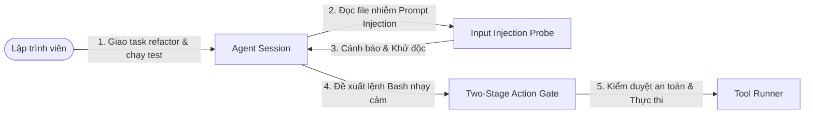
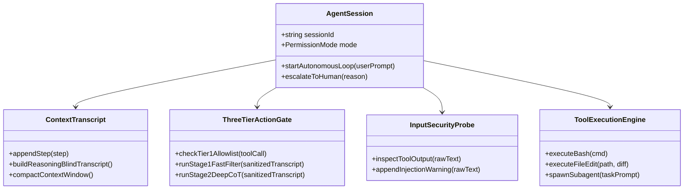
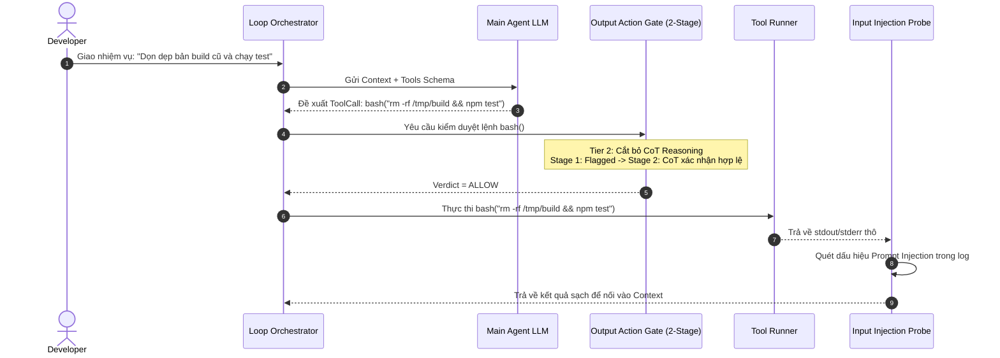
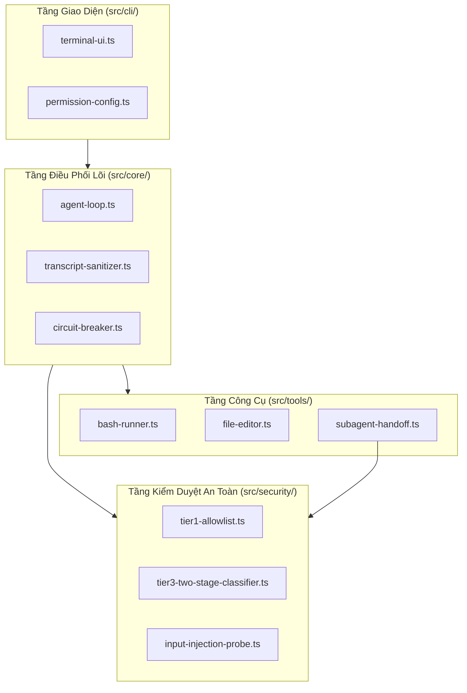
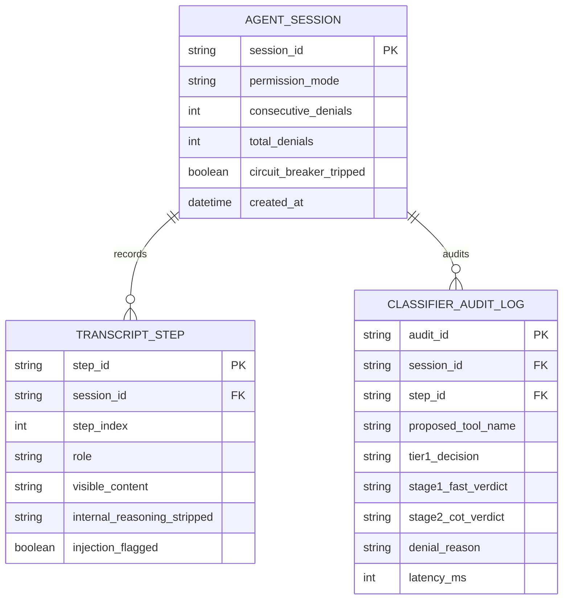
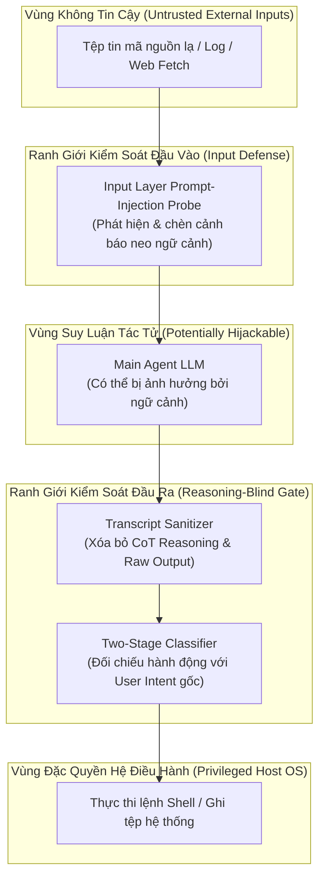
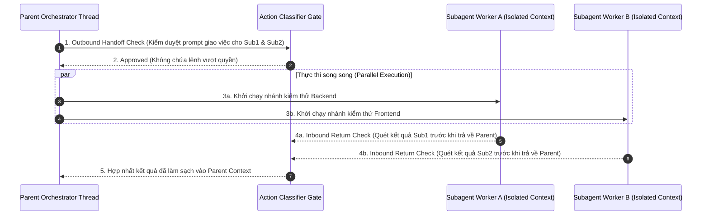

# Tài Liệu Đặc Tả Đầy Đủ: 4+1 Views, Database Schema, Security View & Concurrency View

Bộ tài liệu này minh họa câu trả lời cho câu hỏi: **"Khi nào số lượng Views là đủ?"**
- Chỉ dùng 4 mô hình tĩnh của UML (`Package`, `Component`, `Deployment`, `Artifact`) là **chưa đủ** vì chúng thiếu luồng hành vi thời gian thực, cấu trúc dữ liệu, cơ chế đồng thời và ranh giới bảo mật.
- Tài liệu dưới đây bao gồm **Tối thiểu 4+1 Views + Database Schema**, và mở rộng thêm **Security View** cùng **Concurrency View** (do hệ thống Claude Code Auto Mode đặt trọng tâm cao vào Quality Attributes là *Security* và *Concurrency*). Mỗi sơ đồ đều đi kèm thuyết minh chi tiết từng thành phần bằng chữ.

---

## 1. Scenarios View (+1 View - Kịch Bản Gắn Kết Trung Tâm)



### 📝 Thuyết Minh Các Thành Phần (Scenarios View)
- **Lập trình viên (`Dev`)**: Người khởi tạo yêu cầu nghiệp vụ và chỉ can thiệp khi hệ thống chạm ngưỡng Circuit Breaker.
- **`Agent Session`**: Phiên làm việc tự trị duy trì trạng thái mục tiêu xuyên suốt hàng chục bước thực thi.
- **`Input Injection Probe`**: Chốt chặn đầu vào phát hiện nội dung độc hại cài cắm trong tệp tin trước khi đưa vào bộ nhớ ngữ cảnh.
- **`Two-Stage Action Gate`**: Chốt chặn đầu ra đánh giá xem lệnh hệ thống có phù hợp với ý định ban đầu của người dùng hay không.
- **`Tool Runner`**: Thành phần thực thi lệnh thực tế trên hệ điều hành sau khi đã được cấp phép.

---

## 2. Logical View (Góc Nhìn Chức Năng & Hướng Đối Tượng)



### 📝 Thuyết Minh Các Thành Phần (Logical View)
- **`AgentSession`**: Lớp điều khiển vòng đời phiên làm việc, quản lý chế độ cấp quyền (`Auto Mode` hoặc `Manual`).
- **`ContextTranscript`**: Quản lý danh sách các bước hội thoại và cung cấp phương thức `buildReasoningBlindTranscript()` để lọc bỏ suy nghĩ nội bộ của Agent trước khi gửi đi kiểm duyệt.
- **`ThreeTierActionGate`**: Thực현 hóa chiến lược kiểm duyệt 3 tầng (Allowlist tĩnh $\rightarrow$ Stage 1 Fast Filter $\rightarrow$ Stage 2 Deep Reasoning).
- **`InputSecurityProbe`**: Phân tích dữ liệu đọc từ môi trường ngoài để ngăn chặn Indirect Prompt Injection.
- **`ToolExecutionEngine`**: Giao diện trừu tượng hóa các công cụ thao tác tệp tin, dòng lệnh và khởi chạy tác tử con (Subagents).

---

## 3. Process View (Góc Nhìn Tiến Trình & Luồng Thực Thi Thời Gian Thực)



### 📝 Thuyết Minh Các Thành Phần (Process View)
- **`Loop Orchestrator`**: Tiến trình chính điều phối tuần tự từng bước mà không làm treo giao diện người dùng.
- **`Main Agent LLM`**: Tiến trình suy luận từ xa nhận ngữ cảnh và sinh đề xuất hành động.
- **`Output Action Gate (2-Stage)`**: Pipeline kiểm duyệt bất đồng bộ đảm bảo không một lệnh `bash` nào chạm vào OS trước khi có `Verdict = ALLOW`.
- **`Input Injection Probe`**: Bước hậu kiểm bắt buộc trên luồng dữ liệu trả về từ `Tool Runner` trước khi quay lại `Loop Orchestrator`.

---

## 4. Development View (Góc Nhìn Tổ Chức Module & Package Mã Nguồn)



### 📝 Thuyết Minh Các Thành Phần (Development View)
- **`src/cli/`**: Chứa các module tương tác dòng lệnh và đọc cấu hình quyền hạn (`settings.json`). Phụ thuộc một chiều vào tầng `Core`.
- **`src/core/`**: Chứa logic điều phối vòng lặp (`agent-loop.ts`), bộ lọc bỏ suy luận (`transcript-sanitizer.ts`) và bộ đếm ngắt mạch (`circuit-breaker.ts`).
- **`src/security/`**: Đóng gói độc lập toàn bộ quy tắc Allowlist, khách gọi API phân loại 2 giai đoạn và bộ quét Prompt Injection đầu vào.
- **`src/tools/`**: Chứa các trình thực thi công cụ cụ thể; đặc biệt `subagent-handoff.ts` gọi ngược vào `Security_Layer` để kiểm duyệt cả lúc giao việc và lúc nhận kết quả từ Subagent.

---

## 5. Physical / Deployment View (Góc Nhìn Triển Khai Vật Lý & Hạ Tầng)

```mermaid
flowchart LR
    subgraph DeveloperWorkstation ["Máy Trạm Lập Trình Viên (Local Host OS)"]
        CLIProc["Node.js Process: Claude Code CLI"]
        SubProc["OS Sandbox Subprocess (Bash / Git)"]
        LocalDisk[("Local Workspace Filesystem")]
        CLIProc --> SubProc
        SubProc --> LocalDisk
    end

    subgraph AnthropicCloud ["Hạ Tầng Đám Mây Anthropic (VPC)"]
        APIGW["API Gateway & Rate Limiter (TLS 1.3)"]
        AgentCluster["Main LLM Inference Cluster\n(Claude Opus / Sonnet)"]
        SafetyCluster["Dedicated Safety Cluster\n(Stage 1 Fast + Stage 2 CoT Classifier\n+ Server-side Injection Probe)"]
        APIGW --> AgentCluster
        APIGW --> SafetyCluster
    end

    CLIProc ===|HTTPS / SSE (Port 443)| APIGW
```

### 📝 Thuyết Minh Các Thành Phần (Physical View)
- **`DeveloperWorkstation`**: Máy tính cục bộ nơi tiến trình CLI chạy và nơi các lệnh thao tác tệp tin thực sự diễn ra.
- **`OS Sandbox Subprocess`**: Tiến trình con bị giới hạn thư mục làm việc (`cwd`) và biến môi trường để thực thi lệnh hệ thống.
- **`API Gateway & Rate Limiter`**: Cổng kết nối mã hóa TLS 1.3 xác thực API Key và phân luồng lưu lượng.
- **`Main LLM Inference Cluster` & `Dedicated Safety Cluster`**: Hai cụm GPU/TPU tách biệt trên đám mây phục vụ suy luận chính và phân loại an toàn với độ trễ thấp.

---

## 6. Database Schema View (Mô Hình Cơ Sở Dữ Liệu Lưu Trữ Phiên & Kiểm Toán)



### 📝 Thuyết Minh Các Bảng Dữ Liệu (Database Schema View)
- **`AGENT_SESSION`**: Lưu trạng thái phiên làm việc cùng hai bộ đếm quan trọng của Circuit Breaker (`consecutive_denials` tối đa 3, `total_denials` tối đa 20).
- **`TRANSCRIPT_STEP`**: Lưu từng bước hội thoại, tách biệt rõ cột `visible_content` (dùng để gửi cho Classifier) và `internal_reasoning_stripped` (bị loại bỏ khi kiểm duyệt).
- **`CLASSIFIER_AUDIT_LOG`**: Lưu vết kiểm toán an ninh đầy đủ ở cả Tier 1, Stage 1, Stage 2 và thời gian phản hồi (`latency_ms`) để phục vụ hậu kiểm.

---

## 7. Security View (Góc Nhìn Mở Rộng: Phòng Thủ Sâu & Ranh Giới Tin Cậy)



### 📝 Thuyết Minh Các Thành Phần (Security View)
- **`Untrusted External Inputs`**: Bất kỳ dữ liệu nào đọc từ bên ngoài đều được giả định là có thể chứa mã độc Prompt Injection.
- **`Input Layer Prompt-Injection Probe`**: Lớp phòng thủ thứ nhất giúp giảm nguy cơ Agent bị lừa bởi nội dung đọc vào.
- **`Reasoning-Blind Gate` (`Transcript Sanitizer` + `Two-Stage Classifier`)**: Lớp phòng thủ thứ hai độc lập hoàn toàn với suy nghĩ nội bộ của `Main Agent LLM`, đảm bảo dù `MainModel` bị chiếm quyền thì lệnh phá hoại vẫn bị chặn trước khi vào `Privileged Host OS`.

---

## 8. Concurrency View (Góc Nhìn Mở Rộng: Đồng Thời & Ủy Quyền Subagent)



### 📝 Thuyết Minh Các Thành Phần (Concurrency View)
- **`Parent Orchestrator Thread`**: Luồng điều phối chính chia nhỏ bài toán lớn thành các tác vụ chạy song song.
- **`Subagent Worker A / B`**: Các luồng tác tử con chạy trong cửa sổ ngữ cảnh cô lập (Isolated Context) để không làm tràn bộ nhớ của luồng chính.
- **`Outbound Handoff Check` & `Inbound Return Check`**: Cơ chế kiểm duyệt 2 chiều tại điểm giao cắt đồng thời — ngăn chặn tác tử cha ủy quyền hành vi nguy hiểm cho tác tử con, và ngăn tác tử con bị nhiễm Prompt Injection lây ngược về tác tử cha.
