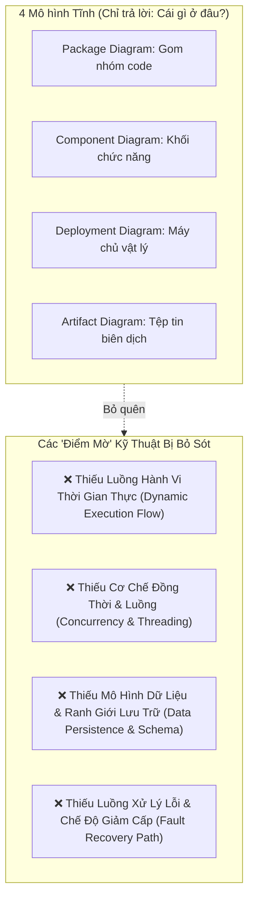
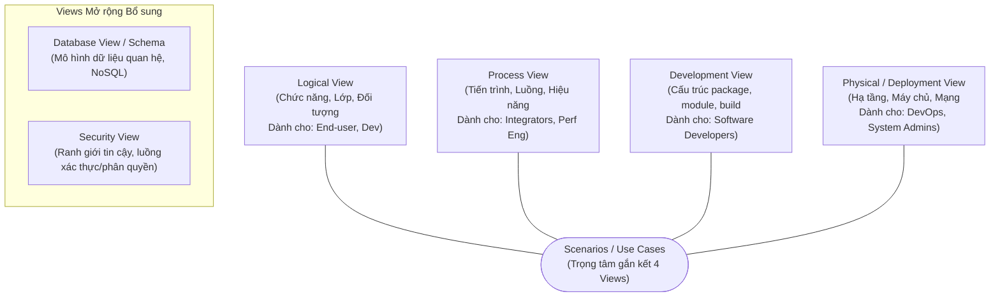
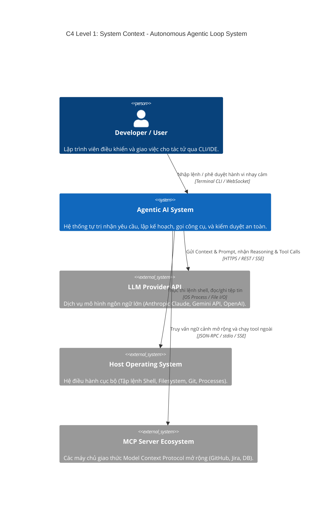
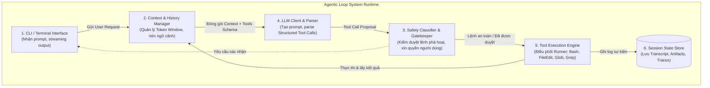

# Phần 2: Biểu Diễn Kiến Trúc (Architecture Representation) & Tái Tạo Kiến Trúc (Architecture Recovery)

Thư mục này giải thích lý thuyết nền tảng về View, Model, tiêu chuẩn "Đủ" của tài liệu kiến trúc, đồng thời cung cấp demo tái tạo kiến trúc (**Architecture Recovery**) cho hệ thống tác tử AI thông minh (**Agentic Loop** - tương tự Claude Code Auto Mode / Antigravity).

---

## 1. Cơ sở Lý thuyết: View, UML Model & Tiêu chí "Đủ"

### 1.1. Phân biệt Kiến trúc View và UML Model

| Tiêu chí | Architecture View (Góc nhìn kiến trúc) | UML Model (Mô hình UML) |
| :--- | :--- | :--- |
| **Định nghĩa** | Biểu diễn của toàn bộ hệ thống từ góc nhìn của một tập hợp các **Mối quan tâm (Concerns)** thuộc về một nhóm **Bên liên quan (Stakeholders)** cụ thể (theo chuẩn IEEE 1471 / ISO 42010). | Tập hợp các ký hiệu đồ họa chuẩn hóa (Classes, Components, Sequences, States, ...) dùng để trực quan hóa và mô hình hóa hệ thống. |
| **Mục đích** | Trả lời câu hỏi: *"Hệ thống này giải quyết bài toán gì cho tôi?"* (cho Dev, QA, Ops, Security, Business). | Là phương tiện (Notation/Tool) để hiện thực hóa một View. |
| **Mối quan hệ** | **View là nội dung và ý nghĩa; UML Model là công cụ diễn đạt.** Một View có thể dùng nhiều sơ đồ UML kết hợp văn bản mô tả. | Một mô hình UML độc lập không phải là một View nếu nó không gắn với mối quan tâm rõ ràng của bên liên quan. |

---

### 1.2. Tại sao 4 Mô hình UML Tĩnh là Chưa Đủ?

Nhiều dự án chỉ vẽ 4 sơ đồ: **Package Diagram**, **Component Diagram**, **Deployment Diagram**, và **Artifact Diagram**. Điều này để lại nhiều lỗ hổng kiến trúc nghiêm trọng:

- **Hậu quả:** Lập trình viên biết module nào nằm ở đâu nhưng không biết gọi ai trước, đồng bộ hay bất đồng bộ, khóa dữ liệu ra sao khi có 1.000 request tranh chấp tài nguyên cùng lúc.

---

### 1.3. Khi Nào Số Lượng Views Là "Đủ"?

Một bộ tài liệu kiến trúc được coi là **"Đủ" (Architectural Sufficiency)** khi thỏa mãn đồng thời hai điều kiện sau:
1. **Phía Đội ngũ Kỹ thuật (Development & Ops):** Có thể bắt đầu viết mã nguồn, thiết lập CI/CD, cấu hình cơ sở dữ liệu mà **không còn điểm mờ kỹ thuật** (no architectural ambiguities). Họ không phải đoán xem giao thức là gì, cơ chế xác thực ra sao, hay xử lý lỗi ở tầng nào.
2. **Phía Ban Quản lý & Khách hàng (Business & Stakeholders):** Không còn câu hỏi thắc mắc về chi phí vận hành hạ tầng, tiến độ bàn giao khả thi, hay việc hệ thống có đáp ứng các quy định pháp lý/bảo mật hay không.

> **Quy tắc vàng:** *"Thêm một View chỉ khi có một nhóm bên liên quan cần giải đáp mối quan tâm mà các View hiện tại không thể trả lời."*

---

### 1.4. Bộ Views Tiêu chuẩn 4+1 và Mở rộng

Hệ thống được biểu diễn qua mô hình **4+1 View Model** của Philippe Kruchten:

---

## 2. Demo Tái Tạo Kiến Trúc (Architecture Recovery): Hệ Thống Agentic Loop

Hệ thống được tái tạo: **Vòng lặp tác tử tự trị (Autonomous Agentic Loop)** như Claude Code Auto Mode, Antigravity Agent Engine.

### 2.1. Biểu Diễn theo C4 Model

#### C4 Level 1: System Context Diagram

#### C4 Level 2: Container Diagram (Kiến trúc phân rã nội bộ)

---

### 2.2. Thuyết Minh Kiến Trúc (Design Rationale & Giao Thức)

1. **CLI / Terminal Interface:**
   - **Trách nhiệm:** Điểm chạm với người dùng, kết xuất kết quả dạng stream (Markdown, màu sắc ANSI), nhận phím ngắt (Ctrl+C).
   - **Giao thức:** Node.js Readline / Inquirer hoặc Python Rich CLI.
   - **Lý do lựa chọn:** Giao diện dòng lệnh mang lại tốc độ tức thì, tích hợp liền mạch vào môi trường làm việc của lập trình viên.

2. **Context & History Manager:**
   - **Trách nhiệm:** Kiểm soát cửa sổ ngữ cảnh (Context Window), tự động tóm tắt (Summarization) khi lịch sử đạt 80% ngưỡng token, gom các tệp tin liên quan vào System Prompt.
   - **Lý do lựa chọn:** Token LLM có giới hạn và tốn kém; nếu không quản lý ngữ cảnh, agent sẽ bị "ảo giác" (hallucination) hoặc tràn bộ nhớ.

3. **Safety Classifier / Gatekeeper (Bộ kiểm duyệt an toàn):**
   - **Trách nhiệm:** Quét các lệnh nhạy cảm (như `rm -rf /`, `git push --force`, ghi đè tệp cấu hình quan trọng). Phân loại lệnh thành: Tự động chạy (Read-only) vs Cần người dùng phê duyệt (Write / Execute).
   - **Lý do lựa chọn:** Đảm bảo an toàn tuyệt đối khi tác tử chạy ở chế độ Auto Mode.

4. **Tool Execution Engine:**
   - **Trách nhiệm:** Thực thi sandbox an toàn các tác vụ: đọc tệp (`read_file`), sửa tệp (`edit_file`), chạy lệnh (`run_command`), tìm kiếm (`ripgrep`).
   - **Giao thức:** Node.js `child_process.spawn` hoặc Python `asyncio.subprocess` với cơ chế timeout và xử lý ngắt tín hiệu.

---

## 3. Nội dung trong Thư mục `architecture-recovery/`
- `agentic-loop-architecture.json`: Định nghĩa cấu trúc các thành phần của Agentic Engine.
- `c4-diagrams.puml` / `mermaid-views.md`: Mã nguồn biểu diễn C4 Container & Sequence Diagram.
- `verify-agentic-loop.js`: Mã nguồn demo một Agentic Loop tối giản chứng minh cách CLI, LLM Client, Safety Gatekeeper và Tool Engine phối hợp tuần hoàn.
