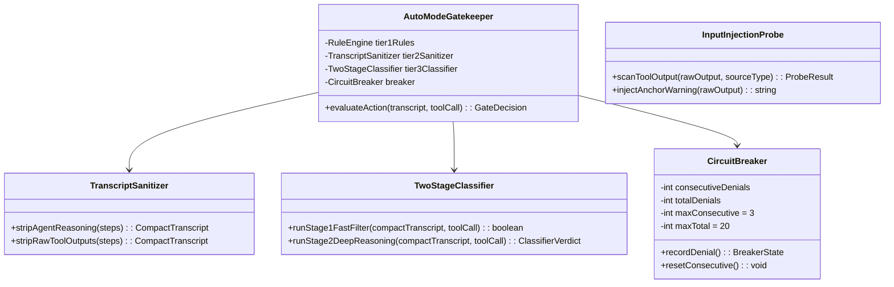

# Tái Tạo Kiến Trúc Claude Code Auto Mode (C4 Model + Thuyết Minh Chi Tiết)

Tài liệu này tái tạo kiến trúc kỹ thuật của **[Claude Code Auto Mode](https://www.anthropic.com/engineering/claude-code-auto-mode)** (Anthropic Engineering) thông qua **Boxes & Arrows kết hợp 4 tầng C4 Model** (Context, Container, Component, Code). Mỗi sơ đồ đều đi kèm bảng thuyết minh chi tiết bằng chữ về trách nhiệm, giao thức và lý do thiết kế (Design Rationale).

---

## 1. C4 Level 1: System Context Diagram (Sơ Đồ Ngữ Cảnh Hệ Thống)

```mermaid
flowchart TD
    User(["Software Engineer / Developer\n[Person]"])
    AutoModeSystem["Claude Code CLI (Auto Mode)\n[Software System]\nTác tử lập trình tự trị có lớp phòng thủ 2 chiều:\nInput Prompt-Injection Probe & Output Two-Stage Action Classifier."]
    
    AnthropicAPI["Anthropic Cloud API\n(Claude Opus/Sonnet + Classifier Model)\n[External System]"]
    HostEnv["Local Host Environment\n(OS Shell, Filesystem, Git, Network)\n[External System]"]
    MCPServers["External MCP Servers & Web\n(GitHub, Jira, Docs, Untrusted Web)\n[External System]"]

    User -->|1. Giao mục tiêu dài hạn & Cấu hình Permission Rules| AutoModeSystem
    AutoModeSystem -->|2. Báo cáo kết quả / Escalate khi chạm ngưỡng Circuit Breaker| User
    AutoModeSystem <-->|3. HTTPS/SSE: Gửi Context & Sanitized Transcript| AnthropicAPI
    AutoModeSystem <-->|4. Thực thi Bash, File I/O trong phạm vi Workspace| HostEnv
    AutoModeSystem <-->|5. Đọc dữ liệu ngoại vi (quét qua Input Injection Probe)| MCPServers
```

### 📝 Thuyết Minh Các Thành Phần Trong Sơ Đồ C4 Level 1

| Tên thành phần | Loại | Trách nhiệm cốt lõi | Giao thức giao tiếp | Lý do lựa chọn thiết kế (Design Rationale) |
| :--- | :--- | :--- | :--- | :--- |
| **Software Engineer / Developer** | `Person` | Giao bài toán kỹ thuật phức tạp, thiết lập `settings.json` và chỉ can thiệp khi hệ thống escalate. | Terminal TTY / Stdin & Stdout | Giảm thiểu **Approval Fatigue** (nghiên cứu của Anthropic chỉ ra con người bấm "Approve" mù quáng tới 93% khi bị hỏi liên tục). |
| **Claude Code CLI (Auto Mode)** | `Software System` | Điều phối vòng lặp tác tử (Agentic Loop), chặn lọc hành vi nguy hiểm ở cả đầu vào lẫn đầu ra mà không làm gián đoạn luồng làm việc. | OS Signals, Child Process, HTTPS | Thay thế cờ `--dangerously-skip-permissions` bằng cơ chế kiểm duyệt tự động có ranh giới bảo mật rõ ràng. |
| **Anthropic Cloud API** | `External System` | Cung cấp mô hình chính để suy luận code (Main Agent LLM) và mô hình chuyên biệt cho bộ phân loại an toàn (Two-Stage Safety Classifier). | HTTPS / REST / Server-Sent Events (SSE) | Tách biệt mô hình thực thi và mô hình giám sát để tránh việc mô hình chính tự hợp thức hóa hành vi vượt quyền. |
| **Local Host Environment** | `External System` | Cung cấp môi trường thực thi thực tế: trình biên dịch, Git, hệ thống tệp tin dự án. | POSIX / Windows System Calls, stdio | Tác tử cần quyền thao tác trực tiếp trên kho mã nguồn cục bộ để chạy build và kiểm thử thực tế. |
| **External MCP Servers & Web** | `External System` | Nguồn dữ liệu bên ngoài (tài liệu, issue tracker, trang web) có khả năng chứa mã độc Prompt Injection. | JSON-RPC 2.0 (stdio/SSE), HTTPS | Mở rộng ngữ cảnh cho tác tử nhưng được xem là **Untrusted Source** bắt buộc phải đi qua Input Probe. |

---

## 2. C4 Level 2: Container Diagram (Sơ Đồ Các Khối Thực Thi)

```mermaid
flowchart TD
    User(["Developer"]) -->|Prompt| CLI["1. CLI & Session Controller\n[Node.js/TypeScript]\nQuản lý phiên, hiển thị stream, nhận Escalation."]
    
    subgraph Claude_Code_Auto_Mode_Runtime ["Claude Code Auto Mode Runtime"]
        CLI --> Orchestrator["2. Agentic Loop Orchestrator\n[Core Engine]\nĐiều phối chu trình suy luận - gọi tool - phục hồi lỗi."]
        Orchestrator <--> ContextStore["3. Context & Transcript Manager\n[In-Memory + JSONL]\nLưu lịch sử, nén ngữ cảnh và tạo Sanitized Transcript."]
        
        Orchestrator -->|Đề xuất Tool Call| ActionGate["4. Three-Tier Output Action Gate\n[Security Pipeline]\nKiểm duyệt mọi hành động trước khi chạm vào OS."]
        ActionGate -->|Được phép| ToolRunner["5. Sandboxed Tool & Subagent Runner\n[Execution Engine]\nChạy Bash, File Edit, hoặc khởi tạo Subagent."]
        
        ToolRunner -->|Kết quả thô (Raw Output)| InputProbe["6. Input Layer Prompt-Injection Probe\n[Security Scanner]\nQuét nội dung đọc về để phát hiện Prompt Injection."]
        InputProbe -->|Kết quả đã làm sạch / Cảnh báo| ContextStore
        
        ActionGate -.->|Từ chối (Denial Feedback)| Orchestrator
        ActionGate -.->|Quá 3 lần liên tiếp / 20 lần tổng| CLI
    end

    Orchestrator <-->|HTTPS| MainLLM[("Main Agent LLM\n(Claude Opus/Sonnet)")]
    ActionGate <-->|HTTPS| ClassifierLLM[("Two-Stage Safety Classifier\n(Claude Sonnet 4.6)")]
```

### 📝 Thuyết Minh Các Thành Phần Trong Sơ Đồ C4 Level 2

| Tên Container | Trách nhiệm cốt lõi | Giao thức giao tiếp | Lý do lựa chọn thiết kế (Design Rationale) |
| :--- | :--- | :--- | :--- |
| **1. CLI & Session Controller** | Quản lý trạng thái giao diện dòng lệnh, cấu hình quyền (`Auto Mode` vs `Manual Mode`), và tiếp nhận yêu cầu phê duyệt khi Circuit Breaker kích hoạt. | In-process Event Emitter, Terminal TTY | Đảm bảo con người luôn là chốt chặn cuối cùng (Human-in-the-loop fallback) khi tác tử gặp tình huống rủi ro cao. |
| **2. Agentic Loop Orchestrator** | Điều phối vòng lặp chính: gửi ngữ cảnh lên LLM, nhận đề xuất gọi công cụ, chuyển qua cổng kiểm duyệt và xử lý phản hồi từ chối (Denial Recovery). | Async/Await Function Calls | Cho phép tác tử tự tìm phương án thay thế an toàn hơn khi một lệnh bị từ chối thay vì dừng đột ngột. |
| **3. Context & Transcript Manager** | Quản lý cửa sổ ngữ cảnh (Context Window), ghi nhận `transcript.jsonl` và trích xuất **Reasoning-Blind Transcript** cho bộ phân loại an toàn. | In-memory Objects & File Stream | Giảm độ trễ và ngăn chặn việc suy luận nội bộ (Chain-of-Thought) của tác tử thao túng bộ kiểm duyệt. |
| **4. Three-Tier Output Action Gate** | Cổng kiểm soát đầu ra gồm 3 tầng: (1) Allowlist tĩnh cho thao tác cục bộ, (2) Làm sạch Transcript, (3) Phân loại 2 giai đoạn bằng mô hình AI độc lập. | Internal Pipeline + HTTPS API | Tối ưu hóa cả tốc độ (Tier 1 không tốn độ trễ mạng) lẫn độ chính xác (Tier 3 giảm thiểu False Positives). |
| **5. Sandboxed Tool & Subagent Runner** | Thực thi các lệnh đọc/sửa tệp, chạy shell, hoặc ủy quyền cho Subagent kèm cơ chế kiểm duyệt Handoff 2 chiều. | OS Child Process (`spawn`), Subagent IPC | Cô lập phạm vi ảnh hưởng của từng công cụ và ngăn chặn việc ủy quyền tác vụ nguy hiểm cho tác tử con. |
| **6. Input Layer Prompt-Injection Probe** | Quét toàn bộ đầu ra từ tệp tin, trang web, hoặc lệnh shell trước khi đưa vào Context để phát hiện chỉ dẫn độc hại ẩn giấu. | Stream Filter / Regex + Probe Model | Phòng chống tấn công **Indirect Prompt Injection** (mã độc nằm trong file README hoặc log bên ngoài cố tình chiếm quyền điều khiển agent). |

---

## 3. C4 Level 3: Component Diagram (Bên Trong Three-Tier Output Action Gate)

```mermaid
flowchart LR
    ToolProposal(["Tool Call Proposal\n(từ Orchestrator)"]) --> Tier1["1. Tier 1: Deterministic Rule Engine\n(Allow/Deny tĩnh & Workspace Boundary)"]
    
    Tier1 -->|Nằm trong Allowlist\n(Read/Edit trong Workspace)| Approved(["✅ APPROVED\n(Chuyển tới Tool Runner)"])
    Tier1 -->|Vi phạm Deny Rule cứng| Denied["❌ DENIED"]
    
    Tier1 -->|Lệnh nhạy cảm\n(Bash, Network, Out-of-tree)| Sanitizer["2. Tier 2: Reasoning-Blind Transcript Sanitizer\n(Cắt bỏ CoT Reasoning & Raw Tool Output)"]
    
    Sanitizer --> Stage1["3. Tier 3 - Stage 1: Fast Single-Token Filter\n(Bộ lọc nhị phân Yes/No độ trễ thấp, High Recall)"]
    Stage1 -->|An toàn rõ ràng| Approved
    Stage1 -->|Nghi ngờ rủi ro (Flagged)| Stage2["4. Tier 3 - Stage 2: Deep CoT Classifier\n(Suy luận chuỗi để loại bỏ False Positives)"]
    
    Stage2 -->|Xác nhận an toàn trong ngữ cảnh| Approved
    Stage2 -->|Xác nhận nguy hiểm / Vượt phạm vi| Denied
    
    Denied --> Breaker["5. Denial Circuit Breaker Counter\n(Đếm lỗi: Max 3 liên tiếp / Max 20 toàn phiên)"]
    Breaker -->|Chưa chạm ngưỡng| RetryLoop(["🔄 Trả lỗi về Agent tự sửa"])
    Breaker -->|Chạm ngưỡng giới hạn| Escalate(["🚨 ESCALATE TO HUMAN USER"])
```

### 📝 Thuyết Minh Các Thành Phần Trong Sơ Đồ C4 Level 3

| Tên Component | Trách nhiệm cốt lõi | Lý do lựa chọn thiết kế (Design Rationale) |
| :--- | :--- | :--- |
| **1. Tier 1: Deterministic Rule Engine** | Kiểm tra tức thì dựa trên danh sách trắng (Allowlist: `read_file`, `edit_file` bên trong thư mục dự án) và danh sách đen cố định. | Giải quyết >70% thao tác lập trình thông thường với độ trễ `0ms` và chi phí token bằng `0`. |
| **2. Tier 2: Reasoning-Blind Transcript Sanitizer** | Tạo bản sao lịch sử hội thoại chỉ chứa yêu cầu của người dùng và danh sách lệnh gọi tool; **loại bỏ hoàn toàn** phần suy nghĩ (`thinking`) của Agent và nội dung trả về từ tool. | **Thiết kế mù suy luận (Reasoning-Blind)**: Ngăn chặn Agent bị chiếm quyền tự "biện minh" (rationalize) để đánh lừa Classifier, đồng thời ngăn mã độc trong file tấn công trực tiếp vào Classifier. |
| **3. Tier 3 - Stage 1: Fast Single-Token Filter** | Đánh giá nhanh bằng 1 token (`ALLOW` / `FLAG`) với ngưỡng thận trọng cao (High Recall, chấp nhận Over-blocking tạm thời). | Giữ độ trễ trung bình thấp cho các lệnh shell đơn giản (`npm test`, `git status`). |
| **4. Tier 3 - Stage 2: Deep CoT Classifier** | Chỉ kích hoạt khi Stage 1 gắn cờ nghi ngờ; sử dụng suy luận chuỗi (Chain-of-Thought) để phân biệt lệnh nguy hiểm thật sự với thao tác kỹ thuật hợp lệ. | Giảm tỷ lệ cảnh báo giả (False Positive Rate) xuống mức tối thiểu để không làm gián đoạn công việc của lập trình viên. |
| **5. Denial Circuit Breaker Counter** | Theo dõi số lần từ chối liên tiếp (`consecutiveDenials <= 3`) và tổng số lần từ chối trong phiên (`totalDenials <= 20`). | Ngăn chặn việc tác tử rơi vào vòng lặp vô tận cố gắng thử các biến thể lệnh để lách qua bộ lọc bảo mật (Adversarial Retry Loop). |

---

## 4. C4 Level 4: Code Diagram (Cấu Trúc Lớp Của Hệ Thống Kiểm Duyệt Auto Mode)



### 📝 Thuyết Minh Các Lớp Trong Sơ Đồ C4 Level 4

- **`AutoModeGatekeeper`**: Lớp điều phối trung tâm thực thi tuần tự 3 tầng kiểm duyệt trước khi cho phép bất kỳ lệnh hệ thống nào chạy.
- **`TranscriptSanitizer`**: Chịu trách nhiệm thực thi nguyên lý *Reasoning-Blind* bằng hai phương thức `stripAgentReasoning()` và `stripRawToolOutputs()`.
- **`TwoStageClassifier`**: Đóng gói giao tiếp với mô hình phân loại 2 giai đoạn (Stage 1 Fast Filter và Stage 2 Deep CoT Reasoning).
- **`InputInjectionProbe`**: Lớp bảo vệ chiều vào, tự động chèn cảnh báo neo ngữ cảnh (`injectAnchorWarning`) nếu phát hiện dấu hiệu Prompt Injection trong tệp tin hoặc phản hồi mạng.
- **`CircuitBreaker`**: Quản lý trạng thái đếm lỗi (`maxConsecutive = 3`, `maxTotal = 20`) để quyết định cho phép Agent tự thử lại hay buộc phải dừng lại hỏi ý kiến con người.
