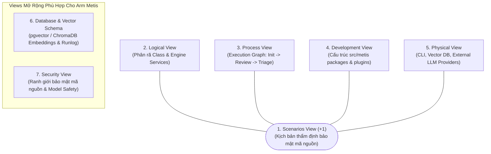
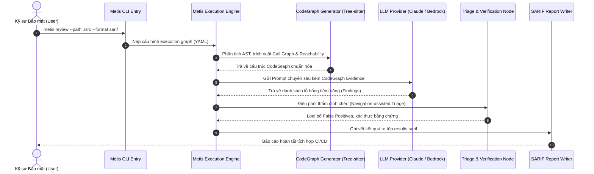
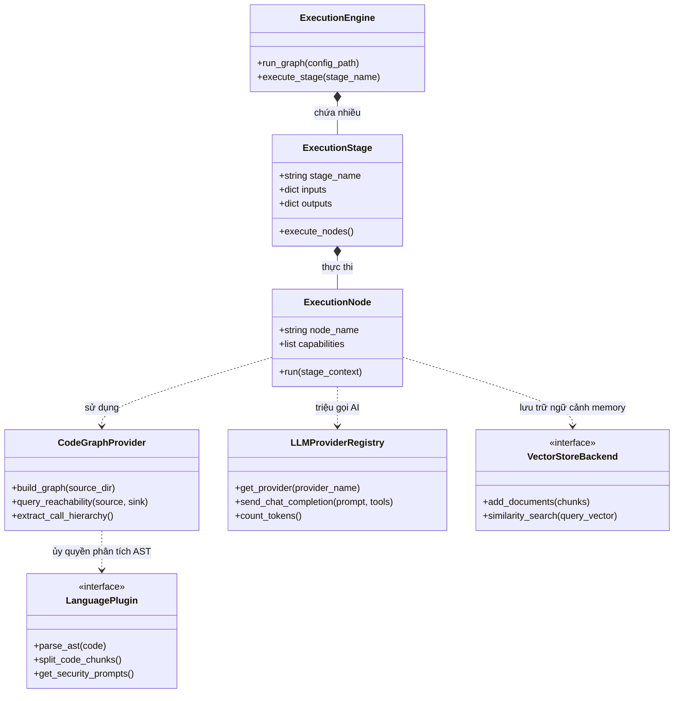
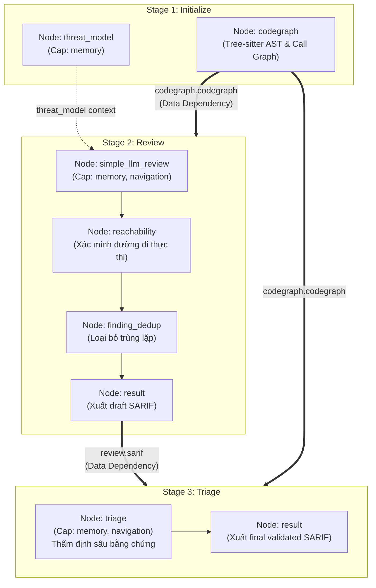
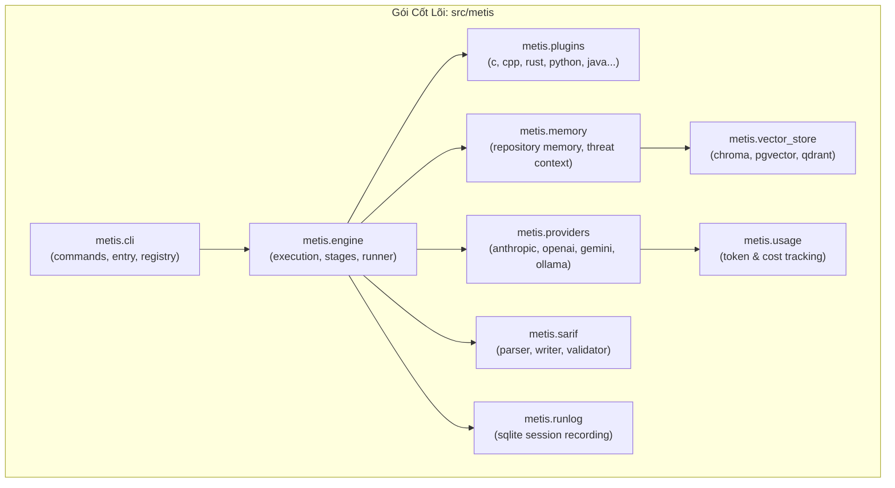
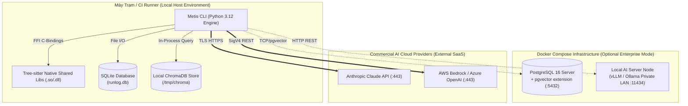
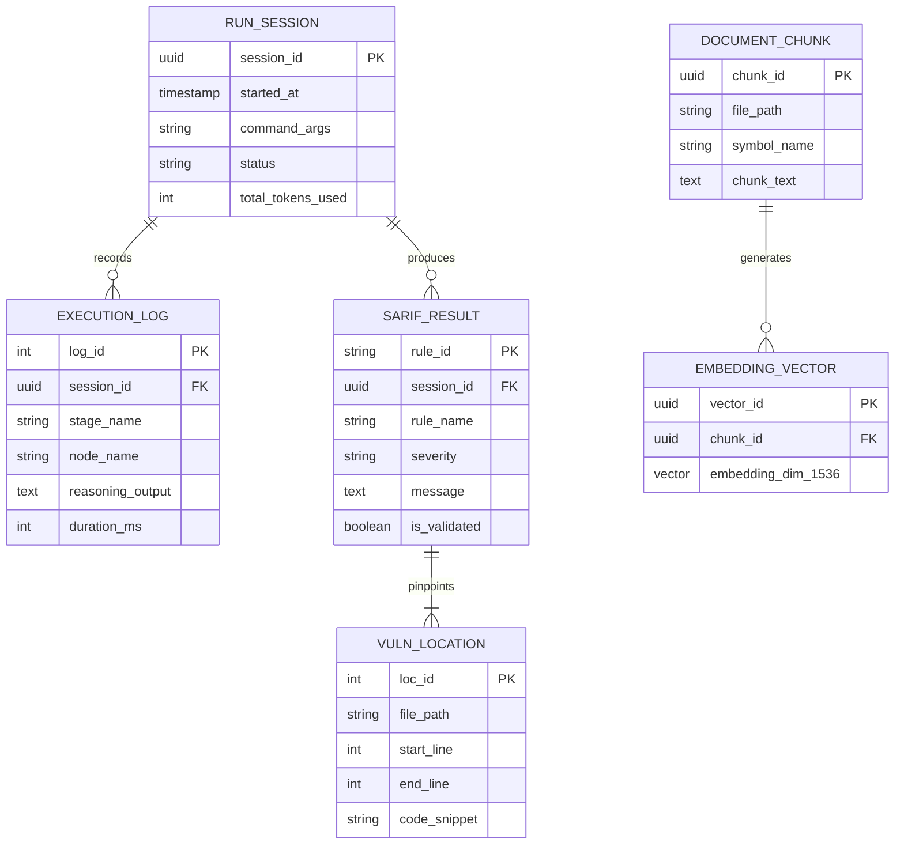
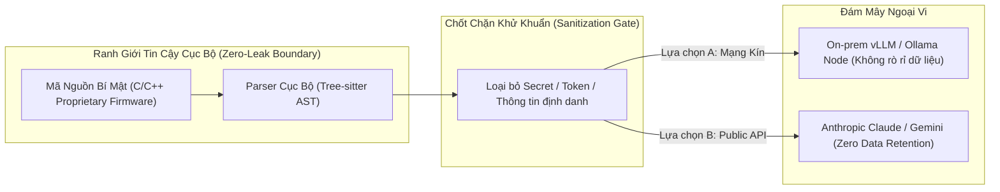

# TÀI LIỆU TÁI TẠO & ĐẶC TẢ KIẾN TRÚC DỰ ÁN ARM METIS
## Chủ đề: Architecture Representation & Recovery using 4+1 Views Model
**Tham chiếu dự án:** [Arm Metis Repository (GitHub)](https://github.com/arm/metis)  
**Tập đoàn phát triển:** Arm's Product Security Team  
**Mục tiêu tài liệu:** Tái tạo kiến trúc hệ thống Arm Metis, giải đáp các câu hỏi lý thuyết cốt lõi về Views & Models, cung cấp bảng thuyết minh thành phần bằng chữ (Element Catalog), và ánh xạ trực tiếp vào mã nguồn thực tế phục vụ buổi vấn đáp môn Kiến trúc Phần mềm.

---

## MỤC LỤC
1. [Tổng Quan Dự Án Arm Metis](#1-tổng-quan-dự-án-arm-metis)
2. [Giải Đáp Câu Hỏi Lý Thuyết Trọng Tâm](#2-giải-đáp-câu-hỏi-lý-thuyết-trọng-tâm)
   - 2.1. Có phải chỉ cần Package, Component, Deployment, Artifact là đủ?
   - 2.2. Phân biệt Architectural View và UML Model
   - 2.3. Số lượng các Views bao nhiêu là đủ? (Tiêu chuẩn Architectural Sufficiency)
3. [Tái Tạo Kiến Trúc Arm Metis (Mô Hình 4+1 Views & Mở Rộng)](#3-tái-tạo-kiến-trúc-arm-metis-mô-hình-41-views--mở-rộng)
   - 3.1. Scenarios View (+1 View - Kịch bản ca sử dụng trung tâm)
   - 3.2. Logical View (Góc nhìn phân rã chức năng & Hướng đối tượng)
   - 3.3. Process View (Tiến trình thực thi động & Execution Graph)
   - 3.4. Development View (Tổ chức gói mã nguồn & Package Structure)
   - 3.5. Physical / Deployment View (Môi trường vận hành hạ tầng)
   - 3.6. Database & Vector Schema View (Mô hình lưu trữ dữ liệu & Embeddings)
   - 3.7. Security View (Ranh giới bảo mật & Quyền riêng tư mã nguồn)
4. [Bảng Ánh Xạ Mã Nguồn Thực Tế (Source Code Mapping for Live Demo)](#4-bảng-ánh-xạ-mã-nguồn-thực-tế-source-code-mapping-for-live-demo)

---

## 1. Tổng Quan Dự Án Arm Metis

### 1.1. Metis là gì?
**Metis** là một khung làm việc mã nguồn mở (Open-source Agentic AI Security Framework) được phát triển bởi **Đội ngũ An ninh Sản phẩm của Tập đoàn Arm (Arm's Product Security Team)**. Dự án được đặt theo tên của **Nữ thần Metis** trong thần thoại Hy Lạp — hiện thân của trí tuệ, sự suy xét sâu sắc và khả năng đưa ra những lời khuyên thông thái.

### 1.2. Bài toán nghiệp vụ & Tại sao cần Metis?
Trong phát triển phần mềm hiện đại, đặc biệt là các kho mã nguồn khổng lồ, phức tạp hoặc hệ thống nhúng/firmware (C/C++, Rust, Assembly) của Arm:
- **Hạn chế của công cụ truyền thống (Linters & SAST):** Phụ thuộc hoàn toàn vào các quy tắc cứng (hardcoded rules) hoặc so khớp mẫu (regex pattern). Điều này dẫn đến tỷ lệ **Cảnh báo giả (False Positives)** cực kỳ cao, gây mệt mỏi cho kỹ sư đánh giá (Review Fatigue), đồng thời bỏ sót các lỗ hổng logic nghiệp vụ tinh vi.
- **Giải pháp của Metis:** Kết hợp năng lực suy luận sâu sắc của các Mô hình Ngôn ngữ Lớn (LLM Reasoning) với **Bằng chứng cục bộ có tính tất định (Deterministic Local Evidence)** được trích xuất từ cấu trúc cây cú pháp trừu tượng (**CodeGraph via Tree-sitter**), tạo nên một quy trình thẩm định bảo mật tự động, chuẩn xác và có thể kiểm chứng được.

### 1.3. Các đặc điểm kiến trúc nổi bật của Arm Metis
1. **Deep Reasoning kết hợp Deterministic CodeGraph:** Không "nhắm mắt" đưa toàn bộ code thô cho LLM, Metis xây dựng đồ thị gọi hàm (Call Graph) và phân tích tính tiếp cận (Reachability Analysis) để cung cấp ngữ cảnh chính xác cho LLM.
2. **Kiến trúc Execution Graph linh hoạt (Engine Workflow):** Cho phép cấu hình quy trình thẩm định qua file YAML với 3 giai đoạn tiêu chuẩn: `initialize` $\to$ `review` $\to$ `triage`.
3. **Language Plugin Architecture:** Hỗ trợ hơn 20 ngôn ngữ lập trình (C, C++, Rust, Python, Go, Java, AArch64 Assembly...) thông qua cơ chế plugin độc lập.
4. **Provider Flexibility:** Không bị trói buộc vào một hãng AI đơn lẻ; Metis hỗ trợ từ các dịch vụ đám mây (Anthropic Claude, OpenAI, Google Gemini, AWS Bedrock) cho đến các mô hình cục bộ bảo mật cao (Ollama, vLLM, llama.cpp).
5. **Tiêu chuẩn đầu ra SARIF:** Xuất báo cáo theo định dạng chuẩn quốc tế SARIF (Static Analysis Results Interchange Format), tích hợp trực tiếp vào GitHub Code Scanning và CI/CD.

---

## 2. Giải Đáp Câu Hỏi Lý Thuyết Trọng Tâm

### 2.1. "Có phải chỉ cần Package, Component, Deployment, Artifact là đủ để thể hiện kiến trúc?"
> **Câu trả lời chuẩn vấn đáp:** **Hoàn toàn KHÔNG đủ.**

**Lý giải 5 nguyên nhân cốt lõi:**
1. **Thiên lệch cấu trúc tĩnh (Static Bias):** Cả 4 mô hình Package, Component, Deployment và Artifact chỉ mô tả **cấu trúc tĩnh** (hệ thống được chia thành module nào, đóng gói thành file gì, đặt trên máy chủ nào). Chúng hoàn toàn trả lời câu hỏi *"Cái gì nằm ở đâu?"* nhưng **bất lực trước câu hỏi *"Hệ thống chạy như thế nào?"***.
2. **Thiếu Process View (Hành vi động & Concurrency):** Hệ thống không thể vận hành nếu thiếu sự tương tác theo thời gian. 4 mô hình trên không chỉ ra được luồng thực thi (execution flow), cơ chế gọi bất đồng bộ (async/await), tương tác đa luồng, tranh chấp tài nguyên (Resource Contention) hay cơ chế chịu lỗi (Fault Recovery).
3. **Thiếu Scenarios (+1):** Không có kịch bản tương tác (Use Cases) đóng vai trò sợi chỉ đỏ kết nối và kiểm chứng xem các thành phần có phối hợp ăn khớp với nhau hay không.
4. **Thiếu Database & Data Schema:** 4 mô hình trên không biểu diễn được mô hình dữ liệu quan hệ, bảng biểu, khóa ngoại, cấu trúc chỉ mục hay không gian vector embeddings.
5. **Đánh tráo khái niệm giữa View và UML Model:** 4 sơ đồ trên chỉ là 4 công cụ vẽ của UML, không đồng nghĩa với 4 Views kiến trúc.

---

### 2.2. Phân biệt Architectural View và UML Model

| Tiêu chí phân biệt | Architectural View (Góc nhìn kiến trúc) | UML Model / Diagram (Mô hình UML) |
| :--- | :--- | :--- |
| **Bản chất** | Một **góc nhìn trừu tượng** thể hiện một tập hợp các mối quan tâm (**Concerns**) của một nhóm các bên liên quan (**Stakeholders**) cụ thể (Chuẩn ISO/IEC/IEEE 42010). | Một **công cụ biểu diễn đồ họa** áp dụng các ký hiệu hình học và quy tắc ngữ pháp chuẩn hóa của ngôn ngữ UML. |
| **Câu hỏi trả lời** | *"Sơ đồ này giải quyết mối bận tâm gì cho ai?"* (Dev cần code, DevOps cần deploy, QA cần test). | *"Sơ đồ này được vẽ bằng ký hiệu, hình khối và mũi tên nào?"* |
| **Phân tầng** | Tầng **Ý niệm & Mục đích (Semantics / Goal)**. | Tầng **Công cụ & Phương tiện (Notation / Tool)**. |
| **Mối quan hệ** | **Một View có thể sử dụng nhiều UML Models** hoặc phối hợp giữa UML với Boxes & Arrows, bảng biểu và văn bản mô tả. | **Một loại UML Model có thể phục vụ nhiều Views khác nhau** (Ví dụ: Component Diagram có thể dùng cho Logical View hoặc Development View tùy mục đích). |

---

### 2.3. Số lượng các Views bao nhiêu là đủ? (Tiêu chuẩn Architectural Sufficiency)

> **Quy tắc vàng:** *"Không có giới hạn số lượng cố định cho các Views. Kiến trúc được coi là ĐỦ (Architecturally Sufficient) khi đáp ứng đồng thời hai tiêu chuẩn sau:"*

1. **Phía Đội ngũ Kỹ thuật (Developers, DevOps, QA):**
   - Lập trình viên có thể bắt tay vào viết mã nguồn, thiết lập cơ sở dữ liệu, dựng pipeline CI/CD mà **không còn điểm mờ kiến trúc (No architectural ambiguities)**. Họ không phải đoán xem giao thức mạng là gì, luồng xử lý lỗi ra sao, hay quyền hạn dữ liệu được chia cắt ở đâu.
2. **Phía Ban Quản lý & Khách hàng (Business & Stakeholders):**
   - Không còn thắc mắc hay lo ngại về chi phí vận hành hạ tầng, tính khả thi của tiến độ, và sự đảm bảo các đặc tính chất lượng trọng yếu (**Quality Attributes** như Security, Scalability, High Availability).

**Bộ Views tiêu chuẩn trong thực tế:**
- **Mức tối thiểu:** Mô hình **4+1 Views** của Philippe Kruchten + **Database / Vector Schema**.
- **Mở rộng theo Quality Attributes:**
  - Nếu hệ thống chú trọng *Security* (như Arm Metis): Bổ sung **Security View / Trust Boundaries**.
  - Nếu hệ thống có nhiều tác vụ chạy nền, xử lý hàng đợi: Bổ sung **Concurrency View**.

---

## 3. Tái Tạo Kiến Trúc Arm Metis (Mô Hình 4+1 Views & Mở Rộng)

Mọi sơ đồ dưới đây đều tuân thủ nguyên tắc: **Luôn đi kèm bảng thuyết minh thành phần bằng chữ (Element Catalog)**.

---

### 3.1. Scenarios View (+1 View - Kịch Bản Ca Sử Dụng Trung Tâm)

Kịch bản Use Case đại diện: **Kỹ sư Bảo mật chạy rà soát kho mã nguồn C/C++ và xác minh lỗ hổng bằng CLI**.

#### 📝 Element Catalog (Thuyết Minh Bằng Chữ - Scenarios View)
| Phần tử | Loại | Trách nhiệm kiến trúc |
| :--- | :--- | :--- |
| **Kỹ sư Bảo mật** | Human Actor | Khởi tạo lệnh kiểm thử, cấu hình đường dẫn mã nguồn và nhận báo cáo kết quả. |
| **Metis CLI Entry** | Giao diện | Tiếp nhận tham số dòng lệnh, nạp biến môi trường và kích hoạt tiến trình engine. |
| **Metis Execution Engine** | Bộ điều phối | Khởi tạo và điều phối các Stage thực thi tuần tự có kiểm soát trạng thái. |
| **CodeGraph Generator** | Bộ phân tích | Sử dụng Tree-sitter bóc tách cấu trúc cú pháp, xác định đường đi giữa nguồn dữ liệu (Source) và điểm chìm (Sink). |
| **LLM Provider** | Dịch vụ AI | Tiếp nhận ngữ cảnh mã nguồn kèm bằng chứng tất định để suy luận lỗ hổng an ninh. |
| **Triage Node** | Bộ thẩm định | Đóng vai trò chốt chặn kiểm duyệt, duyệt ngược cây gọi hàm để xác minh tính khả thi của lỗ hổng, triệt tiêu cảnh báo giả. |
| **SARIF Report Writer** | Bộ xuất dữ liệu | Chuẩn hóa toàn bộ phát hiện thành tệp JSON chuẩn OASIS SARIF v2.1.0. |

---

### 3.2. Logical View (Góc Nhìn Phân Rã Chức Năng & Lớp Đối Tượng)

#### 📝 Element Catalog (Thuyết Minh Bằng Chữ - Logical View)
| Lớp / Module | Trách nhiệm | Giao diện cốt lõi |
| :--- | :--- | :--- |
| **`ExecutionEngine`** | Quản lý toàn bộ vòng đời thực thi đồ thị YAML, truyền nhận dữ liệu giữa các Stage. | `run_graph()`, `execute_stage()` |
| **`ExecutionStage`** | Đóng gói một ranh giới làm việc logic (`initialize`, `review`, `triage`). | `execute_nodes()`, `validate_inputs()` |
| **`ExecutionNode`** | Đơn vị thực thi công việc nhỏ nhất (ví dụ: `simple_llm_review`, `finding_dedup`). | `run()`, `grant_capabilities()` |
| **`CodeGraphProvider`** | Dịch vụ phân tích quan hệ giữa các hàm, tính toán độ sâu gọi hàm và đường đi tiếp cận lỗ hổng. | `build_graph()`, `query_reachability()` |
| **`LanguagePlugin`** | Giao diện trừu tượng cho từng ngôn ngữ; hiện thực hóa bằng Tree-sitter parsers riêng biệt. | `parse_ast()`, `split_code_chunks()` |
| **`LLMProviderRegistry`** | Quản lý kết nối tới đa nhà cung cấp mô hình (Anthropic, Bedrock, Gemini, Local Ollama). | `send_chat_completion()` |
| **`VectorStoreBackend`** | Lớp trừu tượng cho tầng lưu trữ vector; che giấu cài đặt cụ thể của Chroma/Postgres/Qdrant. | `add_documents()`, `similarity_search()` |

---

### 3.3. Process View (Tiến Trình Thực Thi Động & Execution Graph)

Trích xuất trực tiếp từ file tài liệu kiến trúc gốc [`docs/execution-graph.md`](file:///d:/HCMUS/semester7/software-architecture/midterm/KienTrucPhanMemDemo/02-architecture-representation/metis/docs/execution-graph.md) của Arm Metis:

#### 📝 Element Catalog (Thuyết Minh Bằng Chữ - Process View)
- **Data Dependency (Đường mũi tên đôi $==>$):** Ràng buộc dữ liệu bắt buộc. Ví dụ: Stage `review` không thể chạy nếu chưa nhận được đầu ra `codegraph` từ Stage `initialize`.
- **Capability Grant (`memory`, `navigation`):** Quyền năng được cấp cho Node trong file YAML. Node chỉ được phép gọi các công cụ thuộc quyền được cấp (ngăn chặn tình trạng AI tự ý truy cập trái phép tài nguyên).
- **Batching & Stream Control:** Node `reachability` gom cụm các hàm trong cùng một tệp mã nguồn theo thứ tự xuất hiện để tối ưu cửa sổ ngữ cảnh LLM và giảm chi phí token.

---

### 3.4. Development View (Cấu Trúc Gói Mã Nguồn & Package Structure)

Ánh xạ trực tiếp từ cấu trúc thư mục [`src/metis`](file:///d:/HCMUS/semester7/software-architecture/midterm/KienTrucPhanMemDemo/02-architecture-representation/metis/src/metis):

#### 📝 Element Catalog (Thuyết Minh Bằng Chữ - Development View)
| Tên Thư Mục / Module | Vai trò trong quá trình đóng gói và phát triển |
| :--- | :--- |
| `src/metis/cli` | Điểm vào chính của ứng dụng; xử lý nạp tham số qua thư viện dòng lệnh. |
| `src/metis/engine` | Trọng tim của hệ thống; chứa logic quản lý đồ thị thực thi, nạp cấu hình `metis.yaml`. |
| `src/metis/plugins` | Chứa toàn bộ các Parser Tree-sitter riêng biệt cho từng ngôn ngữ; cho phép mở rộng thêm ngôn ngữ mới mà không sửa code core. |
| `src/metis/providers` | Tầng chuyển đổi giao thức AI (Adapter Pattern) tương thích với chuẩn OpenAI API hoặc SDK riêng của từng hãng. |
| `src/metis/vector_store` | Tầng truy cập dữ liệu (Data Access Layer) hỗ trợ chuyển đổi linh hoạt giữa Chroma (file cục bộ) và PostgreSQL (hạ tầng mạng). |
| `src/metis/sarif` | Đảm bảo tính tuân thủ tiêu chuẩn báo cáo bảo mật quốc tế. |

---

### 3.5. Physical / Deployment View (Môi Trường Vận Hành Hạ Tầng)

Mô hình triển khai thực tế dựa trên [`Dockerfile`](file:///d:/HCMUS/semester7/software-architecture/midterm/KienTrucPhanMemDemo/02-architecture-representation/metis/Dockerfile) và [`docker-compose.yml`](file:///d:/HCMUS/semester7/software-architecture/midterm/KienTrucPhanMemDemo/02-architecture-representation/metis/docker-compose.yml) có sẵn trong dự án:

#### 📝 Element Catalog (Thuyết Minh Bằng Chữ - Deployment View)
- **Host / CI Runner:** Máy trạm của nhà phát triển hoặc máy chủ CI/CD (GitHub Actions/GitLab CI) cài đặt Python 3.12 cùng các thư viện C-binding của Tree-sitter.
- **Local Storage:** Mặc định sử dụng SQLite cho `runlog` và ChromaDB cho vector, không đòi hỏi cấu hình mạng phức tạp.
- **Enterprise Mode (Docker Compose):** Mở rộng kết nối tới máy chủ PostgreSQL chuyên dụng có cài `pgvector` phục vụ lưu trữ lâu dài chỉ mục của hàng triệu dòng mã nguồn.

---

### 3.6. Database & Vector Schema View (Mô Hình Dữ Liệu & Embeddings)

#### 📝 Element Catalog (Thuyết Minh Bằng Chữ - Data Schema)
- **`RUN_SESSION` & `EXECUTION_LOG`:** Lưu trữ toàn bộ dấu vết các bước suy luận của AI (Chain of Thought), phục vụ kiểm toán minh bạch và tính toán chi phí token.
- **`EMBEDDING_VECTOR`:** Quản lý không gian vector trong `pgvector` (sử dụng toán tử tương đồng cosine `<=>`) để truy vấn nhanh các đoạn mã liên quan đến lỗ hổng.

---

### 3.7. Security View (Ranh Giới Bảo Mật & Quyền Riêng Tư Mã Nguồn)

Do Arm Metis xử lý mã nguồn nhạy cảm và bảo mật sở hữu trí tuệ (IP) phần cứng của Arm, một **Security View** độc lập là bắt buộc:

- **Nguyên tắc "Local First":** Việc bóc tách cây AST và Call Graph được thực hiện $100\%$ cục bộ trên máy client qua Tree-sitter. Không gửi code thô lên máy chủ AI.
- **Ranh giới bảo mật:** Cho phép triển khai hoàn toàn Offline với các mô hình chạy tại chỗ (Local LLM qua Ollama/vLLM), đáp ứng tiêu chuẩn an toàn tối mật của các dự án phần cứng Arm.

---

## 4. Bảng Ánh Xạ Mã Nguồn Thực Tế (Source Code Mapping for Live Demo)

Khi thầy yêu cầu: *"Em chỉ ra các thành phần trong sơ đồ nằm ở file code nào trong repo Metis em vừa clone?"*, hãy mở và trỏ trực tiếp vào các file sau:

| Thành phần trong Sơ đồ Kiến trúc | File mã nguồn thực tế trong `metis/` | Chức năng kiểm chứng cho Thầy xem |
| :--- | :--- | :--- |
| **Execution Engine & Runner** | [`src/metis/engine/execution_nodes.py`](file:///d:/HCMUS/semester7/software-architecture/midterm/KienTrucPhanMemDemo/02-architecture-representation/metis/src/metis/execution_nodes.py) [`src/metis/engine/execution_stages.py`](file:///d:/HCMUS/semester7/software-architecture/midterm/KienTrucPhanMemDemo/02-architecture-representation/metis/src/metis/execution_stages.py) | Định nghĩa các lớp trừu tượng `ExecutionNode` và `ExecutionStage`. |
| **Cấu hình Đồ thị Thực thi (YAML)** | [`docs/execution-graph.md`](file:///d:/HCMUS/semester7/software-architecture/midterm/KienTrucPhanMemDemo/02-architecture-representation/metis/docs/execution-graph.md) [`src/metis/metis.yaml`](file:///d:/HCMUS/semester7/software-architecture/midterm/KienTrucPhanMemDemo/02-architecture-representation/metis/src/metis/metis.yaml) | Minh chứng cho Process View: các stages `initialize`, `review`, `triage`. |
| **Tree-sitter CodeGraph & Plugins** | [`src/metis/plugins/`](file:///d:/HCMUS/semester7/software-architecture/midterm/KienTrucPhanMemDemo/02-architecture-representation/metis/src/metis/plugins) [`docs/language-plugins.md`](file:///d:/HCMUS/semester7/software-architecture/midterm/KienTrucPhanMemDemo/02-architecture-representation/metis/docs/language-plugins.md) | Thư mục chứa các plugin bóc tách cú pháp AST riêng cho từng ngôn ngữ. |
| **Đa Nhà Cung Cấp Mô Hình (Providers)** | [`src/metis/providers/`](file:///d:/HCMUS/semester7/software-architecture/midterm/KienTrucPhanMemDemo/02-architecture-representation/metis/src/metis/providers) | Chứa các file kết nối: `anthropic.py`, `bedrock.py`, `gemini.py`, `ollama.py`. |
| **Tầng Vector Store & Embeddings** | [`src/metis/vector_store/`](file:///d:/HCMUS/semester7/software-architecture/midterm/KienTrucPhanMemDemo/02-architecture-representation/metis/src/metis/vector_store) | Các file `chroma_store.py`, `pgvector_store.py`, `qdrant_store.py`. |
| **Quản lý Vết Thực Thi (Runlog)** | [`src/metis/runlog/session.py`](file:///d:/HCMUS/semester7/software-architecture/midterm/KienTrucPhanMemDemo/02-architecture-representation/metis/src/metis/runlog/session.py) [`src/metis/runlog/schema.py`](file:///d:/HCMUS/semester7/software-architecture/midterm/KienTrucPhanMemDemo/02-architecture-representation/metis/src/metis/runlog/schema.py) | Ghi vết chi tiết từng bước reasoning và token vào SQLite Database. |
| **Báo cáo Chuẩn SARIF** | [`src/metis/sarif/writer.py`](file:///d:/HCMUS/semester7/software-architecture/midterm/KienTrucPhanMemDemo/02-architecture-representation/metis/src/metis/sarif/writer.py) [`src/metis/sarif/triage.py`](file:///d:/HCMUS/semester7/software-architecture/midterm/KienTrucPhanMemDemo/02-architecture-representation/metis/src/metis/sarif/triage.py) | Định dạng và xuất kết quả báo cáo thẩm định an ninh. |
| **Triển khai Hệ thống (Deployment)** | [`Dockerfile`](file:///d:/HCMUS/semester7/software-architecture/midterm/KienTrucPhanMemDemo/02-architecture-representation/metis/Dockerfile) [`docker-compose.yml`](file:///d:/HCMUS/semester7/software-architecture/midterm/KienTrucPhanMemDemo/02-architecture-representation/metis/docker-compose.yml) | Minh chứng hạ tầng cho Deployment View. |

---

> **Tóm tắt cốt lõi khi thuyết trình:**
> *"Arm Metis giải quyết bài toán cốt lõi của kiểm thử an ninh: Triệt tiêu False Positives bằng cách kết hợp **Suy luận LLM** với **Bằng chứng tất định từ CodeGraph**. Kiến trúc của Metis được tổ chức theo **Execution Graph** phân rã thành các Stage độc lập, hỗ trợ đa ngôn ngữ nhờ **Tree-sitter Plugins**, và đảm bảo **Độ đầy đủ kiến trúc (Sufficiency)** thông qua việc thỏa mãn đồng thời 4+1 Views tiêu chuẩn cùng các mở rộng về Vector Schema và Security Boundaries."*
