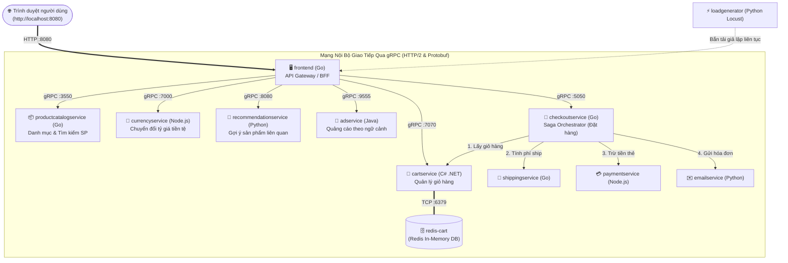

# Phần 3: Microservices, Docker, Kubernetes & Service Mesh (Istio)

Thư mục này triển khai hệ thống Microservices mẫu cho sàn Thương mại điện tử (E-Commerce), bao gồm thiết kế **Bounded Context (Database-per-Service)**, đóng gói **Multi-stage Docker**, triển khai **Kubernetes (K8s)** với cơ chế Self-healing/HPA, cấu hình **Service Mesh (Istio)** (mTLS, Canary, Circuit Breaker) và hệ thống giám sát chỉ số **RED Metrics** qua Prometheus & Grafana.

---

## 1. Cơ sở Kiến trúc: Bounded Context & Database-per-Service

### 1.1. Phân rã theo Miền nghiệp vụ (Domain-Driven Design)

Hệ thống được chia thành 4 Microservices độc lập, mỗi dịch vụ sở hữu cơ sở dữ liệu riêng:

```mermaid
flowchart TD
    Client(["Client / Front-end"]) --> Ingress["API Gateway / Ingress Controller"]
    
    subgraph K8s_Cluster ["Kubernetes Cluster + Istio Service Mesh"]
        Ingress -->|Route /auth| S_Auth["Auth Service\n(Node.js / JWT)"]
        Ingress -->|Route /catalog| S_Cat["Catalog Service\n(Go / Node.js)"]
        Ingress -->|Route /orders| S_Ord["Order Service\n(Node.js / Express)"]
        Ingress -->|Route /payments| S_Pay["Payment Service\n(Python / FastAPI)"]

        S_Auth --- DB_Auth[("Auth DB\n(SQLite / Postgres)")]
        S_Cat --- DB_Cat[("Catalog DB\n(SQLite / Postgres)")]
        S_Ord --- DB_Ord[("Order DB\n(SQLite / Postgres)")]
        S_Pay --- DB_Pay[("Payment DB\n(SQLite / Postgres)")]

        S_Ord -.->|gRPC / REST (mTLS)| S_Cat
        S_Ord -.->|gRPC / REST (mTLS)| S_Pay
    end
```

### 1.2. So sánh Đánh đổi: Monolith vs Microservices

| Tiêu chí | Monolithic Architecture | Microservices Architecture |
| :--- | :--- | :--- |
| **Độc lập triển khai (Deployment)** | ❌ Phải build và deploy toàn bộ khối ứng dụng dù chỉ sửa 1 dòng code. | ✅ Từng dịch vụ (Order, Payment) release độc lập mà không ảnh hưởng dịch vụ khác. |
| **Cô lập lỗi (Fault Isolation)** | ❌ Một lỗi rò rỉ bộ nhớ (Memory leak) ở Module Báo cáo có thể đánh sập cả hệ thống. | ✅ Nếu Payment Service gặp sự cố, người dùng vẫn có thể xem danh mục Catalog bình thường. |
| **Khả năng mở rộng (Scalability)** | ❌ Phải scale toàn bộ Monolith (tốn RAM/CPU lãng phí). | ✅ Scale riêng Order Service từ 2 lên 20 Pods khi Flash Sale mà Catalog vẫn giữ nguyên 2 Pods. |
| **Chi phí vận hành (Operational Cost)**| ✅ Đơn giản, chỉ quản lý 1 pipeline CI/CD và 1 cụm cơ sở dữ liệu. | ❌ Rất cao, đòi hỏi Kubernetes, Istio, CI/CD tự động, tracing phân tán. |
| **Độ trễ mạng (Network Latency)** | ✅ Gọi hàm trong bộ nhớ (In-process memory call) tính bằng micro-giây. | ❌ Gọi qua mạng (gRPC/HTTP qua mTLS Envoy proxy) tính bằng mili-giây. |
| **Nhất quán dữ liệu (Data Consistency)**| ✅ Hỗ trợ giao dịch ACID tức thời (Local Transactions). | ❌ Chấp nhận Eventual Consistency; phải xử lý qua mẫu Saga hoặc Outbox. |

---

## 2. Hệ Sinh Thái Vận Hành Cloud-Native

### 2.1. Đóng gói Container với Docker (Kỹ thuật Multi-Stage Build)

Sử dụng **Multi-stage build** để loại bỏ compiler, development dependencies, công cụ build thừa thãi khỏi image cuối:

```dockerfile
# Stage 1: Build & Dependencies
FROM node:22-alpine AS builder
WORKDIR /app
COPY package*.json ./
RUN npm ci --only=production
COPY . .

# Stage 2: Minimal Production Runtime
FROM node:22-alpine AS runner
WORKDIR /app
ENV NODE_ENV=production
# Tạo non-root user để tăng tính bảo mật
RUN addgroup -S appgroup && adduser -S appuser -G appgroup
COPY --from=builder /app /app
USER appuser
EXPOSE 3000
CMD ["node", "server.js"]
```

> **Lợi ích:** Giảm kích thước Docker Image từ **>800MB** xuống còn **~120MB**, giảm thiểu bề mặt tấn công CVE trong container.

---

### 2.2. Điều Phối Container với Kubernetes (K8s)

1. **Pod Lifecycle & Self-Healing:**
   - K8s tự động chạy `livenessProbe` và `readinessProbe`.
   - Nếu tiến trình ứng dụng bị crash hoặc rơi vào deadlock, K8s tự động khởi động lại Pod ngay lập tức (Self-healing).
2. **Service Discovery & Load Balancing:**
   - Sử dụng K8s CoreDNS và K8s Services (`ClusterIP`) để phân phối tải đều giữa các Pods mà không cần cấu hình IP cứng.
3. **Tự động mở rộng (Horizontal Pod Autoscaler - HPA):**
   - Tự động co giãn số lượng Pod dựa trên mức sử dụng CPU/Memory thực tế (ví dụ: khi CPU > 70%, nâng từ 2 lên tối đa 10 Pods).

---

### 2.3. Service Mesh với Istio (Envoy Sidecar Proxy)

```mermaid
flowchart LR
    subgraph Pod1 ["Order Service Pod"]
        App1["Order App Container"] <-->|localhost| Proxy1["Envoy Sidecar Proxy"]
    end

    subgraph Pod2 ["Payment Service Pod"]
        Proxy2["Envoy Sidecar Proxy"] <-->|localhost| App2["Payment App Container"]
    end

    Proxy1 ===|Mutual TLS (mTLS) Encrypted Wire| Proxy2
```

- **Mã hóa mTLS tự động:** Mọi giao tiếp giữa các Service qua Envoy đều được tự động cấp chứng chỉ X.509 và mã hóa 2 chiều mà không cần sửa 1 dòng code ứng dụng.
- **Canary Release (Điều phối lưu lượng):**
  - Cấu hình Istio `VirtualService` điều hướng 90% traffic vào phiên bản ổn định (`v1`) và 10% traffic vào phiên bản thử nghiệm (`v2`).
- **Circuit Breaking (Ngắt mạch tự động):**
  - Cấu hình Istio `DestinationRule` ngắt kết nối đến dịch vụ đích nếu tỷ lệ lỗi liên tiếp vượt quá ngưỡng (ví dụ: 5 lỗi 5xx trong 10s), bảo vệ hệ thống khỏi lỗi sập dây chuyền (Cascading Failure).

---

### 2.4. Khả Năng Quan Sát (Observability) với Chỉ Số RED

Hệ thống được cấu hình xuất chuẩn chỉ số **RED Metrics** (Rate, Errors, Duration) phục vụ Prometheus & Grafana:

1. **Rate (Tốc độ):** Số lượng request phục vụ mỗi giây (Requests per second - RPS).
2. **Errors (Lỗi):** Số lượng request thất bại (HTTP 4xx, 5xx) theo thời gian thực.
3. **Duration (Độ trễ):** Thời gian xử lý yêu cầu, trực quan hóa qua biểu đồ phân vị $p50, p90, p99$.

---

## 3. Thực Nghiệm Chạy Demo & Kịch Bản Thuyết Trình

Dự án cung cấp **2 cấp độ chạy thực nghiệm** từ cơ bản đến chuẩn công nghiệp:

### 3.1. Cấp độ 1: Cụm 4 Microservices Cơ Sở & Prometheus RED Metrics
Khởi chạy trực tiếp bằng Node.js hoặc Docker Compose ([`docker/docker-compose.yml`](./docker/docker-compose.yml)):
```bash
node demo-microservices-cluster.js
# Hoặc chạy qua Docker Compose:
docker compose -f docker/docker-compose.yml up -d
```
- **Luồng thực thi:**
  1. `auth-service` (`:4001`): Cấp phát JWT Token xác thực người dùng.
  2. `catalog-service` (`:4002`): Trả về danh sách sản phẩm và tồn kho.
  3. `order-service` (`:4003`): Nhận yêu cầu đặt hàng $\to$ gọi HTTP sang `catalog-service` kiểm tra giá $\to$ gọi `payment-service` (`:4004`) thanh toán $\to$ lưu đơn hàng.
  4. Xuất chỉ số **RED Metrics** tại `http://localhost:4003/metrics` theo định dạng chuẩn của Prometheus (`http_requests_total`, `http_request_errors_total`, `http_request_duration_ms_sum`).

---

### 3.2. Cấp độ 2: Hệ Thống Google Cloud Online Boutique (11 Microservices Đa Ngôn Ngữ)
Khởi chạy toàn bộ 12 containers chính chủ của Google Cloud tại [`microservices-demo/docker-compose.yml`](./microservices-demo/docker-compose.yml):
```bash
docker compose -f microservices-demo/docker-compose.yml up -d
```
Truy cập giao diện Web tại: **`http://localhost:8080`**



#### Kịch bản 4 bước thao tác trực tiếp trên `http://localhost:8080`:
1. **Trang chủ (`/`):** `frontend` (Go) gọi gRPC song song sang `productcatalogservice` (Go), `currencyservice` (Node.js) và `adservice` (Java) để tổng hợp giao diện (mẫu **API Composition / BFF**).
2. **Đổi tiền tệ (`USD` $\to$ `EUR` / `JPY`):** Chứng minh tính **Loose Coupling** — chỉ riêng `currencyservice` xử lý việc quy đổi tỷ giá.
3. **Thêm vào giỏ hàng (`Add to Cart`):** Chứng minh nguyên lý **Database-per-Service** — `frontend` gọi gRPC tới `cartservice` (C# .NET), và chỉ duy nhất `cartservice` có quyền đọc/ghi vào `redis-cart`.
4. **Thanh toán (`Place Order`):** Chứng minh mẫu **Saga Orchestration** — `checkoutservice` (Go) điều phối tuần tự 5 dịch vụ: lấy giỏ hàng $\to$ đổi tiền tệ $\to$ trừ tiền thẻ (`paymentservice`) $\to$ tạo vận đơn (`shippingservice`) $\to$ gửi email (`emailservice`) $\to$ làm rỗng giỏ hàng.

---

## 4. Bảng Đối Chiếu Các Công Cụ Tương Đương Thay Thế

Theo yêu cầu mở rộng của môn học, mỗi công cụ trong bộ 5 công cụ chuẩn (**Docker, Kubernetes, Istio, Prometheus, Grafana**) đều có thể được thay thế bằng các công nghệ tương đương tùy theo ngữ cảnh dự án:

| Tầng Kiến Trúc | Công Cụ Chuẩn Trong Demo | Công Cụ Thay Thế Tương Đương | Phân Tích Khi Nào Nên Chọn Công Cụ Thay Thế |
| :--- | :--- | :--- | :--- |
| **1. Container Runtime** | **Docker** | **Podman**, **containerd**, **CRI-O** | Chọn **Podman** khi yêu cầu bảo mật cao (kiến trúc *Daemonless* và *Rootless* không cần tiến trình ngầm chạy quyền root); chọn **containerd / CRI-O** trên cụm K8s production để bỏ qua lớp trung gian Docker Engine. |
| **2. Container Orchestration** | **Kubernetes (K8s)** | **Docker Swarm**, **HashiCorp Nomad**, **AWS ECS** | Chọn **Docker Swarm / Docker Compose** khi quy mô hệ thống nhỏ/vừa, cần triển khai cực nhanh mà không tốn tài nguyên RAM/CPU nuôi Control Plane của K8s; chọn **Nomad** khi cần điều phối hỗn hợp cả container lẫn ứng dụng binary/Java JAR thuần. |
| **3. Service Mesh** | **Istio** | **Linkerd**, **Cilium Service Mesh (eBPF)**, **Consul Connect** | Chọn **Linkerd** khi cần Service Mesh siêu nhẹ (viết bằng Rust, tiêu thụ RAM bằng 1/5 Istio); chọn **Cilium (eBPF)** khi muốn xử lý định tuyến và bảo mật ngay tại nhân Linux Kernel mà **không cần chèn Sidecar Proxy** vào từng Pod (*Sidecarless Mesh*). |
| **4. Metrics & Time-Series DB** | **Prometheus** | **VictoriaMetrics**, **InfluxDB**, **Grafana Mimir**, **Datadog** | Chọn **VictoriaMetrics** khi lưu lượng chỉ số cực lớn (nén dữ liệu tốt hơn và tiết kiệm RAM hơn Prometheus từ 3–5 lần nhưng vẫn tương thích 100% truy vấn PromQL). |
| **5. Observability & Visualization** | **Grafana** | **Kibana (ELK Stack)**, **Datadog UI**, **New Relic**, **Apache Superset** | Chọn **Kibana** khi hệ thống đã sử dụng sẵn стек ELK (Elasticsearch - Logstash - Kibana) để kết hợp truy vấn Log tập trung và biểu đồ giám sát trên cùng một giao diện. |

---

## 5. Cấu trúc Tệp tin & Tài liệu Chi tiết trong `03-microservices-k8s-mesh/`

- [`microservices-architecture-guide.md`](./microservices-architecture-guide.md): Cẩm nang lý thuyết chuyên sâu, phân tích từng tệp cấu hình và ngân hàng câu hỏi vấn đáp.
- [`RUN_GUIDE.md`](./RUN_GUIDE.md): Hướng dẫn từng bước khởi chạy cụm 11 Microservices bằng Docker Compose hoặc Kubernetes.
- [`demo-microservices-cluster.js`](./demo-microservices-cluster.js): Kịch bản tự động chạy cụm 4 Microservices và xuất chỉ số Prometheus RED Metrics.
- [`services/`](./services): Mã nguồn 4 dịch vụ độc lập (`auth-service`, `catalog-service`, `order-service`, `payment-service`).
- [`docker/`](./docker): [`Dockerfile.multistage`](./docker/Dockerfile.multistage) và [`docker-compose.yml`](./docker/docker-compose.yml).
- [`k8s/`](./k8s): [`order-deployment.yaml`](./k8s/order-deployment.yaml) (Deployments, Services, Probes, Resource Requests/Limits).
- [`istio/`](./istio): [`canary-traffic-routing.yaml`](./istio/canary-traffic-routing.yaml) & [`circuit-breaking.yaml`](./istio/circuit-breaking.yaml).
- [`observability/`](./observability): [`prometheus.yml`](./observability/prometheus.yml) & [`grafana-dashboard.json`](./observability/grafana-dashboard.json).
- [`microservices-demo/`](./microservices-demo): Kho mã nguồn đầy đủ dự án **Google Cloud Online Boutique (11 Microservices)**.
