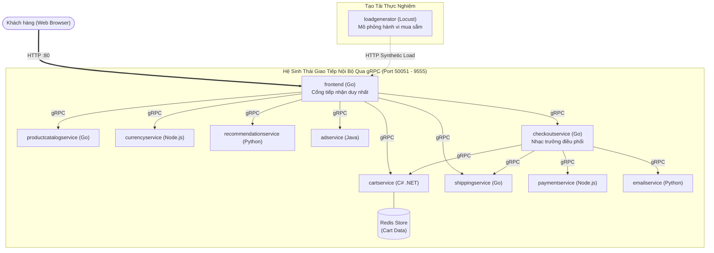
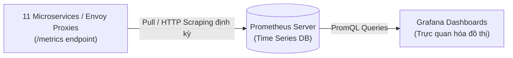

# CẨM NANG ĐẶC TẢ VÀ VẤN ĐÁP KIẾN TRÚC MICROSERVICES, DOCKER, KUBERNETES, ISTIO & OBSERVABILITY
## Hệ thống mẫu thực chứng: Google Cloud Online Boutique (microservices-demo)

Tài liệu này cung cấp toàn bộ kiến thức chuyên sâu, sơ đồ kiến trúc chuẩn hóa, phân tích các tệp cấu hình thực tế trong thư mục [`microservices-demo`](./microservices-demo), và bộ câu hỏi vấn đáp điểm 10 dành cho **Chủ đề 3: Kiến trúc Microservices & Hệ sinh thái Cloud-Native**.

---

## MỤC LỤC
1. [Tổng Quan Hệ Thống Google Cloud Online Boutique](#1-tổng-quan-hệ-thống-google-cloud-online-boutique)
2. [Kiến Trúc Microservices & Bounded Contexts](#2-kiến-trúc-microservices--bounded-contexts)
3. [Đóng Gói Container với Docker (Kỹ Thuật Multi-Stage Build)](#3-đóng-gói-container-với-docker-kỹ-thuật-multi-stage-build)
4. [Điều Phối Container với Kubernetes (K8s Orchestration)](#4-điều-phối-container-với-kubernetes-k8s-orchestration)
5. [Quản Lý Giao Tiếp Mạng với Istio (Service Mesh)](#5-quản-lý-giao-tiếp-mạng-với-istio-service-mesh)
6. [Giám Sát & Khả Năng Quan Sát (Prometheus & Grafana)](#6-giám-sát--khả-năng-quan-sát-prometheus--grafana)
7. [Ngân Hàng Câu Hỏi Vấn Đáp Điểm 10 (Thầy Ngô Huy Biên)](#7-ngân-hàng-câu-hỏi-vấn-đáp-điểm-10-thầy-ngô-huy-biên)
8. [Bảng Ánh Xạ File Mã Nguồn Thực Tế Để Demo Trực Tiếp](#8-bảng-ánh-xạ-file-mã-nguồn-thực-tế-để-demo-trực-tiếp)

---

## 1. Tổng Quan Hệ Thống Google Cloud Online Boutique

**Online Boutique** là ứng dụng thương mại điện tử mẫu do chính đội ngũ kỹ sư của **Google Cloud** phát triển nhằm chứng minh năng lực triển khai thực tế của các công nghệ điện toán đám mây hiện đại: **Microservices, Kubernetes (GKE), gRPC, Service Mesh (Istio), và Cloud Operations**.

### Đặc tính kỹ thuật cốt lõi:
- **Quy mô:** Gồm **11 microservices** độc lập.
- **Đa ngôn ngữ (Polyglot Architecture):** Mỗi dịch vụ được viết bằng ngôn ngữ tối ưu nhất cho nghiệp vụ đó: **Go, C#, Python, Node.js, Java**.
- **Giao thức liên lạc:** Toàn bộ giao tiếp nội bộ giữa các microservices sử dụng **gRPC (HTTP/2) và Protocol Buffers (`/protos`)** cho tốc độ tuần tự hóa nhị phân cực nhanh, thay vì REST/JSON truyền thống.
- **Mô phỏng lưu lượng:** Tích hợp sẵn `loadgenerator` viết bằng Python Locust bắn request liên tục để tạo tải thực nghiệm.

---

## 2. Kiến Trúc Microservices & Bounded Contexts



### 📝 Bảng Thuyết Minh Thành Phần (Element Catalog)

| Tên Microservice | Ngôn ngữ | Bounded Context (Miền nghiệp vụ) | Giao thức / Cơ sở dữ liệu |
| :--- | :--- | :--- | :--- |
| **`frontend`** | Go | Cửa ngõ duy nhất (Edge/Gateway) phục vụ HTML/CSS, quản lý phiên cookie người dùng. | Nhận HTTP, gọi gRPC ra ngoài. |
| **`cartservice`** | C# (.NET) | Quản lý giỏ hàng tạm thời của khách hàng. | gRPC :7070, lưu trữ trên **Redis Database**. |
| **`productcatalogservice`**| Go | Danh mục hàng hóa, tìm kiếm và chi tiết thông số sản phẩm. | gRPC :3550, dữ liệu đọc từ JSON/Memory. |
| **`currencyservice`** | Node.js | Quy đổi tiền tệ dựa trên tỷ giá của Ngân hàng Trung ương Châu Âu (Dịch vụ có QPS cao nhất). | gRPC :7000. |
| **`paymentservice`** | Node.js | Xử lý thanh toán thẻ tín dụng và sinh mã giao dịch (Mock). | gRPC :50051. |
| **`shippingservice`** | Go | Tính toán cước vận chuyển dựa trên trọng lượng đơn hàng. | gRPC :50051. |
| **`emailservice`** | Python | Gửi thư xác nhận đơn hàng thành công qua SMTP/HTML. | gRPC :8080. |
| **`checkoutservice`** | Go | Đóng vai trò **Process Manager / Saga Orchestrator**: điều phối thanh toán, tính ship, trừ giỏ hàng và gửi email. | gRPC :5050. |
| **`recommendationservice`**| Python | Thuật toán gợi ý các sản phẩm liên quan dựa trên giỏ hàng hiện tại. | gRPC :8080. |
| **`adservice`** | Java | Phục vụ các banner quảng cáo ngữ cảnh theo từ khóa. | gRPC :9555. |
| **`loadgenerator`** | Python | Công cụ bắn tải tự động mô phỏng luồng khách hàng: Xem hàng $\to$ Thêm giỏ $\to$ Thanh toán. | HTTP tới `frontend`. |

### Nguyên Lý Thiết Kế Trọng Tâm Cần Nhớ:
1. **Database-per-Service:** `cartservice` sở hữu độc quyền cụm Redis. Nếu `checkoutservice` cần lấy giỏ hàng để tính tiền, nó **bắt buộc phải gọi gRPC `GetCart()` tới `cartservice`**. Tuyệt đối không có chuyện `checkoutservice` kết nối thẳng vào Redis của `cartservice`. Nếu kết nối chung DB sẽ gây ra *Shared Database Coupling*, phá vỡ hoàn toàn tính độc lập triển khai.
2. **Polylot Persistence & Micro-stacks:** Không ép buộc một ngôn ngữ hay một loại cơ sở dữ liệu duy nhất cho toàn công ty. Dịch vụ cần tính toán song song nhanh chọn **Go**, cần xử lý thuật toán AI gợi ý chọn **Python**, cần giỏ hàng dạng key-value tốc độ cao chọn **Redis**.

---

## 3. Đóng Gói Container với Docker (Kỹ Thuật Multi-Stage Build)

Mỗi microservice trong thư mục `src/` đều có một `Dockerfile` được tối ưu hóa theo tiêu chuẩn công nghiệp.

### 3.1. Phân tích Dockerfile Đa Tầng Mẫu ([`src/frontend/Dockerfile`](./microservices-demo/src/frontend/Dockerfile))

```dockerfile
# ==========================================
# GIAI ĐOẠN 1: BUILDER (Môi trường biên dịch nặng)
# ==========================================
FROM golang:1.23-alpine AS builder
WORKDIR /src

# Tận dụng cơ chế Layer Caching của Docker để tải dependencies trước
COPY go.mod go.sum ./
RUN go mod download

# Sao chép toàn bộ mã nguồn và biên dịch ra file binary tĩnh
COPY . .
RUN CGO_ENABLED=0 go build -o /go/bin/frontend .

# ==========================================
# GIAI ĐOẠN 2: RUNNER (Môi trường thực thi tối giản)
# ==========================================
FROM scratch AS release
WORKDIR /src

# Sao chép chứng chỉ SSL và file binary tĩnh từ giai đoạn Builder
COPY --from=builder /etc/ssl/certs/ca-certificates.crt /etc/ssl/certs/
COPY --from=builder /go/bin/frontend /src/frontend
COPY ./templates ./templates
COPY ./static ./static

# Khởi chạy bằng người dùng không có đặc quyền root (Non-root user)
USER 10001
ENV PORT=8080
EXPOSE 8080
ENTRYPOINT ["/src/frontend"]
```

### 3.2. Điểm Đắt Giá Khi Vấn Đáp Về Docker:
1. **Tại sao phải dùng Multi-stage build?**
   - Nếu không dùng multi-stage, image cuối cùng sẽ chứa cả hệ điều hành Linux đầy đủ, bộ Go compiler, mã nguồn gốc, file `.git`... khiến image phình to **$> 800\text{MB}$**.
   - Với multi-stage, image tầng chạy cuối (`scratch` hoặc `alpine`) **chỉ chứa duy nhất 1 file binary** thực thi, rút gọn kích thước xuống chỉ còn **$\approx 20\text{MB}$** (nhỏ hơn 40 lần!).
2. **Lợi ích an ninh (Security Attack Surface):**
   - Image siêu nhỏ không chứa shell (`/bin/sh`, `/bin/bash`), không có package manager (`apt`, `apk`), và chạy với `USER 10001` (Non-root). Kẻ tấn công dù khai thác được lỗ hổng Remote Code Execution (RCE) cũng không thể mở shell hay leo thang đặc quyền root trên máy chủ vật lý.
3. **Bản chất Container dưới tầng OS Kernel:**
   - Container không phải máy ảo (VM), nó không ảo hóa phần cứng qua Hypervisor.
   - Container cô lập tiến trình bằng 2 tính năng có sẵn của Linux Kernel:
     - **Namespaces (`pid`, `net`, `mnt`, `ipc`, `uts`, `user`):** Cô lập tầm nhìn (tiến trình chỉ thấy card mạng ảo và cây thư mục của riêng nó).
     - **Control Groups (`cgroups`):** Giới hạn định mức tài nguyên phần cứng (CPU shares, RAM limit).

---

## 4. Điều Phối Container với Kubernetes (K8s Orchestration)

Tất cả các manifest khai báo cho cụm K8s đều nằm tại thư mục [`microservices-demo/kubernetes-manifests`](./microservices-demo/kubernetes-manifests).

### 4.1. Phân tích Tệp Triển Khai Tiêu Chuẩn ([`kubernetes-manifests/frontend.yaml`](./microservices-demo/kubernetes-manifests/frontend.yaml))

```yaml
apiVersion: apps/v1
kind: Deployment
metadata:
  name: frontend
spec:
  replicas: 2 # Luôn duy trì 2 bản sao để đảm bảo High Availability (N+1)
  selector:
    matchLabels:
      app: frontend
  template:
    metadata:
      labels:
        app: frontend
    spec:
      serviceAccountName: frontend
      containers:
      - name: server
        image: gcr.io/google-samples/microservices-demo/frontend:v0.10.1
        ports:
        - containerPort: 8080
        # 1. Cơ chế giám sát tự phục hồi (Self-Healing)
        readinessProbe:
          initialDelaySeconds: 10
          httpGet:
            path: "/_healthz"
            port: 8080
        livenessProbe:
          initialDelaySeconds: 10
          httpGet:
            path: "/_healthz"
            port: 8080
        # 2. Định mức tài nguyên (Resource Governance)
        resources:
          requests:
            cpu: 100m      # Cam kết cấp tối thiểu 0.1 CPU core
            memory: 64Mi   # Cam kết cấp tối thiểu 64MB RAM
          limits:
            cpu: 200m      # Trần tối đa được dùng 0.2 CPU core (throttling nếu vượt)
            memory: 128Mi  # Trần tối đa 128MB RAM (K8s sẽ OOMKilled nếu vượt)
```

### 4.2. Hai Cặp Khái Niệm Sống Còn Khi Trả Lời Vấn Đáp K8s:

#### A. Phân biệt `requests` và `limits`:
- `requests`: Lượng tài nguyên mà `kube-scheduler` dùng để **quyết định xếp Pod lên Node nào**. Node phải còn đủ chỗ trống bằng `requests` thì Pod mới được đặt vào.
- `limits`: Ngưỡng chặn tối đa của nhân Linux `cgroups`. Nếu ứng dụng ngốn quá limit CPU, K8s sẽ bóp nghẽn CPU (*CPU Throttling*). Nếu ứng dụng ngốn quá limit Memory, K8s sẽ lập tức kích hoạt Out-Of-Memory Killer (**OOMKilled - Exit code 137**) để bảo vệ Node không bị sập.

#### B. Phân biệt `readinessProbe` và `livenessProbe`:
- **`readinessProbe` (Đã sẵn sàng đón khách chưa?):**
  - Nếu probe rớt (fail): K8s **gỡ IP của Pod ra khỏi Service Endpoints**. Khách hàng sẽ không bị gửi vào Pod này nữa. **Pod KHÔNG bị giết**. Khi Pod tải xong cache, nó trả về 200 và K8s tự động gắn lại vào Load Balancer.
- **`livenessProbe` (Tiến trình còn sống không hay đã bị Deadlock?):**
  - Nếu probe rớt liên tiếp 3 lần: K8s coi như Pod đã chết não và **LẬP TỨC GIẾT CHẾT (KILL) VÀ KHỞI TẠO POD MỚI**.

---

## 5. Quản Lý Giao Tiếp Mạng với Istio (Service Mesh)

Khi hệ thống có 11 dịch vụ, việc quản lý an ninh và định tuyến bằng code thủ công trở nên bất khả thi. **Istio** được áp dụng thông qua mô hình **Sidecar Pattern**.

```mermaid
flowchart LR
    subgraph Pod_A ["checkoutservice Pod"]
        AppA["checkoutservice Container"] <-->|localhost :5050| EnvoyA["Envoy Sidecar Proxy\n(iptables intercept)"]
    end

    subgraph Pod_B ["paymentservice Pod"]
        EnvoyB["Envoy Sidecar Proxy\n(Giải mã mTLS & Rate Limit)"] <-->|localhost :50051| AppB["paymentservice Container"]
    end

    EnvoyA ===|Mutual TLS (mTLS) - Đã mã hóa 2 chiều tự động| EnvoyB
```

### 5.1. Các Giá Trị Kiến Trúc Của Istio Được Cấu Hình Sẵn:

1. **Kiểm Soát Cửa Khẩu (Istio Ingress Gateway - [`istio-manifests/frontend-gateway.yaml`](./microservices-demo/istio-manifests/frontend-gateway.yaml)):**
   - Đóng vai trò Reverse Proxy ngoài cùng tiếp nhận toàn bộ traffic cổng 80/443 từ Internet, kiểm tra TLS và điều phối vào Pod Frontend.
2. **Mã Hóa Toàn Diện (Zero-Trust Automatic mTLS):**
   - Mọi kết nối gRPC giữa `checkoutservice` và `paymentservice` đều được tự động cấp chứng chỉ X.509 bởi `istiod` và mã hóa qua đường hầm an toàn. Dù hacker có nghe lén gói tin trên mạng nội bộ cụm K8s cũng chỉ nhận được các byte rác đã mã hóa.
3. **Định Tuyến Thử Nghiệm Canary Release ([`istio/canary-traffic-routing.yaml`](./istio/canary-traffic-routing.yaml)):**
   - Cho phép định tuyến $90\%$ người dùng vào phiên bản cũ (`v1`) và chỉ $10\%$ người dùng trải nghiệm phiên bản mới (`v2`) thông qua cấu hình `VirtualService`. Nếu phiên bản mới có lỗi, rollback về $100\%$ `v1` trong 1 giây mà không cần deploy lại code.
4. **Ngắt Mạch Bảo Vệ (Circuit Breaking - [`istio/circuit-breaking.yaml`](./istio/circuit-breaking.yaml)):**
   - Cấu hình `DestinationRule` theo dõi nếu dịch vụ đích trả về lỗi 5xx liên tiếp 3 lần trong 10 giây, Envoy sẽ lập tức ngắt mạch (Eject out of pool) trong 30 giây, trả về lỗi ngay tức thì cho client thay vì bắt client chờ time-out.

---

## 6. Giám Sát & Khả Năng Quan Sát (Prometheus & Grafana)

Một hệ thống phân tán không thể vận hành nếu không có khả năng quan sát (**Observability**). Hệ thống được tích hợp theo dõi qua bộ chỉ số **RED Metrics** (Richard rodger pattern).



### 6.1. Bộ Chỉ Số RED Metrics Cần Nắm:
- **Rate (Tốc độ):** Số lượng yêu cầu mà hệ thống tiếp nhận mỗi giây ($RPS$).
  - *PromQL:* `sum(rate(http_requests_total[1m]))`
- **Errors (Lỗi):** Tỷ lệ các yêu cầu bị lỗi ($HTTP\ 4xx, 5xx$).
  - *PromQL:* `sum(rate(http_requests_total{status=~"5.."}[1m])) / sum(rate(http_requests_total[1m])) * 100`
- **Duration (Độ trễ):** Thời gian mà mỗi yêu cầu được xử lý, đo đạc qua phân vị $p95, p99$.
  - *PromQL:* `histogram_quantile(0.95, sum(rate(http_request_duration_seconds_bucket[5m])) by (le))`

---

## 7. Ngân Hàng Câu Hỏi Vấn Đáp Điểm 10 (Thầy Ngô Huy Biên)

Dưới đây là 3 câu hỏi vấn đáp kinh điển của Thầy Biên kèm đáp án chuẩn xác từng chi tiết kỹ thuật:

### ❓ Câu hỏi 1:
> *"Khi một request đi từ trình duyệt người dùng vào cụm Kubernetes có cài Istio để gọi tới `checkoutservice`, rồi `checkoutservice` gọi sang `paymentservice`, hãy mô tả chính xác đường đi của gói tin qua những thành phần mạng nào?"*

**Trả lời chuẩn:**
1. Trình duyệt gửi HTTP Request tới địa chỉ IP công khai của cụm.
2. Gói tin đi qua Cloud Load Balancer và chạm vào **Istio Ingress Gateway Pod** (chạy một container Envoy proxy ngoài rìa).
3. Ingress Gateway giải mã SSL/TLS, đối chiếu quy tắc định tuyến trong `Gateway` và `VirtualService`, rồi chuyển tiếp gói tin tới Pod của `checkoutservice`.
4. Gói tin **KHÔNG chạm trực tiếp vào container checkoutservice**, mà bị cơ chế `iptables` của Linux chuyển hướng vào **Envoy Sidecar Proxy** nằm cùng Pod.
5. Envoy Sidecar xác thực chứng chỉ mTLS, ghi nhận metrics, rồi chuyển tiếp nội bộ qua giao diện mạng `localhost :5050` vào container **checkoutservice**.
6. Khi checkoutservice cần gọi sang `paymentservice:50051`:
   - Gói tin gRPC đi ra `localhost` và bị **Envoy Sidecar của checkoutservice** chặn lại.
   - Envoy này kiểm tra bảng định tuyến, áp dụng quy tắc Circuit Breaker, mã hóa gói tin bằng Mutual TLS (mTLS), rồi bắn qua mạng K8s tới Pod của `paymentservice`.
   - Tại Pod đích, **Envoy Sidecar của paymentservice** nhận gói tin, giải mã mTLS, xác thực quyền hạn, rồi mới chuyển tiếp vào `localhost :50051` cho container **paymentservice** xử lý.

---

### ❓ Câu hỏi 2:
> *"Sự khác biệt giữa `livenessProbe` và `readinessProbe` trong Kubernetes là gì? Chuyện gì sẽ xảy ra nếu em cấu hình `livenessProbe` kiểm tra kết nối tới Database bên ngoài và Database đó bị chậm trong 10 giây?"*

**Trả lời chuẩn:**
- **Khác biệt bản chất:** `readinessProbe` quyết định Pod có được nhận lưu lượng mạng từ Service hay không (chỉ ngắt routing, không kill Pod). Trong khi `livenessProbe` quyết định sự sống còn của container (nếu rớt liên tiếp sẽ kill và reboot Pod).
- **Hậu quả sự cố (Cascading Failure):**
  - Nếu đưa kiểm tra Database bên ngoài vào `livenessProbe`: Khi Database bị quá tải hoặc chậm mạng trong 10 giây, toàn bộ các Pod microservice trong cụm sẽ đồng loạt rớt `livenessProbe`.
  - **Kubernetes sẽ đồng loạt ra lệnh GIẾT và KHỞI ĐỘNG LẠI toàn bộ hàng chục Pod cùng một thời điểm!**
  - Việc hàng chục Pod cùng khởi động lại, khởi tạo kết nối (handshake, connection pool) đập dồn dập vào Database sẽ khiến Database chết hẳn, đẩy toàn bộ hệ thống vào vòng xoáy sập đổ dây chuyền (**Cascading Failure**).
  - *Kết luận:* Kiểm tra kết nối dịch vụ phụ thuộc bên ngoài chỉ được phép cấu hình ở `readinessProbe` hoặc xử lý mềm (Graceful Degradation). `livenessProbe` chỉ được dùng để kiểm tra nội tại tiến trình (ví dụ gọi endpoint `/healthz` nội bộ trả về RAM/deadlock status).

---

### ❓ Câu hỏi 3:
> *"Nếu không dùng Istio (Service Mesh), làm thế nào để em thực hiện được Circuit Breaking, mTLS và thu thập Metrics độ trễ giữa các microservices? Việc dùng Istio mang lại lợi ích gì và cái giá phải trả (Trade-off) là gì?"*

**Trả lời chuẩn:**
- **Giải pháp thay thế khi không dùng Istio:** Bắt buộc phải tích hợp thư viện SDK chuyên dụng trực tiếp vào mã nguồn của từng service:
  - *Circuit Breaker:* Dùng thư viện Resilience4j / Netflix Hystrix (Java), Polly (.NET), Gobreaker (Go).
  - *mTLS:* Lập trình viên tự viết logic nạp chứng chỉ SSL và kiểm tra handshake ở code HTTP/gRPC server/client.
  - *Metrics:* Cài SDK Prometheus client trong từng ứng dụng để đo thời gian hàm.
  - *Nhược điểm lớn nhất:* Với hệ thống Polyglot (như Online Boutique dùng 5 ngôn ngữ khác nhau), việc duy trì và đồng bộ cấu hình trên 5 bộ SDK khác nhau là cực kỳ tốn công sức và dễ sai sót.
- **Lợi ích của Istio:** Triệt tiêu hoàn toàn sự phụ thuộc vào code ứng dụng. Tách biệt tầng mạng và bảo mật ra khỏi tầng nghiệp vụ (*Decouple Network Concerns from Business Logic*). Toàn bộ mTLS, Canary, Tracing đều được quản lý tập trung qua khai báo YAML.
- **Cái giá phải trả (Trade-off):**
  1. **Hao phí tài nguyên (Resource Overhead):** Mỗi Pod phải cõng thêm một container Envoy proxy chạy nền, tiêu tốn thêm $50\text{MB} - 100\text{MB}$ RAM và CPU cho mỗi Pod.
  2. **Tăng độ trễ mạng (Added Latency):** Mỗi chặng gọi mạng phải qua 2 lần Envoy proxy (Sidecar gửi và Sidecar nhận), làm tăng thêm từ **$1.5\text{ms}$ đến $3\text{ms}$** cho mỗi request.
  3. **Độ phức tạp vận hành:** Đòi hỏi đội ngũ DevOps có chuyên môn cao để quản lý `istiod`, debug lỗi cấu hình mạng iptables và chứng chỉ bảo mật.

---

## 8. Bảng Ánh Xạ File Mã Nguồn Thực Tế Để Demo Trực Tiếp

Khi Thầy yêu cầu mở code minh chứng trong buổi thi vấn đáp, bạn hãy mở trực tiếp các file sau:

| Thành phần lý thuyết | Đường dẫn tệp tin trong thư mục `03-microservices-k8s-mesh/` | Nội dung chỉ cho Thầy xem |
| :--- | :--- | :--- |
| **Giao thức gRPC & Protobuf** | [`microservices-demo/protos/demo.proto`](file:///d:/HCMUS/semester7/software-architecture/midterm/KienTrucPhanMemDemo/03-microservices-k8s-mesh/microservices-demo/protos/demo.proto) | Khai báo các RPC calls: `GetCart`, `EmptyCart`, `Charge`, `ShipOrder`. |
| **Multi-Stage Dockerfile** | [`microservices-demo/src/frontend/Dockerfile`](file:///d:/HCMUS/semester7/software-architecture/midterm/KienTrucPhanMemDemo/03-microservices-k8s-mesh/microservices-demo/src/frontend/Dockerfile) | Giai đoạn 1: `builder` biên dịch Go; Giai đoạn 2: `scratch` siêu nhẹ chạy `USER 10001`. |
| **K8s Probes & Resources** | [`microservices-demo/kubernetes-manifests/frontend.yaml`](file:///d:/HCMUS/semester7/software-architecture/midterm/KienTrucPhanMemDemo/03-microservices-k8s-mesh/microservices-demo/kubernetes-manifests/frontend.yaml) | Cấu hình `readinessProbe`, `livenessProbe`, `resources.requests` và `limits`. |
| **Istio Ingress Gateway** | [`microservices-demo/istio-manifests/frontend-gateway.yaml`](file:///d:/HCMUS/semester7/software-architecture/midterm/KienTrucPhanMemDemo/03-microservices-k8s-mesh/microservices-demo/istio-manifests/frontend-gateway.yaml) | Định nghĩa `Gateway` đón cổng 80 và `VirtualService` trỏ vào dịch vụ frontend. |
| **Canary Traffic Routing** | [`istio/canary-traffic-routing.yaml`](file:///d:/HCMUS/semester7/software-architecture/midterm/KienTrucPhanMemDemo/03-microservices-k8s-mesh/istio/canary-traffic-routing.yaml) | Chia lưu lượng 90% version 1 và 10% version 2. |
| **Istio Circuit Breaking** | [`istio/circuit-breaking.yaml`](file:///d:/HCMUS/semester7/software-architecture/midterm/KienTrucPhanMemDemo/03-microservices-k8s-mesh/istio/circuit-breaking.yaml) | `DestinationRule` cấu hình `maxConnections`, ngắt kết nối khi lỗi 5xx. |
| **Prometheus Metrics** | [`observability/prometheus.yml`](file:///d:/HCMUS/semester7/software-architecture/midterm/KienTrucPhanMemDemo/03-microservices-k8s-mesh/observability/prometheus.yml) | Cấu hình cào dữ liệu (scrape job) định kỳ 5s từ các microservices. |
| **Grafana Dashboard** | [`observability/grafana-dashboard.json`](file:///d:/HCMUS/semester7/software-architecture/midterm/KienTrucPhanMemDemo/03-microservices-k8s-mesh/observability/grafana-dashboard.json) | Bảng điều khiển trực quan hóa biểu đồ RED metrics và 4 Golden signals. |


---

## 9. Các Công Cụ Tương Đương Thay Thế (Mở Rộng Theo Đề Bài)

Trong trường hợp không sử dụng bộ 5 công cụ chuẩn (**Docker, Kubernetes, Istio, Prometheus, Grafana**), kiến trúc sư có thể thay thế bằng các công nghệ tương đương dưới đây tùy theo quy mô và ràng buộc hạ tầng:

| Tầng Kiến Trúc | Công Cụ Chuẩn Trong Demo | Công Cụ Thay Thế Tương Đương | Phân Tích Đánh Đổi & Khi Nào Nên Lựa Chọn |
| :--- | :--- | :--- | :--- |
| **1. Container Runtime** | **Docker** | **Podman**, **containerd**, **CRI-O** | **Podman** hoạt động theo kiến trúc *Daemonless* và *Rootless* (không cần tiến trình ngầm quyền root như Docker daemon), an toàn hơn trên máy chủ Linux. **containerd / CRI-O** là runtime nhẹ chạy trực tiếp dưới Kubernetes mà không cần lớp vỏ Docker CLI. |
| **2. Orchestration** | **Kubernetes (K8s)** | **Docker Swarm**, **HashiCorp Nomad**, **AWS ECS** | **Docker Swarm / Docker Compose** phù hợp cho quy mô vừa và nhỏ, cấu hình đơn giản, không tốn hàng GB RAM để nuôi Control Plane như K8s. **HashiCorp Nomad** cho phép điều phối cả ứng dụng container lẫn ứng dụng truyền thống (file binary, Java JAR). |
| **3. Service Mesh** | **Istio** | **Linkerd**, **Cilium Service Mesh (eBPF)**, **Consul Connect** | **Linkerd** (viết bằng Rust) nhẹ hơn và độ trễ thấp hơn Istio. **Cilium Service Mesh** dùng công nghệ **eBPF** can thiệp trực tiếp dưới Linux Kernel, loại bỏ hoàn toàn việc phải cài đặt Sidecar Proxy trên từng Pod (*Sidecarless Architecture*), tiết kiệm lượng lớn RAM/CPU. |
| **4. Metrics & TSDB** | **Prometheus** | **VictoriaMetrics**, **InfluxDB**, **Grafana Mimir**, **Datadog** | **VictoriaMetrics** tương thích 100% với ngôn ngữ truy vấn PromQL nhưng tối ưu hóa nén dữ liệu tốt hơn và sử dụng ít RAM hơn Prometheus từ 3–5 lần ở quy mô lớn. |
| **5. Visualization** | **Grafana** | **Kibana (ELK Stack)**, **Datadog UI**, **New Relic**, **Apache Superset** | **Kibana** đặc biệt mạnh khi hệ thống đã dùng Elasticsearch để lưu trữ Log tập trung, giúp kết hợp tìm kiếm văn bản (Full-text Log Search) và biểu đồ trên một màn hình duy nhất. |
