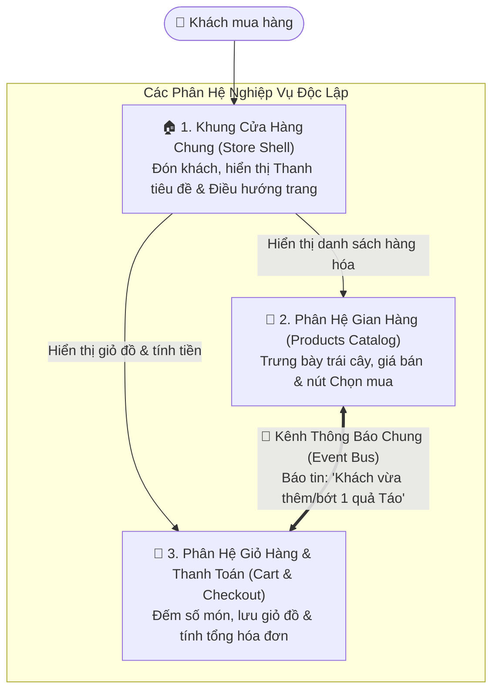
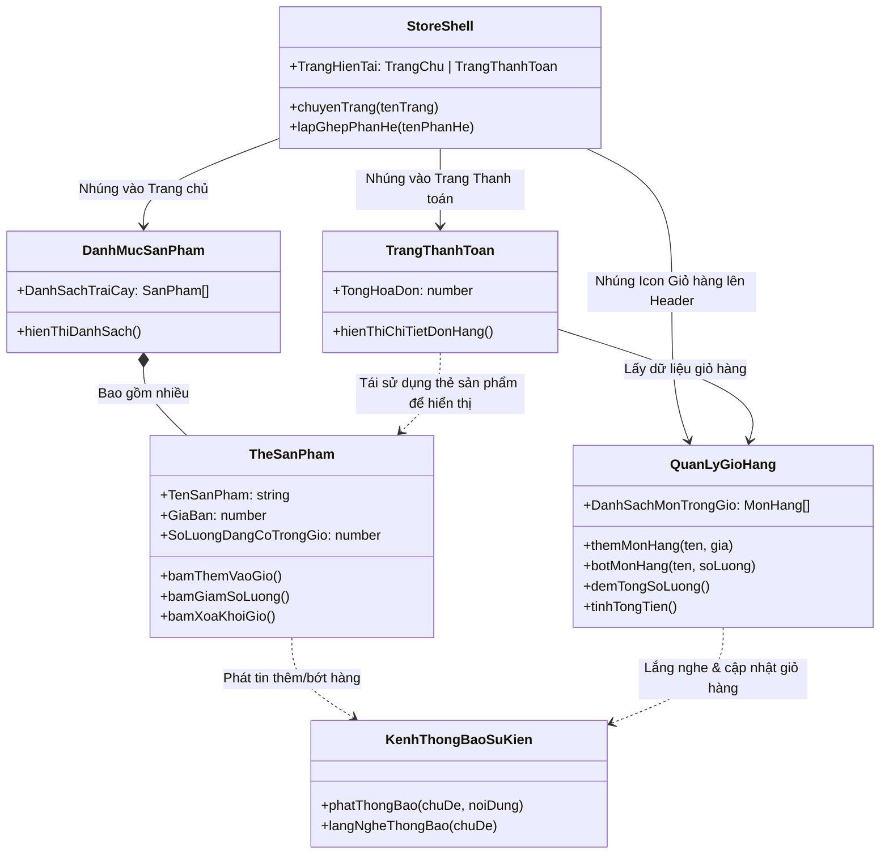
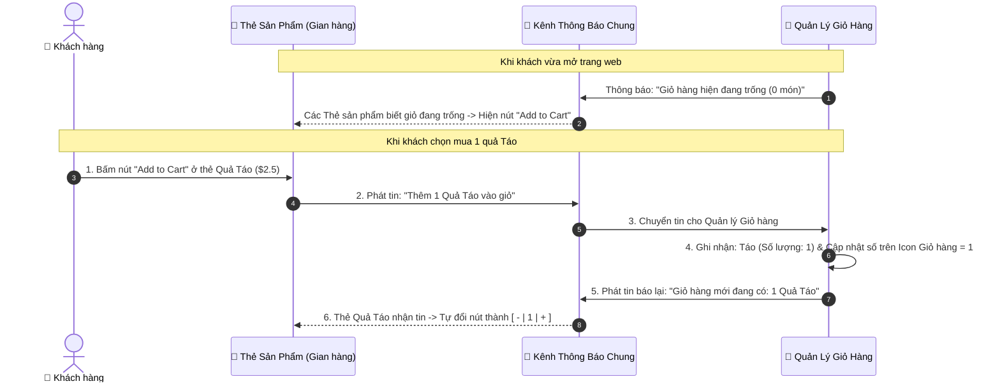

# LOGICAL VIEW: HỆ THỐNG CỬA HÀNG TRÁI CÂY (`micro-frontend-demo`)

> **Bản chất của Logical View (trong mô hình 4+1 Views):**  
> **Logical View** trả lời câu hỏi: *"Hệ thống cung cấp những chức năng gì cho người dùng? Nó được chia thành những mảng nghiệp vụ nào và các đối tượng nghiệp vụ đó quan hệ với nhau ra sao?"*  
> Góc nhìn này **tập trung hoàn toàn vào bài toán và chức năng (What)**, lược bỏ các chi tiết kỹ thuật hạ tầng (như cổng mạng, Webpack hay cú pháp code).

---

## 1. Bức Tranh Tổng Thể: Hệ Thống Được Chia Nhỏ Như Thế Nào?

Hãy hình dung hệ thống **Cửa hàng Trái cây (Fruit Store)** giống như một **Trung tâm Thương mại**:
- Thay vì một công ty tự làm tất cả mọi thứ từ sảnh chính, quầy trưng bày trái cây cho đến quầy thu ngân (kiến trúc nguyên khối - Monolith), trung tâm thương mại chia thành **3 khu vực độc lập** do 3 đội khác nhau phụ trách.
- Khách hàng bước vào chỉ thấy **một cửa hàng duy nhất liền mạch**, nhưng bên dưới là sự kết hợp của 3 phân hệ chức năng:

### Giải thích đơn giản 4 thành phần trên sơ đồ:
1. **🏠 Khung Cửa Hàng Chung (Store Shell):** Giống như tòa nhà trung tâm thương mại. Nó không trực tiếp bán trái cây và cũng không trực tiếp tính tiền. Nhiệm vụ của nó chỉ là tạo ra cái khung màn hình chung, gắn bảng hiệu **"Fruit Store"**, và chừa chỗ trống để lắp "Gian hàng" cùng "Giỏ hàng" vào.
2. **🍎 Phân Hệ Gian Hàng (Products Catalog):** Giống như quầy trưng bày trái cây. Đội phụ trách khu này chỉ lo việc hiển thị danh sách các loại quả (Táo, Chuối, Lê...), giá tiền của từng quả và nút để khách bấm **"Thêm vào giỏ"**.
3. **🛒 Phân Hệ Giỏ Hàng & Thanh Toán (Cart & Checkout):** Giống như xe đẩy hàng và quầy thu ngân. Đội phụ trách khu này chỉ lo việc đếm xem khách đã lấy bao nhiêu quả, giữ danh sách các món hàng trong giỏ và tính tổng số tiền cần thanh toán.
4. **📢 Kênh Thông Báo Chung (Event Bus):** Vì đội "Gian hàng" và đội "Giỏ hàng" làm việc độc lập (không can thiệp vào sổ sách của nhau), họ giao tiếp qua một chiếc **loa thông báo chung**:
   - Khi khách bấm mua 1 quả Táo ở *Gian hàng*, Gian hàng phát loa: *"Khách vừa thêm 1 quả Táo!"*.
   - *Giỏ hàng* nghe thấy loa thì tự động bỏ 1 quả Táo vào giỏ, cộng tổng số lượng lên, rồi phát loa báo lại: *"Trong giỏ hiện đang có 1 quả Táo nhé!"*.

---

## 2. Sơ Đồ Các Đối Tượng Nghiệp Vụ (Logical Class Diagram)

Dưới góc nhìn hướng đối tượng, mỗi phân hệ sở hữu các thực thể (Entities) và hành vi (Behaviors) rõ ràng như sau:

### 📝 Thuyết minh vai trò của từng đối tượng:
- **`StoreShell` (Khung Cửa Hàng):** Quản lý việc khách hàng đang đứng ở *Trang chủ* hay *Trang thanh toán* để hiển thị đúng phân hệ tương ứng.
- **`DanhMucSanPham` & `TheSanPham` (Thuộc phân hệ Gian hàng):**
  - Mỗi quả trái cây được biểu diễn bằng một `TheSanPham` (Thẻ sản phẩm).
  - Điểm thông minh của `TheSanPham`: Nếu món hàng chưa có trong giỏ, nó hiện nút **"Add to Cart"**. Nếu món hàng đã có trong giỏ, nó tự động đổi thành nút **`[ - | Số lượng | + ]`** để khách tăng/giảm ngay tại chỗ.
- **`QuanLyGioHang` & `TrangThanhToan` (Thuộc phân hệ Giỏ hàng):**
  - `QuanLyGioHang` là nơi duy nhất giữ danh sách các món hàng khách đã chọn, tự động tính tổng số món để hiển thị lên biểu tượng giỏ hàng ở góc trên màn hình.
  - `TrangThanhToan` liệt kê các mặt hàng trong giỏ và nhân số lượng với đơn giá để ra tổng số tiền thanh toán. Đáng chú ý, thay vì tự thiết kế lại giao diện hiển thị quả trái cây, `TrangThanhToan` **mượn luôn `TheSanPham`** của phân hệ Gian hàng sang để hiển thị.
- **`KenhThongBaoSuKien` (Trạm trung chuyển thông báo):** Đảm bảo `TheSanPham` và `QuanLyGioHang` phối hợp nhịp nhàng mà không bị phụ thuộc cứng vào nhau.

---

## 3. Kịch Bản Hoạt Động Thực Tế Của Người Dùng (Logical Scenario)

Để dễ hình dung nhất, hãy theo dõi chuyện gì xảy ra từng bước khi khách hàng bấm mua một quả Táo:

---

## 4. Tại Sao Lại Thiết Kế Theo Cấu Trúc Logic Này? (Giá Trị Mang Lại)

| Nguyên lý Thiết kế | Giải thích dễ hiểu | Lợi ích thực tế |
| :--- | :--- | :--- |
| **1. Chia để trị (Mỗi đội làm một mảng)** | Đội làm *Gian hàng* chỉ cần biết về sản phẩm; Đội làm *Giỏ hàng* chỉ cần biết cộng tiền và giữ giỏ đồ. | Hai đội có thể làm việc song song, sửa đổi giao diện riêng mà không sợ làm hỏng phần việc của đội kia. |
| **2. Không phụ thuộc trực tiếp (Giao tiếp qua Loa thông báo)** | *Gian hàng* và *Giỏ hàng* không gọi trực tiếp vào dữ liệu của nhau mà chỉ gửi tin nhắn qua *Kênh Thông Báo*. | Giống như hai phòng ban giao tiếp qua văn bản chuẩn: dù bên trong phòng *Giỏ hàng* có thay đổi cách tính toán thì *Gian hàng* vẫn hoạt động bình thường. |
| **3. Tái sử dụng chéo (Mượn thành phần của nhau)** | Ở màn hình *Thanh toán*, thay vì vẽ lại thẻ trái cây, phân hệ *Giỏ hàng* mượn luôn *Thẻ Sản Phẩm* từ phân hệ *Gian hàng*. | Giao diện đồng nhất 100%, không phải viết lặp lại cùng một chức năng ở hai nơi. |
| **4. Hỏng một phần không sập toàn bộ (Cô lập sự cố)** | *Khung Cửa Hàng* có cơ chế bảo vệ riêng cho từng khu vực. | Nếu khu vực *Giỏ hàng* chẳng may bị lỗi bảo trì, khách hàng vẫn vào xem danh sách trái cây ở *Gian hàng* bình thường mà trang web không bị sập trắng trang. |
