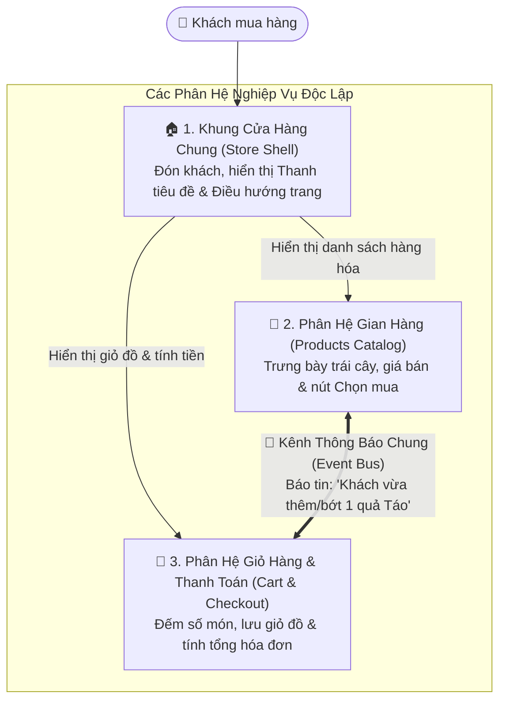
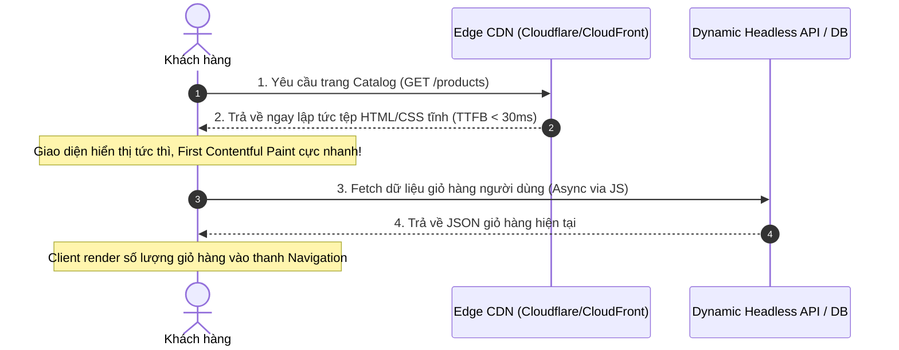

# Phần 4: Micro-Frontends & JAMstack

Thư mục này trình bày hai phong cách kiến trúc hiện đại ở tầng giao diện người dùng: **Micro-Frontends** (chia nhỏ frontend cho quy mô đội ngũ lớn với repo thực nghiệm `rautio/micro-frontend-demo`) và **JAMstack** (tối ưu hóa hiệu năng, bảo mật và chi phí hạ tầng thông qua CDN Pre-rendering).

---

## 1. Demo & Giải Thích Kiến Trúc Micro-Frontends (`micro-frontend-demo`)

### 1.1. Bản chất Kiến trúc

Thay vì xây dựng một khối Frontend nguyên khối khổng lồ (Frontend Monolith) nơi hàng trăm lập trình viên cùng chỉnh sửa một repo:
- **Micro-Frontends** chia nhỏ giao diện thành các ứng dụng web độc lập tương ứng với các Bounded Contexts:
  - **`main` (Port `9001`)**: Ứng dụng Host App Shell (Điều hướng, Header, nạp Dynamic Remotes và PubSub Event Bus).
  - **`products` (Port `9002`)**: Micro-app Danh mục sản phẩm trái cây (`ProductsList`, `ProductCard`).
  - **`cart` (Port `9003`)**: Micro-app Giỏ hàng & Thanh toán (`Cart`, `CheckoutPage`, Zustand Store).
- Từng nhóm có thể tự do phát triển, kiểm thử và triển khai độc lập lên các máy chủ/CDN riêng biệt, thậm chí thay đổi địa chỉ URL của Remote ngay tại thời điểm chạy (Runtime Dynamic Remote Containers).

> 📄 **Tài liệu Chi tiết & Toàn văn Sơ đồ:**  
> Xem toàn bộ sơ đồ Component & Package Diagram, Sequence Diagram tương tác sự kiện và bảng kết nối kiến trúc tại tệp riêng biệt:  
> 🔗 **[LOGICAL_VIEW.md](./LOGICAL_VIEW.md)**

---

### 1.2. Tổng quan Logical View (4+1 Architectural View Model)

Dưới góc nhìn chức năng & nghiệp vụ (**Logical View**), hệ thống **Cửa hàng Trái cây (Fruit Store)** được chia thành 3 khu vực độc lập giao tiếp qua một Kênh Thông Báo Chung:



> Xem đầy đủ sơ đồ lớp nghiệp vụ (Class Diagram), kịch bản mua hàng từng bước và giải thích dễ hiểu tại: **[LOGICAL_VIEW.md](./LOGICAL_VIEW.md)**.

---

### 1.3. Ba Điểm Nhấn Kỹ Thuật Trọng Tâm

1. **Cô lập Lỗi & Giao diện (Fault & UI Isolation):**
   - Mỗi Remote Component được bọc trong `ErrorBoundary` và `React.Suspense`, đảm bảo nếu một dịch vụ Remote (`PRODUCTS` hoặc `CART`) bị ngừng hoạt động, khung `MAIN` vẫn hoạt động bình thường.
   - Sử dụng Material UI (`@mui/material`) kết hợp CSS-in-JS (`@emotion/styled`, `styled-components`) giúp cô lập class CSS theo từng component.

2. **Quản lý Thư viện Dùng chung (Shared Dependencies):**
   - Cấu hình Module Federation với cơ chế `shared` (`singleton: true`, `eager: true`) cho `react` và `react-dom`:
     ```javascript
     shared: {
       ...dependencies,
       react: { eager: true, singleton: true, requiredVersion: dependencies["react"] },
       "react-dom": { eager: true, singleton: true, requiredVersion: dependencies["react-dom"] }
     }
     ```
     Trình duyệt chỉ khởi tạo duy nhất một bản thể `react` trong Shared Scope.

3. **Giao tiếp Liên Phân Hệ (Cross-MFE Communication):**
   - Sử dụng dịch vụ **PubSub (`window.fsEvents`)** kết hợp **Zustand Store (`cart/src/store/index.ts`)** với tính năng **Persisted Topics** giúp tách rời hoàn toàn trạng thái giữa `PRODUCTS` và `CART` mà vẫn đồng bộ tức thì.

---

## 2. Demo & Giải Thích Kiến Trúc JAMstack (JavaScript, APIs, Markup)

### 2.1. Bản chất Kiến trúc

- **Kiến trúc Server-Side Rendering (SSR) truyền thống:** Mỗi khi người dùng yêu cầu trang, máy chủ web (Node/PHP/Java) phải chạy logic, truy vấn cơ sở dữ liệu, render HTML rồi trả về. Khi có 100.000 người truy cập, database và server rất dễ bị quá tải.
- **JAMstack:** 
  - **Markup (HTML/CSS):** Được biên dịch sẵn (Pre-rendered) từ thời điểm build bằng cơ chế **Static Site Generation (SSG)** hoặc **Incremental Static Regeneration (ISR)** và được đẩy ra hàng trăm máy chủ **Edge CDN** trên toàn cầu.
  - **JavaScript & APIs:** Các thành phần dữ liệu động (như thông tin cá nhân hóa, giỏ hàng người dùng) được nạp bất đồng bộ từ trình duyệt thông qua các lệnh gọi API không máy chủ (Headless Serverless APIs).



---

### 2.2. Đánh Giá Hiệu Quả Kiến Trúc (So Sánh Kỹ Thuật)

| Tiêu chí | Web Truyền thống (SSR / Monolith) | Kiến trúc JAMstack (SSG + CDN) |
| :--- | :--- | :--- |
| **Time to First Byte (TTFB)** | 300ms - 1500ms (phụ thuộc tốc độ truy vấn DB). | **< 30ms - 50ms** (phục vụ từ RAM cache của Edge CDN gần nhất). |
| **Khả năng chịu tải (Traffic Spikes)** | Kém; dễ sập khi hàng chục nghìn kết nối dồn về database. | **Vô hạn**; mạng lưới CDN hấp thụ 99% lưu lượng mà máy chủ gốc không bị chạm tới. |
| **Chi phí Vận hành (Hosting Cost)** | Đắt đỏ; cần duy trì cụm server CPU cao và DB cluster liên tục. | **Cực rẻ hoặc miễn phí**; lưu trữ tệp tĩnh trên Object Storage (S3) và Cloudflare. |
| **Mức độ An toàn (Security Surface)** | Bề mặt tấn công lớn (nguy cơ dính SQLi, RCE trực tiếp trên Web server). | **An toàn tối đa**; không có database hay runtime server nào chạy sau các trang tĩnh. |

---

## 3. Danh mục tài liệu và mã nguồn trong `04-micro-frontends-jamstack/`

- 📄 **[LOGICAL_VIEW.md](./LOGICAL_VIEW.md)**: Hồ sơ tài liệu chuyên sâu về **Logical View** (Mô hình 4+1) của hệ thống Micro-Frontends.
- 📄 **[jamstack/01-BLOG_STARTER_SSG_EXPLAINED.md](./jamstack/01-BLOG_STARTER_SSG_EXPLAINED.md)**: Giải thích cơ chế tạo file tĩnh (SSG) từ dữ liệu Markdown & Template dựa trên repo `vercel/next.js/examples/blog-starter`.
- 📄 **[jamstack/02-SCRIPTHAMMER_OAUTH_AND_AUTH_PROCESS_VIEW.md](./jamstack/02-SCRIPTHAMMER_OAUTH_AND_AUTH_PROCESS_VIEW.md)**: Phân tích kết nối API từ Static Site, sơ đồ **Process View** của Google OAuth (PKCE), cơ chế Backend nhận diện Frontend và quy trình đăng nhập dựa trên repo `TortoiseWolfe/ScriptHammer`.
- 📂 `micro-frontend-demo/`: Mã nguồn cụm Micro-Frontends (Turborepo + Webpack 5 Module Federation):
  - `main/`: Host App Shell chạy tại `http://localhost:9001`.
  - `products/`: Remote Catalog MFE chạy tại `http://localhost:9002`.
  - `cart/`: Remote Cart & Checkout MFE chạy tại `http://localhost:9003`.
- 📂 `jamstack/`: Mã nguồn thực nghiệm JAMstack:
  - `blog-starter/`: Dự án Next.js Blog Starter (SSG từ file Markdown `_posts/*.md`).
  - `ScriptHammer/`: Dự án Static Export (`output: 'export'`) kết nối Headless Backend Supabase (OAuth, PKCE, E2EE).
  - `static-site/` & `serverless-apis/`: Mô hình đo đạc hiệu năng TTFB.
- 📜 `demo-mfe-and-jamstack.js`: Script Node.js tự động kiểm chứng Module Federation và đo đạc TTFB.
