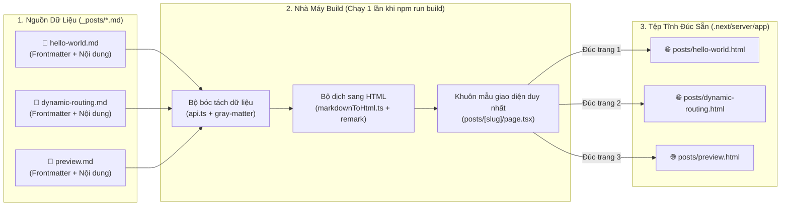
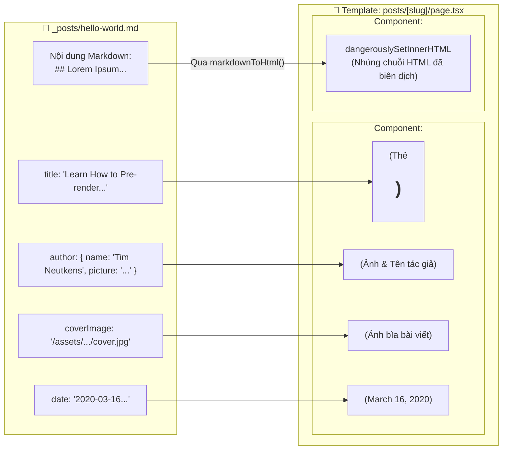

# PHẦN 4.2A: CƠ CHẾ TẠO FILE TĨNH (SSG) TỪ DỮ LIỆU MARKDOWN & TEMPLATE TRONG JAMSTACK (`blog-starter`)

> 📌 **KHỐI TRÍCH DẪN NGUỒN MÃ NGUỒN (CÓ THỂ LƯỢC BỎ KHI HOÀN THIỆN BÁO CÁO)**
> - **Repository gốc:** [vercel/next.js — `examples/blog-starter` (Commit `ddb5b049`)](https://github.com/vercel/next.js/tree/ddb5b04950f776e155f19ed504648b4d5bd6d332/examples/blog-starter)
> - **Thư mục tại máy cục bộ:** [jamstack/blog-starter](./blog-starter)
> - **Các tệp mã nguồn được trích dẫn trực tiếp trong tài liệu này:**
>   1. **Dữ liệu gốc (Markdown Data):** [_posts/hello-world.md](./blog-starter/_posts/hello-world.md), [_posts/dynamic-routing.md](./blog-starter/_posts/dynamic-routing.md), [_posts/preview.md](./blog-starter/_posts/preview.md)
>   2. **Định nghĩa kiểu dữ liệu (Data Schema):** [src/interfaces/post.ts](./blog-starter/src/interfaces/post.ts#L1-L15)
>   3. **Bộ đọc & tách dữ liệu Markdown (`gray-matter`):** [src/lib/api.ts](./blog-starter/src/lib/api.ts#L1-L28)
>   4. **Bộ biên dịch Markdown sang HTML (`remark`):** [src/lib/markdownToHtml.ts](./blog-starter/src/lib/markdownToHtml.ts#L1-L7)
>   5. **Khung mẫu giao diện (Templates & Layouts):** [src/app/layout.tsx](./blog-starter/src/app/layout.tsx#L20-L69), [src/app/page.tsx](./blog-starter/src/app/page.tsx#L7-L30), [src/app/posts/[slug]/page.tsx](./blog-starter/src/app/posts/%5Bslug%5D/page.tsx#L12-L72)
>   6. **Các Component hiển thị:** [src/app/_components/post-header.tsx](./blog-starter/src/app/_components/post-header.tsx#L14-L34), [src/app/_components/post-body.tsx](./blog-starter/src/app/_components/post-body.tsx#L7-L16)

---

## 1. Câu Hỏi Trọng Tâm: Trong JAMstack, Làm Sao Từ Các File Markdown Lại Tạo Ra Được Trang Web Hoàn Chỉnh?

Trong kiến trúc web truyền thống (như WordPress hay PHP/Node.js SSR), mỗi bài viết được lưu trong cơ sở dữ liệu (MySQL/PostgreSQL). Khi có người vào đọc, máy chủ mới truy vấn database rồi ghép vào giao diện.

Ngược lại, chữ **M (Markup)** trong **JAMstack** hoạt động theo nguyên lý **Đúc sẵn tại thời điểm Build (Static Site Generation - SSG)** giống như một **nhà máy in báo**:
1. **Nguyên liệu thô (Data):** Là các tệp văn bản `.md` nằm trong thư mục `_posts/`. Mỗi tệp `.md` chính là một "bản ghi dữ liệu" của một bài báo.
2. **Khuôn in (Template):** Là các tệp giao diện `.tsx` (như `posts/[slug]/page.tsx`). Bạn chỉ cần thiết kế **1 khuôn mẫu duy nhất**.
3. **Dây chuyền lắp ráp (Build Process):** Khi chạy lệnh `npm run build`, hệ thống tự động quét toàn bộ thư mục `_posts/`, đọc từng file `.md`, đổ dữ liệu vào khuôn `[slug]/page.tsx` để **in ra sẵn hàng loạt tệp `.html` tĩnh hoàn chỉnh** trước khi đưa lên mạng (CDN).



---

## 2. Giải Phẫu Một File Markdown: Tại Sao Nó Là "Cơ Sở Dữ Liệu" Của Trang Web?

> *Trích dẫn mã nguồn: [_posts/hello-world.md](./blog-starter/_posts/hello-world.md#L1-L19)*

Nếu mở file `_posts/hello-world.md`, bạn sẽ thấy nó không chỉ là văn bản thuần túy mà được chia làm **2 phần tách biệt**:

```markdown
---
title: "Learn How to Pre-render Pages Using Static Generation with Next.js"
excerpt: "Lorem ipsum dolor sit amet, consectetur adipiscing elit..."
coverImage: "/assets/blog/hello-world/cover.jpg"
date: "2020-03-16T05:35:07.322Z"
author:
  name: Tim Neutkens
  picture: "/assets/blog/authors/tim.jpeg"
ogImage:
  url: "/assets/blog/hello-world/cover.jpg"
---

Lorem ipsum dolor sit amet, consectetur adipiscing elit...

## Lorem Ipsum

Tristique senectus et netus et malesuada fames ac turpis...
```

### Ý nghĩa của 2 phần này:
1. **Phần Đầu — YAML Frontmatter (Nằm giữa 2 dấu `---`):**
   - Đóng vai trò y hệt như **các cột trong bảng Cơ sở dữ liệu (Database Columns)**.
   - Chứa các thuộc tính có cấu trúc (`key: value`): Tiêu đề bài viết (`title`), Tóm tắt (`excerpt`), Ảnh bìa (`coverImage`), Ngày đăng (`date`), Thông tin tác giả (`author.name`, `author.picture`).
   - Tên của chính tệp tin (`hello-world.md` $\rightarrow$ bỏ đuôi `.md` thành `hello-world`) đóng vai trò là **Khóa chính / Đường dẫn URL (`slug`)**.
2. **Phần Thân — Markdown Body (Nằm dưới dấu `---` thứ hai):**
   - Là nội dung chính của bài viết, viết bằng ký hiệu Markdown (`##` là tiêu đề phụ, đoạn văn...).

---

## 3. Dây Chuyền 4 Bước Biến File Markdown Thành Trang HTML Tĩnh

Dưới đây là quy trình chính xác diễn ra bên trong mã nguồn `blog-starter` khi thực hiện lệnh Build:

### Bước 1: Quét thư mục và bóc tách Frontmatter bằng `gray-matter`
> *Trích dẫn mã nguồn: [src/lib/api.ts](./blog-starter/src/lib/api.ts#L6-L19)*

Trong tệp `src/lib/api.ts`, hệ thống dùng thư viện `fs` của Node.js để đọc tệp `.md` trên ổ cứng và dùng thư viện **`gray-matter`** để chẻ đôi tệp Markdown:

```typescript
const postsDirectory = join(process.cwd(), "_posts");

export function getPostBySlug(slug: string) {
  const realSlug = slug.replace(/\.md$/, "");
  const fullPath = join(postsDirectory, `${realSlug}.md`);
  const fileContents = fs.readFileSync(fullPath, "utf8");
  
  // gray-matter tách riêng phần YAML (data) và phần nội dung bài viết (content)
  const { data, content } = matter(fileContents);

  return { ...data, slug: realSlug, content } as Post;
}
```
- **`data`**: Nhận được đối tượng JSON `{ title: "Learn How to...", date: "2020-03-16...", author: { name: "Tim Neutkens", ... } }`.
- **`content`**: Nhận được chuỗi văn bản Markdown phía dưới.

---

### Bước 2: Biên dịch nội dung Markdown sang thẻ HTML bằng `remark`
> *Trích dẫn mã nguồn: [src/lib/markdownToHtml.ts](./blog-starter/src/lib/markdownToHtml.ts#L1-L7)*

Trình duyệt web không hiểu trực tiếp ký hiệu `## Lorem Ipsum` của Markdown, mà chỉ hiểu thẻ `<h2>Lorem Ipsum</h2>` của HTML. Do đó, tệp `src/lib/markdownToHtml.ts` chuyển đổi chuỗi Markdown thành chuỗi thẻ HTML:

```typescript
import { remark } from "remark";
import html from "remark-html";

export default async function markdownToHtml(markdown: string) {
  const result = await remark().use(html).process(markdown);
  return result.toString(); // Trả về chuỗi "<p>Lorem ipsum...</p><h2>Lorem Ipsum</h2>..."
}
```

---

### Bước 3: Liệt kê danh sách các trang cần đúc sẵn (`generateStaticParams`)
> *Trích dẫn mã nguồn: [src/app/posts/[slug]/page.tsx](./blog-starter/src/app/posts/%5Bslug%5D/page.tsx#L66-L72)*

Làm sao Next.js biết trong thư mục `_posts/` có bao nhiêu bài viết để tạo ra bấy nhiêu trang HTML? Câu trả lời nằm ở hàm `generateStaticParams()` cuối tệp `src/app/posts/[slug]/page.tsx`:

```typescript
export async function generateStaticParams() {
  const posts = getAllPosts();

  return posts.map((post) => ({
    slug: post.slug,
  }));
}
```
- Hàm này trả về danh sách 3 slug: `[{ slug: "hello-world" }, { slug: "dynamic-routing" }, { slug: "preview" }]`.
- Nhờ đó, trình biên dịch biết nó cần gọi khuôn mẫu `Post` đúng **3 lần** để tạo ra 3 tệp HTML tương ứng.

---

### Bước 4: Đổ dữ liệu vào Khuôn Mẫu (Template) để xuất ra File HTML
> *Trích dẫn mã nguồn: [src/app/posts/[slug]/page.tsx](./blog-starter/src/app/posts/%5Bslug%5D/page.tsx#L12-L39), [post-header.tsx](./blog-starter/src/app/_components/post-header.tsx#L14-L33), [post-body.tsx](./blog-starter/src/app/_components/post-body.tsx#L7-L15)*

Với mỗi `slug`, khuôn mẫu `src/app/posts/[slug]/page.tsx` lắp ghép phần `data` vào `PostHeader` và phần `content` (đã dịch sang HTML) vào `PostBody`:

```tsx
export default async function Post(props: Params) {
  const params = await props.params;
  const post = getPostBySlug(params.slug); // 1. Lấy dữ liệu từ file .md

  const content = await markdownToHtml(post.content || ""); // 2. Dịch nội dung sang HTML

  // 3. Lắp vào khuôn giao diện (Template)
  return (
    <main>
      <Alert preview={post.preview} />
      <Container>
        <Header />
        <article className="mb-32">
          <PostHeader
            title={post.title}
            coverImage={post.coverImage}
            date={post.date}
            author={post.author}
          />
          <PostBody content={content} />
        </article>
      </Container>
    </main>
  );
}
```

#### Sơ đồ Ánh xạ từ File Markdown sang Khuôn Mẫu Giao Diện (Template Mapping):



---

## 4. Bằng Chứng Thực Nghiệm Khi Chạy `npm run build` Trên Repo `blog-starter`

Khi chạy lệnh `npm run build` trực tiếp trong thư mục [jamstack/blog-starter](./blog-starter), trình biên dịch Next.js in ra bảng kết quả đúc trang tĩnh (SSG):

```text
Route (app)
┌ ○ /
├ ○ /_not-found
└   /posts/[slug]
  ├ ● /posts/dynamic-routing
  ├ ● /posts/hello-world
  └ ● /posts/preview

○  (Static)  prerendered as static content
●  (SSG)     prerendered as static HTML (uses generateStaticParams)
```

Kiểm tra bên trong thư mục đầu ra `.next/server/app/`, ta thấy **4 tệp `.html` vật lý** đã được đúc sẵn từ 3 tệp `.md`:
- [.next/server/app/index.html](./blog-starter/.next/server/app/index.html) (`24,228 bytes`) — Trang chủ danh sách bài viết.
- [.next/server/app/posts/hello-world.html](./blog-starter/.next/server/app/posts/hello-world.html) (`22,436 bytes`) — Được đúc từ `_posts/hello-world.md`.
- [.next/server/app/posts/dynamic-routing.html](./blog-starter/.next/server/app/posts/dynamic-routing.html) (`22,169 bytes`) — Được đúc từ `_posts/dynamic-routing.md`.
- [.next/server/app/posts/preview.html](./blog-starter/.next/server/app/posts/preview.html) (`22,060 bytes`) — Được đúc từ `_posts/preview.md`.

---

## 5. Tóm Tắt Giá Trị Cốt Lõi Của Mô Hình Này

| Khía cạnh | Cách hoạt động trong `blog-starter` (JAMstack SSG) | Ý nghĩa thực tế |
| :--- | :--- | :--- |
| **1. Tách biệt Nội dung & Giao diện** | Người viết bài chỉ cần tạo file `.md` mới trong `_posts/`. Lập trình viên chỉ sửa giao diện ở `src/app/`. | Thêm 100 bài viết mới chỉ cần thêm 100 file `.md`, không phải viết thêm bất kỳ dòng code giao diện nào. |
| **2. Chi phí xử lý lúc chạy = 0** | Toàn bộ việc đọc file (`fs.readFileSync`), tách YAML (`gray-matter`) và dịch HTML (`remark`) **chỉ diễn ra đúng 1 lần lúc Build**. | Khi người dùng truy cập web, máy chủ chỉ trả về file `.html` có sẵn với tốc độ tính bằng mili-giây. |
| **3. Bảo mật tuyệt đối** | Không có cơ sở dữ liệu MySQL/MongoDB nào mở cổng trên Internet khi trang web vận hành. | Hacker không thể tấn công SQL Injection hay đánh sập Database khi lượng truy cập tăng đột biến. |
