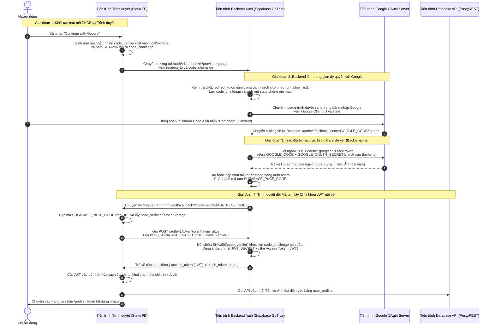
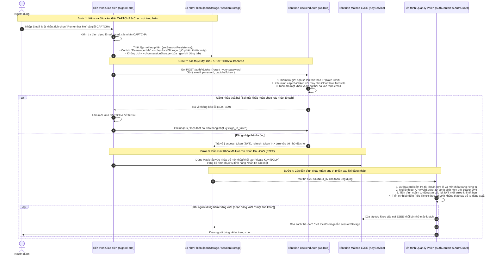
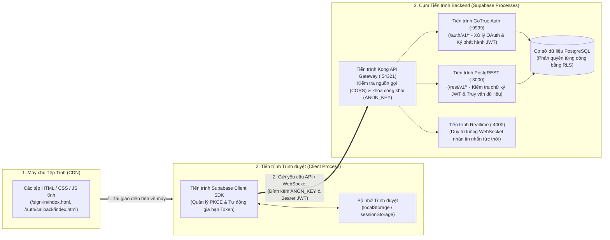
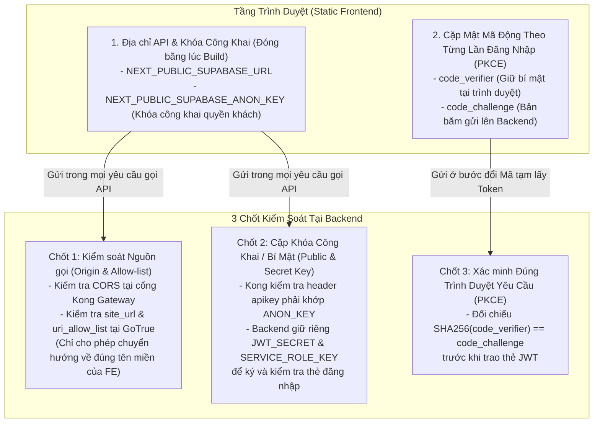

# PROCESS VIEW: KẾT NỐI API TỪ STATIC SITE & LUỒNG ĐĂNG NHẬP OAUTH (`ScriptHammer`)

> 📌 **KHỐI TRÍCH DẪN NGUỒN MÃ NGUỒN (CÓ THỂ LƯỢC BỎ KHI HOÀN THIỆN BÁO CÁO)**
> - **Repository gốc:** [TortoiseWolfe/ScriptHammer](https://github.com/TortoiseWolfe/ScriptHammer.git)
> - **Thư mục tại máy cục bộ:** [./ScriptHammer](./ScriptHammer)
> - **Các tệp mã nguồn được trích dẫn trực tiếp trong tài liệu này:**
>   1. **Cấu hình xuất Static Site (`output: 'export'`):** [next.config.ts](./ScriptHammer/next.config.ts#L42-L49)
>   2. **Khởi tạo kết nối API & PKCE Flow ở trình duyệt:** [src/lib/supabase/client.ts](./ScriptHammer/src/lib/supabase/client.ts#L95-L347)
>   3. **Nút khởi tạo đăng nhập Google/GitHub OAuth:** [src/components/auth/OAuthButtons/OAuthButtons.tsx](./ScriptHammer/src/components/auth/OAuthButtons/OAuthButtons.tsx#L21-L88)
>   4. **Trang hứng kết quả trả về `/auth/callback`:** [src/app/auth/callback/page.tsx](./ScriptHammer/src/app/auth/callback/page.tsx#L18-L96)
>   5. **Kiểm duyệt URL nhận mã PKCE & chống Login CSRF:** [src/lib/auth/url-session.ts](./ScriptHammer/src/lib/auth/url-session.ts#L1-L113)
>   6. **Đồng bộ thông tin Google/GitHub vào bảng `user_profiles`:** [src/lib/auth/oauth-utils.ts](./ScriptHammer/src/lib/auth/oauth-utils.ts#L27-L165)
>   7. **Cấu hình Origin, Allow-list & OAuth Secrets ở Backend:** [scripts/supabase/auth-config.json](./ScriptHammer/scripts/supabase/auth-config.json#L1-L24), [scripts/supabase/set-auth-config.ts](./ScriptHammer/scripts/supabase/set-auth-config.ts#L139-L165), [docker/supabase/kong.yml](./ScriptHammer/docker/supabase/kong.yml#L21-L100), [docker-compose.yml](./ScriptHammer/docker-compose.yml#L260-L350)
>   8. **Đăng nhập Email/Password, CAPTCHA, E2EE Key & Quản lý Phiên:** [src/components/auth/SignInForm/SignInForm.tsx](./ScriptHammer/src/components/auth/SignInForm/SignInForm.tsx#L34-L195), [src/contexts/AuthContext.tsx](./ScriptHammer/src/contexts/AuthContext.tsx#L90-L360), [src/components/auth/AuthGuard/AuthGuard.tsx](./ScriptHammer/src/components/auth/AuthGuard/AuthGuard.tsx#L23-L50)

---

> **Bản chất của Process View (trong mô hình 4+1 Views):**  
> **Process View** mô tả **luồng thực thi động theo thời gian thực (Runtime Behavior)** giữa các tiến trình (Processes) độc lập: Tiến trình Trình duyệt của người dùng (Browser Client), Tiến trình Cổng API (Kong Gateway), Tiến trình Máy chủ Xác thực (GoTrue Auth), Tiến trình Máy chủ Google OAuth và Tiến trình Cơ sở dữ liệu (PostgREST/PostgreSQL).

---

## 1. PROCESS VIEW 1: Luồng Tiến Trình Đăng Nhập Bằng Google OAuth (PKCE Flow)

> *Trích dẫn: [OAuthButtons.tsx](./ScriptHammer/src/components/auth/OAuthButtons/OAuthButtons.tsx#L25-L37), [client.ts](./ScriptHammer/src/lib/supabase/client.ts#L307-L318), [auth/callback/page.tsx](./ScriptHammer/src/app/auth/callback/page.tsx#L27-L81)*

Khi người dùng bấm nút **"Continue with Google"** trên trang tĩnh `ScriptHammer`, 4 tiến trình độc lập (`Browser Client`, `Supabase Auth BE`, `Google OAuth Server`, `Database API`) phối hợp tuần tự qua 4 giai đoạn như sau:

---

## 2. PROCESS VIEW 2: Luồng Tiến Trình Đăng Nhập Thường (Email/Password) & Duy Trì Phiên

> *Trích dẫn: [SignInForm.tsx](./ScriptHammer/src/components/auth/SignInForm/SignInForm.tsx#L68-L195), [AuthContext.tsx](./ScriptHammer/src/contexts/AuthContext.tsx#L126-L355), [AuthGuard.tsx](./ScriptHammer/src/components/auth/AuthGuard/AuthGuard.tsx#L23-L50)*

Sơ đồ dưới đây thể hiện luồng tiến trình khi người dùng đăng nhập bằng **Email + Mật khẩu** trong `ScriptHammer`, nối tiếp bằng các tiến trình chạy ngầm duy trì phiên làm việc (Tạo khóa mã hóa tin nhắn E2EE, Tự động làm mới thẻ JWT trước khi hết hạn, Đếm ngược 24h không tương tác và Đồng bộ đăng xuất giữa các Tab):

---

## 3. Sơ Đồ Các Tiến Trình Hoạt Động Khi Kết Nối Từ Static Site Đến Backend

> *Trích dẫn: [next.config.ts](./ScriptHammer/next.config.ts#L42-L49) & [docker/supabase/kong.yml](./ScriptHammer/docker/supabase/kong.yml#L39-L120)*

Vì `ScriptHammer` được xuất ra thành các tệp tĩnh (`output: 'export'`), không có máy chủ Node.js nào đứng giữa trình duyệt và Backend. Toàn bộ quá trình giao tiếp diễn ra trực tiếp giữa **Tiến trình Trình duyệt** và **Cụm Tiến trình Backend Supabase** qua cổng Kong API Gateway:

---

## 4. Giải Thích Chi Tiết Các Câu Hỏi Kiến Trúc

### 4.1. Vì sao phải đi qua Backend (BE) để kết nối OAuth mà KHÔNG để trình duyệt (FE) gọi thẳng Google rồi lấy chìa khóa luôn?

Có **3 lý do cốt lõi**:

1. **Giao diện tĩnh (Static FE) không thể cất giữ mật khẩu ứng dụng (`GOOGLE_OAUTH_SECRET`):**
   - *Trích dẫn: [scripts/supabase/set-auth-config.ts](./ScriptHammer/scripts/supabase/set-auth-config.ts#L139-L165)*
   - Khi làm việc với Google OAuth, ứng dụng có 2 thông số: `Client ID` (công khai) và `Client Secret` (`GOOGLE_OAUTH_SECRET` — bí mật tuyệt đối).
   - Trong kiến trúc JAMstack, toàn bộ mã nguồn Frontend được tải về máy tính của người dùng. Nếu nhúng `GOOGLE_OAUTH_SECRET` vào Frontend, bất kỳ ai nhấn `F12` đều lấy cắp được mật khẩu này để mạo danh hệ thống của bạn. Vì vậy, bắt buộc phải để tiến trình Backend (`GoTrue`) giữ `GOOGLE_OAUTH_SECRET` và gọi ngầm lên Google ở **Giai đoạn 3** trong sơ đồ Process View 1.

2. **Thẻ chứng nhận của Google không mở khóa được Cơ sở dữ liệu của hệ thống bạn:**
   - *Trích dẫn: [docker-compose.yml](./ScriptHammer/docker-compose.yml#L282) (`GOTRUE_JWT_SECRET`) & `#L346` (`PGRST_JWT_SECRET`)*
   - Google chỉ xác nhận giúp bạn: *"Người dùng này đúng là chủ tài khoản `abc@gmail.com`"*.
   - Nhưng cơ sở dữ liệu PostgreSQL của bạn lại phân quyền truy cập dựa trên **Thẻ JWT nội bộ** do chính hệ thống của bạn đóng dấu bằng con dấu bí mật `JWT_SECRET` (chứa mã định danh `user.id` nội bộ và quyền `role: authenticated`). Google không hề có con dấu `JWT_SECRET` này. Do đó, phải đi qua Backend để Backend nhận xác nhận từ Google $\rightarrow$ tra cứu người dùng trong Database $\rightarrow$ **đóng dấu cấp thẻ JWT nội bộ** trả về cho trình duyệt.

3. **Ngăn chặn kẻ gian đánh cắp chìa khóa trên thanh địa chỉ trình duyệt (Chống Login CSRF & Lộ Token):**
   - *Trích dẫn bình luận kỹ thuật `#1255`: [src/lib/auth/url-session.ts](./ScriptHammer/src/lib/auth/url-session.ts#L1-L19) & [src/lib/supabase/client.ts](./ScriptHammer/src/lib/supabase/client.ts#L307-L318)*
   - Nếu trả thẳng chìa khóa (`#access_token=...`) trên thanh địa chỉ URL khi chuyển hướng về trình duyệt:
     - Chìa khóa sẽ lưu lại trong Lịch sử duyệt web (Browser History) và dễ bị lộ qua các công cụ theo dõi.
     - Kẻ tấn công có thể gắn chìa khóa của chúng vào một đường link rồi lừa người dùng bấm vào (tấn công **Login CSRF**).
   - Khi đi qua Backend bằng quy trình **PKCE** (Giai đoạn 1 & 4 ở Process View 1): Đường dẫn trả về chỉ chứa một mã tạm `?code=...`. Mã này chỉ đổi được ra chìa khóa thật khi kết hợp với mật mã gốc `code_verifier` đang nằm trong `localStorage` của chính trình duyệt đã bấm nút đăng nhập ban đầu.

---

### 4.2. Backend (BE) nhận biết và kiểm soát Frontend (FE) bằng cách nào? (Set Origin? Public/Private Key? Hardcode API?)

Hệ thống `ScriptHammer` kết hợp đồng thời cả **3 cơ chế** để Backend nhận diện và kiểm soát chặt chẽ Frontend:

| Câu hỏi | Cách thực hiện trong `ScriptHammer` | Giải thích dễ hiểu |
| :--- | :--- | :--- |
| **1. Có giới hạn Origin / URL nhất định không?** | **CÓ.** Cấu hình tại [scripts/supabase/auth-config.json](./ScriptHammer/scripts/supabase/auth-config.json#L2-L3): - `site_url`: `"https://scripthammer.com"` - `uri_allow_list`: Chỉ liệt kê đúng tên miền chính thức của FE (`https://scripthammer.com/**`, `http://localhost:3000/**`). | Nếu một trang web lạ (`trang-gia-mao.com`) cố tình gọi vào Backend của bạn để xin đăng nhập Google và yêu cầu trả kết quả về `trang-gia-mao.com`, Backend kiểm tra thấy không nằm trong `uri_allow_list` sẽ **từ chối ngay lập tức**. |
| **2. Dùng cơ chế Public / Private Key như thế nào?** | **CÓ.** Cấu hình tại [.env.local-supabase](./ScriptHammer/.env.local-supabase#L27-L28) & [docker/supabase/kong.yml](./ScriptHammer/docker/supabase/kong.yml#L21-L83): - **Public Key (`NEXT_PUBLIC_SUPABASE_ANON_KEY`):** Giao cho Frontend cầm để trình diện tại cổng Kong Gateway (xác nhận đây là khách hợp lệ, `role: anon`). - **Private/Secret Key (`JWT_SECRET` & `SERVICE_ROLE_KEY`):** Cất giữ tuyệt mật ở Backend để đóng dấu (sign) thẻ `access_token` cho người dùng sau khi đăng nhập. | Giống như **Vé vào cổng khu vui chơi (`ANON_KEY`)** ai cũng thấy được để bước qua cổng bảo vệ, nhưng chỉ có **Con dấu mật của Ban quản lý (`JWT_SECRET`)** ở trong phòng kín mới đóng dấu cấp **Thẻ VIP (`access_token`)** cho từng tài khoản. |
| **3. Có Hardcode API vào Frontend không?** | **Đóng băng từ Biến môi trường lúc Build.** Xem tại [src/lib/supabase/client.ts](./ScriptHammer/src/lib/supabase/client.ts#L280-L299): - Không gõ cứng địa chỉ URL trong code, mà đọc từ biến `NEXT_PUBLIC_SUPABASE_URL`. Khi chạy lệnh `next build` tạo file tĩnh, địa chỉ API và `ANON_KEY` sẽ được gắn vào gói JavaScript tĩnh. - Nếu chưa gắn API, hàm `createDisabledClient()` sẽ tự chạy chế độ mô phỏng để giao diện không bị lỗi. | Giúp bạn dùng chung 1 bộ code cho nhiều môi trường: lúc chạy ở máy cá nhân thì trỏ về `localhost:54321`, lúc đưa lên mạng thì trỏ về máy chủ Cloud thật. |
