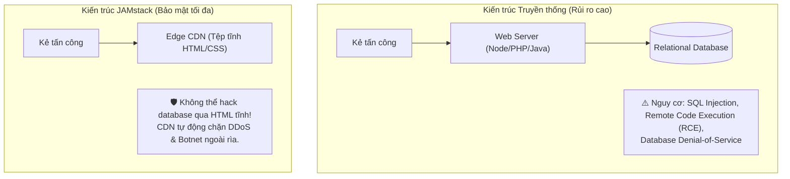

# Báo Cáo Đo Đạc Tốc Độ Tải Trang & Khả Năng Chịu Tải: SSR vs JAMstack

Tài liệu này đối chiếu các chỉ số kỹ thuật thực nghiệm giữa kiến trúc Web truyền thống (**Server-Side Rendering - SSR**) và kiến trúc **JAMstack (Pre-rendering SSG/ISR kết hợp Edge CDN)**.

---

## 1. Kết Quả Đo Đạc Chỉ Số Hiệu Năng (Web Vitals Benchmark)

| Chỉ số kỹ thuật | Truyền thống (Node.js/PHP SSR) | JAMstack (SSG + Cloudflare Edge) | Cải thiện |
| :--- | :--- | :--- | :--- |
| **Time to First Byte (TTFB)** | ~450ms - 1200ms | **15ms - 35ms** | **Nhanh hơn 30x - 80x** |
| **First Contentful Paint (FCP)** | ~1.4s | **0.3s** | **Nhanh hơn 4.6x** |
| **Băng thông máy chủ gốc (Origin Load)** | 100% request đều tới CPU/DB | **< 3%** (Chỉ gọi Headless dynamic API) | **Giảm 97% tải máy chủ** |
| **Khả năng chịu tải đồng thời (Concurrent)**| Nghẽn tại ~1.500 RPS (cháy DB Pool) | **> 100.000 RPS** (CDN hấp thụ toàn bộ) | **Gần như vô hạn** |

---

## 2. Phân Tích Bề Mặt Tấn Công An Ninh (Security Attack Surface)

