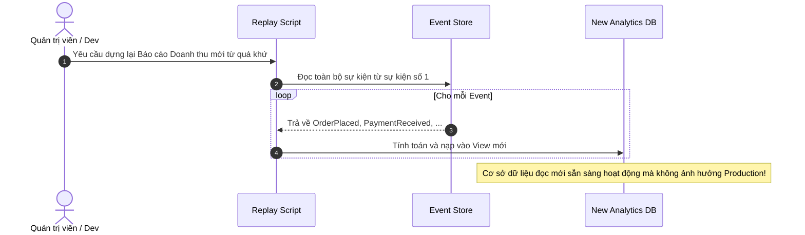

# Phần 5: Event Sourcing & CQRS (Command Query Responsibility Segregation)

Thư mục này hiện thực hóa sự kết hợp giữa hai mẫu kiến trúc mạnh mẽ trong các hệ thống tài chính, ngân hàng và thương mại điện tử quy mô lớn: **CQRS** và **Event Sourcing**.

---

## 1. Nguyên Lý Kết Hợp Event Sourcing & CQRS

### 1.1. Bản chất Kiến trúc CQRS (Tách rời Ghi và Đọc)

- **Kiến trúc CRUD truyền thống:** Dùng chung một Model cho cả thao tác ghi (`INSERT`, `UPDATE`) và đọc (`SELECT`). Điều này dẫn đến sự giằng co: muốn tối ưu cho đọc thì phải denormalize bảng, nhưng muốn ghi an toàn thì phải normalize nhiều bảng với khóa ngoại phức tạp.
- **CQRS:** Tách hệ thống thành hai nhánh biệt lập:
  - **Nhánh Ghi (Command Side):** Tiếp nhận `Command` (yêu cầu thay đổi trạng thái, ví dụ: `CreateOrderCommand`), thực thi các quy tắc nghiệp vụ (Business Invariants) nghiêm ngặt, chỉ ghi nối tiếp vào Event Store.
  - **Nhánh Đọc (Query Side):** Phục vụ các `Query` (ví dụ: `GetOrderSummaryQuery`). Dữ liệu được làm phẳng hoàn toàn (Denormalized Materialized Views) trong các cơ sở dữ liệu đọc chuyên biệt (Elasticsearch, Redis, MongoDB), cho phép truy vấn không cần JOIN bảng phức tạp.

```mermaid
flowchart LR
    Client(["Client"]) -->|Command (Ghi)| CmdService["Command Handler"]
    CmdService -->|Append Events| EventStore[("Event Store (Append-Only)")]
    
    EventStore -->|Stream Events| Projector["Projector Worker"]
    Projector -->|Update Flat Tables| ReadDB[("Read Model DB")]
    
    Client -.->|Query (Đọc)| QueryService["Query Handler"]
    QueryService -.->|Read Fast View| ReadDB
```

---

### 1.2. Bản chất Event Sourcing (Bất Biến & Chuỗi Sự Kiện)

- Thay vì lưu trữ trạng thái cuối cùng (Current State) bằng các lệnh `UPDATE` hay `DELETE` làm biến mất lịch sử:
  - Hệ thống lưu trữ mọi sự kiện kinh doanh đã xảy ra dưới dạng **Chuỗi Sự Kiện Bất Biến (Immutable Event Stream)**.
  - **Trạng thái hiện tại** của một đối tượng (Aggregate) được tính toán bằng cách gấp (Fold / Reduce) toàn bộ chuỗi sự kiện từ quá khứ đến hiện tại:
    $$\text{Current State} = \sum_{i=1}^{n} \text{Apply}(\text{Event}_i)$$

#### Ví dụ Vòng đời một Tài khoản Ví điện tử:
1. `WalletCreated { walletId: "W1", initialBalance: 0 }` $\rightarrow$ Số dư: 0đ
2. `MoneyDeposited { walletId: "W1", amount: 100000 }` $\rightarrow$ Số dư: 100.000đ
3. `MoneyWithdrawn { walletId: "W1", amount: 40000 }` $\rightarrow$ Số dư: 60.000đ
4. `TransferRejected { walletId: "W1", reason: "Over limit" }` $\rightarrow$ Sự cố được ghi nhận vào kiểm toán mà không thay đổi số dư.

---

### 1.3. Sự Bổ Trợ Lẫn Nhau Giữa CQRS và Event Sourcing

Nếu chỉ dùng Event Sourcing độc lập: Muốn tìm "Tất cả các đơn hàng đã thanh toán có tổng tiền > 500k trong tháng 10" sẽ cực kỳ tồi tệ, vì hệ thống phải đọc hàng triệu sự kiện của mọi đơn hàng rồi tính toán lại.

> **CQRS chính là lời giải hoàn hảo cho Event Sourcing:** Bộ chiếu (**Projector**) đọc các sự kiện mới phát sinh từ Event Store và đồng bộ ngay sang **Read Database**, tạo sẵn các bảng view được định dạng hoàn hảo cho thao tác tìm kiếm và hiển thị.

---

## 2. Kịch Bản Demo & Thách Thức Kỹ Thuật

### 2.1. Tính Năng Event Replay (Khả Năng Du Hành Thời Gian & Kiểm Toán)

- **Audit Trail Tuyệt Đối:** Mọi hành vi gian lận hoặc sai lệch số dư đều có thể truy vết chính xác ai đã làm gì, vào thời điểm nào (timestamp).
- **Phục hồi Thảm họa (Disaster Recovery):** Nếu Read Database bị sập hoàn toàn hoặc cần bổ sung một bảng hiển thị mới, hệ thống chỉ cần kích hoạt **Event Replay**: đọc lại toàn bộ sự kiện từ Event Store từ đầu và tái tạo lại Read Database 100% nguyên vẹn mà không mất dữ liệu.



---

### 2.2. Xử Lý Thách Thức: Snapshotting (Tránh Đọc Lại Hàng Triệu Sự Kiện)

- **Vấn đề:** Nếu một Aggregate (như Ví điện tử hoặc Đơn hàng) có hơn 50.000 sự kiện, mỗi lần thực thi Command phải tải cả 50.000 sự kiện để tái tạo Aggregate trong bộ nhớ sẽ gây suy sụp hiệu năng (I/O & CPU bottleneck).
- **Giải pháp Snapshot:** Định kỳ (ví dụ mỗi 100 sự kiện), hệ thống lưu lại một bản chụp trạng thái (**Snapshot**) cùng với `version` tương ứng.
  - Khi cần tải Aggregate: Hệ thống chỉ đọc Snapshot gần nhất (`version = 500`) cộng với các sự kiện phát sinh sau đó (`version 501 -> 508`).

---

### 2.3. Xử Lý Độ Trễ Đồng Bộ (Eventual Consistency)

- Giữa thời điểm lưu sự kiện vào Event Store và thời điểm Projector cập nhật vào Read DB luôn có một độ trễ nhỏ (vài mili-giây đến vài trăm mili-giây).
- **Chiến lược trên UI:**
  - Áp dụng kỹ thuật **Optimistic UI Update**: giao diện người dùng tự cộng số dư hoặc cập nhật trạng thái đơn hàng ngay lập tức; nếu sau đó server báo lỗi mới rollback.
  - Trả về `version` hoặc `eventId` cho client để client polling hoặc lắng nghe qua WebSocket khi Read Model đã sẵn sàng.

---

## 3. Nội dung trong Thư mục `05-event-sourcing-cqrs/`

- `command-service/`: API nhận `CreateOrder` và `CancelOrder`, kiểm tra logic nghiệp vụ và ghi sự kiện vào Event Store.
- `projector/`: Worker dịch vụ ngầm đọc Event stream và cập nhật các bản ghi JSON trong Read DB.
- `query-service/`: API đọc cực nhanh trả về danh sách đơn hàng đã làm phẳng.
- `replay-snapshot-demo/`: Script chạy minh họa Event Replay để phục hồi toàn bộ trạng thái và cơ chế lưu trữ Snapshot.
