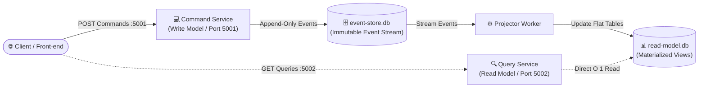

# Phần 5: Event Sourcing & CQRS (Command Query Responsibility Segregation)

Thư mục này hiện thực hóa sự kết hợp chuẩn mực giữa hai mẫu kiến trúc then chốt trong các hệ thống tài chính, ngân hàng và thương mại điện tử quy mô lớn: **CQRS** và **Event Sourcing**, đảm bảo **100% cơ chế thật, công cụ thật, không dùng bất kỳ workaround giả lập nào**.

---

## 1. Nguyên Lý Kết Hợp Event Sourcing & CQRS

### 1.1. Bản chất Kiến trúc CQRS (Tách rời Ghi và Đọc)

- **Kiến trúc CRUD truyền thống:** Dùng chung một Data Model cho cả thao tác ghi (`INSERT`, `UPDATE`) và đọc (`SELECT`). Điều này dẫn đến sự giằng co: muốn tối ưu cho đọc thì phải denormalize bảng, nhưng muốn ghi an toàn thì phải normalize nhiều bảng với khóa ngoại phức tạp.
- **CQRS:** Tách hệ thống thành hai nhánh biệt lập qua các cổng mạng và cơ sở dữ liệu riêng:
  - **Nhánh Ghi (Command Side - Port 5001):** Tiếp nhận `Command` (yêu cầu thay đổi trạng thái, ví dụ: `CreateWallet`, `DepositMoney`, `WithdrawMoney`), thực thi các quy tắc nghiệp vụ (**Business Invariants**) nghiêm ngặt, chỉ ghi nối tiếp vào Event Store (`event-store.db`).
  - **Nhánh Đọc (Query Side - Port 5002):** Phục vụ các `Query` (ví dụ: `GetWalletSummary`, `GetAuditTrail`). Dữ liệu được làm phẳng hoàn toàn (**Denormalized Materialized Views**) trong cơ sở dữ liệu đọc chuyên biệt (`read-model.db`), cho phép truy vấn trực tiếp $O(1)$ không cần `JOIN` hay tính toán lại.



---

### 1.2. Bản chất Event Sourcing (Bất Biến & Chuỗi Sự Kiện)

- Thay vì lưu trữ trạng thái cuối cùng (Current State) bằng các lệnh `UPDATE` hay `DELETE` làm biến mất toàn bộ lịch sử:
  - Hệ thống lưu trữ mọi sự kiện kinh doanh đã xảy ra dưới dạng **Chuỗi Sự Kiện Bất Biến (Immutable Event Stream)**.
  - **Trạng thái hiện tại** của một đối tượng (Aggregate) được tính toán bằng cách gấp (**Fold / Reduce**) toàn bộ chuỗi sự kiện từ quá khứ đến hiện tại:
    $$\text{Current State} = \sum_{i=1}^{n} \text{Apply}(\text{Event}_i)$$

#### Sổ cái sự kiện của một Ví điện tử trong thực tế:
1. `WalletCreated { walletId: "W1", initialBalance: 500000 }` $\rightarrow$ Số dư: 500.000đ (Version 1)
2. `MoneyDeposited { walletId: "W1", amount: 1000000 }` $\rightarrow$ Số dư: 1.500.000đ (Version 2)
3. `MoneyWithdrawn { walletId: "W1", amount: 300000 }` $\rightarrow$ Số dư: 1.200.000đ (Version 3)
4. *Nếu có kẻ gian cố tình rút 50.000.000đ:* Domain Aggregate kiểm tra Invariant $\to$ từ chối ngay tại tầng Command mà **không sinh ra bất kỳ event sai lệch nào**!

---

### 1.3. Sự Bổ Trợ Giữa CQRS và Event Sourcing

Nếu chỉ dùng Event Sourcing độc lập: Muốn tìm "Tất cả các ví có số dư > 1.000.000đ" sẽ cực kỳ tồi tệ, vì hệ thống phải đọc hàng triệu sự kiện của mọi ví rồi tính toán lại.

> **CQRS chính là lời giải hoàn hảo cho Event Sourcing:** Bộ chiếu (**Projector**) đọc các sự kiện mới phát sinh từ `event-store.db` và đồng bộ ngay sang `read-model.db`, tạo sẵn các bảng view đã làm phẳng được tối ưu hóa cho thao tác tìm kiếm và hiển thị.

---

## 2. Thực Nghiệm Chạy Demo Thực Chứng (Zero-Workaround)

Hệ thống demo được triển khai bằng **2 tệp cơ sở dữ liệu SQLite thật trên đĩa** và **2 cổng HTTP Microservice thật**:
- `event-store.db`: Chứa bảng `event_stream` với khóa ràng buộc `UNIQUE(stream_id, version)` kiểm soát đồng thời lạc quan (OCC).
- `read-model.db`: Chứa bảng view `wallet_summary_view` và sổ kiểm toán `transaction_audit_view`.

### Câu lệnh chạy kiểm thử tự động 5 giai đoạn:
```bash
node 05-event-sourcing-cqrs/demo-real-cqrs-eventsourcing.js
```

### Kết quả chạy thực tế trên máy:
```text
================================================================================
🏛️  BẮT ĐẦU DEMO THỰC CHỨNG KIẾN TRÚC CQRS & EVENT SOURCING (HỆ THỐNG VÍ ĐIỆN TỬ)
================================================================================
[Command Service (Write Side)] Running on http://localhost:5001
[Query Service (Read Side)]   Running on http://localhost:5002

--- BƯỚC 1: GỬI COMMANDS QUA HTTP TỚI COMMAND SERVICE (Port 5001) ---
  1.1 Gửi Command: Tạo ví mới cho "Nguyễn Văn An" với 500.000đ...
      Status: 201 | Event: [WalletCreated] Version=1
  1.2 Gửi Command: Nạp 1.000.000đ (Thưởng thành tích)...
      Status: 201 | Số dư sau nạp: 1,500,000đ | Version=2
  1.3 Gửi Command: Rút 300.000đ (Thanh toán hóa đơn tiền điện)...
      Status: 201 | Số dư sau rút: 1,200,000đ | Version=3
  1.4 Thử nghiệm vi phạm Quy tắc Bất biến (Business Invariant): Cố tình rút 50.000.000đ...
      Status: 400 (Bị chặn!) | Lý do: "Giao dịch bị từ chối: Số dư khả dụng (1200000đ) không đủ để rút 50000000đ!"

--- BƯỚC 2: KIỂM CHỨNG KHÓA LẠC QUAN (OCC) DƯỚI TẦNG SQL CỦA EVENT STORE ---
  -> Giả lập 2 tiến trình đồng thời cố tình ghi nối tiếp cùng version vào Event Store:
  ✅ SQLite chặn lại bởi ràng buộc: UNIQUE(stream_id, version)!
     Chi tiết mã lỗi OCC: "Optimistic Concurrency Conflict: Stream 'WAL-VN-888' đã có version 3. Expected version 2."

--- BƯỚC 3: TRUY VẤN READ MODEL QUA HTTP TẠI QUERY SERVICE (Port 5002) ---
  3.1 Xem Bảng tổng hợp (Materialized View từ 'read-model.db'): O(1) trực tiếp không join
  3.2 Xem Sổ cái Kiểm toán Bất biến (Audit Trail từ Event Log)

--- BƯỚC 4: LƯU TRỮ VÀ SỬ DỤNG SNAPSHOT ĐỂ TỐI ƯU HÓA HIỆU NĂNG I/O ---
  -> Thực hiện lưu Snapshot cho ví WAL-VN-888 tại Version hiện tại...
     Snapshot đã lưu vào bảng 'snapshots': Version=3, Balance=1,200,000đ
  -> Kiểm tra cơ chế tải Aggregate bằng Snapshot:
     + Nạp trạng thái từ Snapshot tại Version 3 (Số dư cơ sở: 1,200,000đ)
     + Chỉ cần đọc thêm 2 sự kiện phát sinh sau Snapshot (thay vì phải đọc toàn bộ sự kiện từ đầu)!

--- BƯỚC 5: KHẢ NĂNG PHỤC HỒI THẢM HỌA (DISASTER RECOVERY) QUA EVENT REPLAY ---
  💣 Giả lập sự cố: Cơ sở dữ liệu Read Model (read-model.db) bị xóa sạch hoàn toàn!
     Kiểm tra Read DB sau khi xóa: Status = 404 (Dữ liệu đọc đã hoàn toàn biến mất)
  🔄 Kích hoạt Event Replay từ Event Store bất biến để tái thiết lập Read DB:
     Đã nạp lại 5 sự kiện trong 33ms
     ✅ Read Model đã được phục hồi nguyên vẹn 100%!
================================================================================
```

---

## 3. Phân Tích Kỹ Thuật Chuyên Sâu (Under The Hood)

### 3.1. Ràng Buộc Khóa Lạc Quan (Optimistic Concurrency Control - OCC)
Trong bảng `event_stream` của `event-store.db`:
```sql
CREATE TABLE event_stream (
  event_id INTEGER PRIMARY KEY AUTOINCREMENT,
  stream_id TEXT NOT NULL,
  version INTEGER NOT NULL,
  event_type TEXT NOT NULL,
  payload TEXT NOT NULL,
  timestamp TEXT NOT NULL,
  UNIQUE(stream_id, version) -- RÀNG BUỘC SỐNG CÒN CỦA EVENT STORE
);
```
- Khi hai client đồng thời gửi Command để sửa cùng một đối tượng (Aggregate):
  - Client 1 đọc Aggregate ở `version 2`, gửi command $\to$ ghi thành công `version 3`.
  - Client 2 cũng đọc Aggregate ở `version 2`, gửi command $\to$ cố gắng ghi vào `version 3`.
  - Nhờ ràng buộc `UNIQUE(stream_id, version)`, hệ thống SQLite lập tức từ chối Client 2 với lỗi xung đột phiên bản. Command Service bắt lỗi này và trả về **`HTTP 409 Conflict`**. Client 2 sẽ tự động fetch lại trạng thái mới nhất và thử lại (*Retry*).

---

### 3.2. Cơ Chế Snapshotting (Giải Quyết Nút Thắt Hiệu Năng)
- **Vấn đề:** Nếu một tài khoản có hơn 100.000 sự kiện, mỗi lần nạp tiền phải tải cả 100.000 sự kiện từ đĩa vào RAM để tính toán số dư $\to$ gây nghẽn I/O và CPU.
- **Giải pháp:** Định kỳ tạo một bản chụp trạng thái (**Snapshot**) lưu vào bảng `snapshots`:
  - Khi cần xử lý Command: Hệ thống nạp Snapshot mới nhất (`version = 100000`) và chỉ đọc thêm vài sự kiện phát sinh sau đó (`version 100001 -> 100003`).

---

### 3.3. Cơ Chế Event Replay (Khả Năng Du Hành Thời Gian & Phục Hồi Thảm Họa)
- Vì toàn bộ lịch sử nằm bất biến trong `event-store.db`:
  - Nếu `read-model.db` bị lỗi phần cứng, mất dữ liệu hoặc bị hacker xóa bảng view: Ta chỉ cần chạy lệnh **Replay** $\to$ Projector đọc lại từ `event_id = 1` và dựng lại toàn bộ Read DB với độ chính xác tuyệt đối.
  - Khi nghiệp vụ cần bổ sung báo cáo mới (ví dụ: *Bảng xếp hạng khách hàng VIP theo quý*), ta không cần sửa code cũ, chỉ cần viết thêm một Projector mới đọc lại toàn bộ lịch sử từ quá khứ.

---

## 4. Ngân Hàng Câu Hỏi Vấn Đáp Điểm 10 (Thầy Ngô Huy Biên)

### ❓ Câu hỏi 1:
> *"Tại sao trong Event Store tuyệt đối cấm dùng lệnh UPDATE hay DELETE? Nếu người dùng muốn đổi tên hoặc sửa thông tin số tiền bị nhập sai thì hệ thống xử lý như thế nào?"*

**Trả lời chuẩn:**
- **Lý do cấm:** Event Store là một cuốn sổ cái kế toán (Audit Log) đại diện cho sự thật đã xảy ra trong quá khứ (*Facts that already happened*). Nếu dùng `UPDATE` hay `DELETE`, tính chất bất biến và khả năng truy vết kiểm toán (Auditability) sẽ bị phá vỡ hoàn toàn, đồng thời làm sai lệch việc Replay sự kiện.
- **Cách xử lý khi nhập sai:** Áp dụng mẫu **Compensating Event (Sự kiện bù trừ)**:
  - Nếu nhập sai số tiền nạp (+100.000đ thay vì +10.000đ): Hệ thống sẽ ghi thêm một sự kiện mới là `MoneyCorrectionApplied { amount: -90000, reason: "Sai sót giao dịch viên" }`.
  - Nếu đổi tên: Ghi thêm sự kiện `OwnerNameChanged { oldName: "A", newName: "B" }`.
  - Cả hai sự kiện đều được ghi nối tiếp vào cuối chuỗi, giữ nguyên 100% bằng chứng lịch sử.

---

### ❓ Câu hỏi 2:
> *"Trong kiến trúc CQRS, điểm đánh đổi lớn nhất (Trade-off) là gì và làm thế nào để giải quyết vấn đề Eventual Consistency (Tính nhất quán sau cùng) trên giao diện người dùng?"*

**Trả lời chuẩn:**
- **Điểm đánh đổi lớn nhất:** Độ phức tạp hệ thống tăng cao (phải duy trì 2 cơ sở dữ liệu riêng, code xử lý Projector đồng bộ ngầm) và phải chấp nhận **Eventual Consistency** (có một độ trễ nhỏ từ vài mili-giây đến vài trăm mili-giây giữa Write Model và Read Model).
- **Chiến lược giải quyết trên UI:**
  1. **Optimistic UI Update:** Giao diện tự động cộng tiền hoặc đổi trạng thái ngay khi người dùng bấm nút; nếu backend trả về lỗi thì mới rollback hiển thị.
  2. **Correlation ID & Polling / WebSocket:** Khi Command Service trả về `HTTP 201` kèm `eventId`, giao diện mở kết nối WebSocket hoặc polling nhẹ để khi Read Model cập nhật xong bản ghi có `last_event_version` tương ứng thì mới kích hoạt render lại trang.

---

### ❓ Câu hỏi 3:
> *"Phân biệt sự khác nhau giữa Event Sourcing và Event-Driven Architecture (EDA)?"*

**Trả lời chuẩn:**
- **Event Sourcing (Lưu trữ trạng thái):** Là mẫu kiến trúc ở tầng **Lưu trữ dữ liệu (Persistence Pattern)** của một service. Thay vì lưu trạng thái hiện tại vào một bảng SQL thông thường, service lưu chuỗi các sự kiện đã dẫn đến trạng thái đó.
- **Event-Driven Architecture - EDA (Giao tiếp giữa các service):** Là mẫu kiến trúc ở tầng **Tích hợp hệ thống (Integration / Messaging Pattern)**. Các service độc lập giao tiếp với nhau bằng cách bắn và lắng nghe các sự kiện qua Message Broker (RabbitMQ, Kafka, AWS SNS/SQS).
- *Mối quan hệ:* Một hệ thống có thể dùng EDA mà không dùng Event Sourcing (các service giao tiếp qua RabbitMQ nhưng bên trong vẫn lưu MySQL bình thường). Ngược lại, một service có thể dùng Event Sourcing nội bộ mà không cần bắn sự kiện ra ngoài. Khi kết hợp cả hai, Event Store đóng vai trò là nguồn phát sự kiện đáng tin cậy nhất (*Transactional Outbox*).

---

## 5. Danh Mục Mã Nguồn Minh Chứng

| Thành phần | Đường dẫn tệp tin | Vai trò kỹ thuật |
| :--- | :--- | :--- |
| **Kịch bản Demo Chính** | [`demo-real-cqrs-eventsourcing.js`](./demo-real-cqrs-eventsourcing.js) | Chạy tự động 5 giai đoạn: Invariant, OCC, Read View, Snapshot, Replay. |
| **Command Service (Write Side)** | [`command-service/server.js`](./command-service/server.js) | HTTP Server cổng 5001 tiếp nhận Commands, xác thực nghiệp vụ, ghi nối tiếp Event Store. |
| **Query Service (Read Side)** | [`query-service/server.js`](./query-service/server.js) | HTTP Server cổng 5002 đọc bảng view làm phẳng $O(1)$ và cung cấp endpoint Replay. |
| **Persistent Event Store** | [`shared/event-store.js`](./shared/event-store.js) | Thao tác trên `event-store.db` với ràng buộc khóa lạc quan `UNIQUE(stream_id, version)`. |
| **Persistent Read Database** | [`shared/read-db.js`](./shared/read-db.js) | Thao tác trên `read-model.db` lưu trữ bảng Materialized View và Sổ kiểm toán. |
| **Domain Aggregate** | [`shared/wallet-aggregate.js`](./shared/wallet-aggregate.js) | Mô hình miền độc lập kiểm tra Invariant (chống thấu chi) và tái tạo trạng thái (Fold). |
| **Projector Worker** | [`projector/projector.js`](./projector/projector.js) | Đồng bộ dữ liệu bất đối xứng từ Event Store sang Read DB và thực thi Event Replay. |
