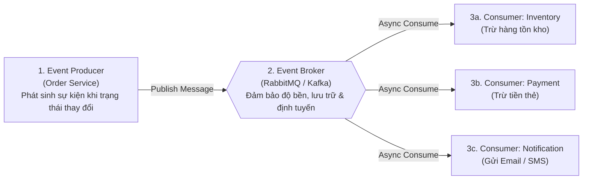
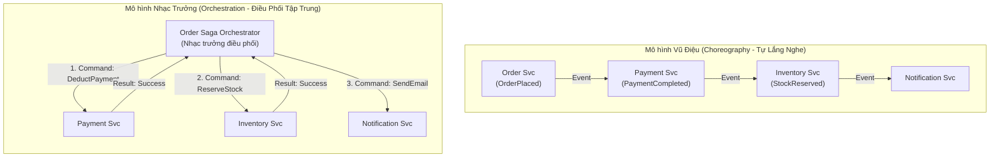

# Phần 6: Kiến Trúc Hướng Sự Kiện (Event-Driven Architecture - EDA)

Thư mục này hiện thực hóa mô hình **Event-Driven Architecture (EDA)** cho bài toán xử lý đơn hàng phân tán, chứng minh tính liên kết lỏng (**Loose Coupling**), khả năng tự phục hồi khi có dịch vụ bị sập, cơ chế **Dead Letter Queue (DLQ)** và tính lũy đẳng (**Idempotency**).

---

## 1. Cấu Trúc và Các Mẫu Điều Phối (Coordination Patterns)

### 1.1. Ba Thành phần Cốt lõi của EDA

---

### 1.2. Phân Biệt: Choreography vs Orchestration (Saga Patterns)

Khi xử lý một nghiệp vụ liên quan đến nhiều microservices, có hai trường phái thiết kế chính:

| Tiêu chí | Choreography (Vũ điệu phân tán) | Orchestration (Nhạc trưởng trung tâm) |
| :--- | :--- | :--- |
| **Độ kết dính (Coupling)** | Cực thấp (Loose coupling). Dịch vụ chỉ quan tâm sự kiện đến từ Broker. | Trung bình. Các dịch vụ worker độc lập, nhưng Orchestrator nắm toàn bộ logic quy trình. |
| **Độ phức tạp quy trình** | Phù hợp quy trình ngắn (2 - 4 bước). Khi quy trình có 15 bước, rất khó theo dõi trạng thái tổng thể. | Phù hợp quy trình dài, nhiều nhánh rẽ phức tạp hoặc yêu cầu bồi hoàn (Compensating Transactions). |
| **Điểm nghẽn đơn lẻ (SPOF)**| Không có điểm nghẽn đơn lẻ ngoài chính Message Broker. | Bộ điều phối Orchestrator cần được thiết kế sẵn sàng cao để tránh trở thành SPOF. |

---

## 2. Kịch Bản Demo: Chứng Minh Loose Coupling & Khả Năng Chịu Lỗi

### 2.1. Thí Nghiệm Đánh Sập Dịch Vụ Email (Fault Isolation Demo)

1. **Bước 1:** Khởi chạy Message Broker, Order Producer, Inventory Consumer và Payment Consumer.
2. **Bước 2 (Mô phỏng sự cố):** **Tắt hoàn toàn** tiến trình `notification-consumer` (giả lập sự cố máy chủ gửi email chết).
3. **Bước 3:** Người dùng đặt hàng mới (`POST /api/orders`).
   - Order Producer lập tức ghi nhận, phát sự kiện `OrderPlaced` lên Broker và trả về `HTTP 201 Created` cho người dùng sau **< 20ms**.
   - Kho hàng vẫn trừ số lượng tồn kho thành công.
   - Thẻ tín dụng vẫn được thanh toán thành công.
   - **Kết luận 1:** Sự cố ở Notification Service **hoàn toàn không làm gián đoạn** hoạt động kinh doanh cốt lõi của hệ thống.
4. **Bước 4 (Khôi phục tự động):** Khởi động lại `notification-consumer`.
   - Consumer tự động kết nối lại Broker, kéo toàn bộ các sự kiện `OrderPlaced` còn tồn đọng trong Queue và gửi email bù đầy đủ cho khách hàng mà không mất tin.

---

### 2.2. Các Cơ Chế Đảm Bảo Độ Tin Cậy (Reliability Tactics)

1. **Cơ chế Thử Lại (Retry with Exponential Backoff):**
   - Khi Consumer xử lý lỗi (ví dụ: cổng thanh toán bên thứ 3 quá tải tạm thời), tin nhắn được đưa vào hàng đợi chờ thử lại sau: $1s \rightarrow 2s \rightarrow 4s \rightarrow 8s$.
2. **Hàng Đợi Thư Chết (Dead Letter Queue - DLQ):**
   - Nếu sau số lần thử lại tối đa (ví dụ: 3 lần) tin nhắn vẫn thất bại (do payload lỗi định dạng, dữ liệu hỏng), tin nhắn sẽ được chuyển hướng sang **DLQ**.
   - Đảm bảo hàng đợi chính không bị tắc nghẽn (Head-of-Line Blocking) và kỹ sư hệ thống có thể kiểm tra tệp tin lỗi để phân tích nguyên nhân.
3. **Tính Lũy Đẳng (Idempotency):**
   - Trong mạng phân tán, một sự kiện có thể được gửi lại nhiều lần (At-least-once delivery).
   - Consumer lưu trữ `processed_event_ids` trong Redis/DB; nếu một `eventId` đã từng được xử lý, Consumer bỏ qua việc trừ tiền/gửi mail lần hai:
     $$\forall x, \quad f(f(x)) = f(x)$$

---

## 3. Nội dung trong Thư mục `06-event-driven-architecture/`

- `broker-setup/`: Cấu hình Docker Compose dựng RabbitMQ (hoặc mô phỏng In-Memory Broker có DLQ & Retry).
- `order-producer/`: Service nhận REST request và phát tán sự kiện `OrderPlaced`.
- `inventory-consumer/`: Worker lắng nghe sự kiện để cập nhật số lượng tồn kho.
- `payment-consumer/`: Worker xử lý thanh toán bất đồng bộ.
- `notification-consumer/`: Worker gửi thông báo (có kịch bản tắt/bật chứng minh Fault-tolerance).
- `orchestration-saga/`: Triển khai minh họa Saga Orchestrator với các bước bồi hoàn khi có lỗi.
