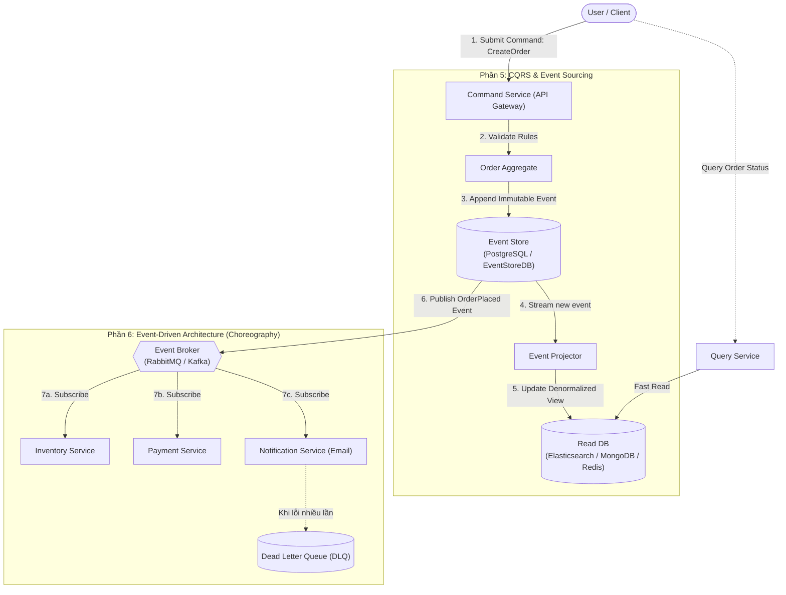

# Hệ Thống Demo Kiến Trúc Phần Mềm (Software Architecture Demos)

Dự án này là tập hợp các mô hình triển khai thực nghiệm và tài liệu kiến trúc tương ứng với **6 chủ đề cốt lõi** trong môn Thiết kế Kiến trúc Phần mềm:

---

## 📂 Cấu trúc Tổng thể Thư mục (Project Directory Tree)

```text
Demos/
├── 01-quality-attributes/               # Phần 1: Các đặc tính chất lượng & Đánh đổi kiến trúc
│   ├── scalability-test/               # Demo kiểm thử tải (k6) cho ứng dụng có Read/Write
│   │   ├── app/                        # Ứng dụng mẫu có kết nối CSDL và xử lý I/O & CPU
│   │   ├── k6/                         # 3 kịch bản: baseline.js, stress.js, spike.js
│   │   └── results/                    # Báo cáo phân vị p50, p95, p99, Throughput & Bottlenecks
│   └── security-audit/                 # Demo rà soát bảo mật (SAST, DAST & AI Audit)
│       ├── vulnerable-app/             # Mã nguồn mẫu chứa lỗ hổng OWASP Top 10
│       ├── sast-dast-scripts/          # Kịch bản quét tự động (Semgrep / ZAP)
│       └── ai-audit-prompt-reports/    # Prompts & đối chiếu AI phát hiện lỗi vs False Positives
│
├── 02-architecture-representation/     # Phần 2: Biểu diễn kiến trúc (Views, Models & Recovery)
│   ├── c4-models/                      # Biểu diễn C4 (Context, Container, Component, Code)
│   ├── 4plus1-views/                   # Khung 4+1 Views (Logical, Process, Dev, Physical + Scenarios)
│   └── architecture-recovery/          # Tái tạo kiến trúc hệ thống Agentic Loop (Claude Code Auto Mode)
│
├── 03-microservices-k8s-mesh/          # Phần 3: Microservices, Docker, Kubernetes & Istio
│   ├── services/                       # Dịch vụ độc lập theo Bounded Context (Database-per-Service)
│   │   ├── auth-service/               # Xác thực JWT & quản lý người dùng
│   │   ├── catalog-service/            # Quản lý danh mục hàng hóa
│   │   ├── order-service/              # Tiếp nhận & xử lý đơn hàng
│   │   └── payment-service/            # Giao dịch & cổng thanh toán
│   ├── docker/                         # Dockerfiles (Multi-stage build) & docker-compose.yml
│   ├── k8s/                            # K8s Manifests: Pods, Services, HPA, ConfigMaps
│   ├── istio/                          # Service Mesh: VirtualService, DestinationRule, Canary, CircuitBreaker
│   └── observability/                  # Giám sát RED metrics (Prometheus & Grafana)
│
├── 04-micro-frontends-jamstack/        # Phần 4: Micro-Frontends & JAMstack
│   ├── micro-frontends/                # Chia nhỏ giao diện người dùng
│   │   ├── host-app-shell/             # App Shell điều hướng & nạp Remote modules (Module Federation)
│   │   ├── remote-catalog/             # Micro-app trang danh mục sản phẩm
│   │   └── remote-cart/                # Micro-app giỏ hàng & thanh toán
│   └── jamstack/                       # Kiến trúc JAMstack (JavaScript, APIs, Markup)
│       ├── static-site/                # Pre-rendering (SSG / ISR) phân phối qua CDN
│       └── serverless-apis/            # Headless API động phục vụ giỏ hàng & cá nhân hóa
│
├── 05-event-sourcing-cqrs/             # Phần 5: Event Sourcing & CQRS
│   ├── command-service/                # Nhánh Ghi (Command Handler, Aggregate, Event Store)
│   ├── projector/                      # Bộ chiếu (Projector) cập nhật Read Database bất đồng bộ
│   ├── query-service/                  # Nhánh Đọc (Query Handler, Read DB được tối ưu hóa)
│   └── replay-snapshot-demo/           # Script demo Event Replay (Time-travel) & Snapshotting
│
└── 06-event-driven-architecture/       # Phần 6: Kiến trúc Hướng sự kiện (Event-Driven Architecture)
    ├── broker-setup/                   # Cấu hình Message Broker (RabbitMQ / Kafka)
    ├── order-producer/                 # Phát sự kiện OrderPlaced
    ├── inventory-consumer/             # Xử lý cập nhật kho hàng bất đồng bộ
    ├── payment-consumer/               # Xử lý thanh toán
    ├── notification-consumer/          # Xử lý email (Minh họa Loose Coupling & DLQ)
    └── orchestration-saga/             # So sánh Choreography vs Orchestrator Saga
```

---

## 🎯 Bản đồ Nội dung Chi tiết theo Từng Phần

| Phần | Tên chủ đề | Trọng tâm lý thuyết | Thư mục Demo |
| :--- | :--- | :--- | :--- |
| **Phần 1** | **Quality Attributes** | Đánh đổi kiến trúc, 6 yếu tố kịch bản, Availability, Performance, Maintainability, Observability, Fault Tolerance | `01-quality-attributes/` |
| **Phần 2** | **Architecture Representation** | View vs UML, Khi nào số Views là đủ, Mô hình 4+1, C4 Model, Architecture Recovery | `02-architecture-representation/` |
| **Phần 3** | **Microservices & Cloud-Native** | Bounded Context, Database-per-service, Docker Multi-stage, K8s HPA, Istio Mesh (mTLS, Canary, Circuit Breaker), RED Metrics | `03-microservices-k8s-mesh/` |
| **Phần 4** | **Micro-Frontends & JAMstack** | Module Federation, DOM/CSS Isolation, Cross-app Events, SSG/ISR, Headless dynamic APIs, So sánh TTFB | `04-micro-frontends-jamstack/` |
| **Phần 5** | **Event Sourcing & CQRS** | Tách Command/Query, Bất biến (Immutable Events), Event Store, Projector, Event Replay, Snapshot, Eventual Consistency | `05-event-sourcing-cqrs/` |
| **Phần 6** | **Event-Driven Architecture (EDA)** | Producer/Broker/Consumer, Choreography vs Orchestration, Loose Coupling, Retry, Dead Letter Queue (DLQ), Idempotency | `06-event-driven-architecture/` |

---

## 🔄 Sơ đồ Tương tác Phối hợp (EDA + CQRS + Event Sourcing)

Dưới đây là sơ đồ mô phỏng cách thức các mẫu kiến trúc phối hợp chặt chẽ từ khi tiếp nhận Command, ghi nhận Event vào Event Store, phát tán qua Broker đến khi đồng bộ sang Read Database và các Consumer độc lập:


